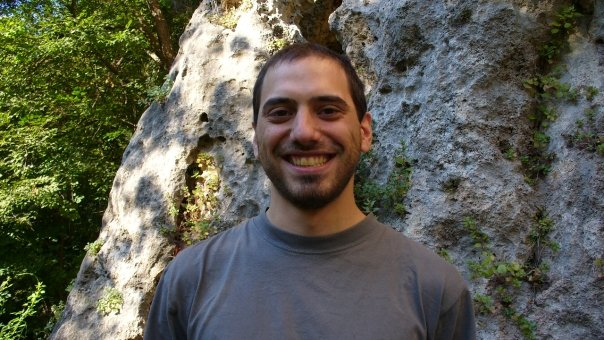

```{r setup, include=FALSE}
knitr::opts_chunk$set(
  fig.retina = 3,
  warning = FALSE,
  message = FALSE,
  comment = "",
  out.width = "100%"
)
library(knitr)

library(tidyverse)
library(here)
library(gridExtra)

library(countdown)
library(DT)

options(width = 59) # fit into the right-column slides

```

## [Obiettivi]{.orange}

Alla fine del corso saprete:

- scegliere e calcolare le **misure di centralità e di variabilità** adatte
  ai dati, e dire quando la media inganna;

- riconoscere un **grafico** che distorce i dati e scegliere il grafico
  adatto al tipo di variabile;

- calcolare **sensibilità**, **specificità** e **valori predittivi** di un
  test diagnostico, anche dopo un secondo test;

- calcolare probabilità con le distribuzioni **binomiale**, di **Poisson**
  e **normale**;

- calcolare un **intervallo di confidenza** per una media e dire come
  cambia con la numerosità, la variabilità e il livello di confidenza;

- leggere un **p-value** in un articolo: che cosa significa e che cosa no.

## [Requisiti]{.orange}

- **aritmetica** di base (somma, sottrazione, moltiplicazione, divisione, potenza, radice)

- **operatori tra insiemi** (appartenenza, intersezione, unione, complemento; and, or, not).

## [Lezioni]{.orange}

- Modalità: in presenza, **75% obbligatorio** (minimo)

- Materiale didattico: Moodle

- Portale accesso slide, esercizi e calendario: [bit.ly/cl-statmed](https://bit.ly/cl-statmed)


### Licenza

Utilizzo del materiale e suoi derivati: consentito e libero sotto licenza  [cc-by 4.0](https://creativecommons.org/licenses/by/4.0/deed.it).
  
<br>

::: {.small}

In sintesi: potete condividere, modificare, utilizzare il materiale
liberamente e gratuitamente per qualsiasi fine, a patto di attribuire
adeguata paternità al materiale che producete, ma senza alcuna mia
responsabilità o garanzia su di esso. Siete tenuti comunque a
distribuirlo (incluse eventuali opere derivate) con analoga ed esplicita
licenza, e senza ulteriori restrizioni.

:::

## [Agenda]{.orange}

:::: {.columns}

::: {.column width="48%"}

+ intro al corso

+ statistica descrittiva - prerequisiti, definizioni, localizzazione, dispersione / distribuzione, grafici
  
+ fondamenti di probabilità

+ rischi, test di screening: sensibilità e specificità, valori predittivi positivo e negativo, teorema di Bayes (anche per due test in sequenza)

:::

::: {.column width="48%"}

+ distribuzioni: modelli discreti

+ distribuzioni: modelli continui

+ intervalli di confidenza e p-value
  
+ revisione e simulazione completa d'esame

:::

::::

## [Supporto]{.orange}

In [**Moodle**]{.orange}, trovate:

- Link al portale **slide** ed **Esercizi**

- **Lavagne** scritte a lezione

- Link per prenotare **ricevimento**  [bit.ly/statmed-cl-ricevimento](https://bit.ly/statmed-cl-ricevimento): 
  
  - 25 minuti a sessione
  - prenotabile con almeno 2 giorni di anticipo,
  - entro due settimane nel futuro
  
> La settimana precedente le sessioni d'esame NON è attivo il ricevimento.

## [Esame finale]{.orange} {.smaller}


L'esame finale sarà composto da 10 **esercizi a risposta multipla** dal valore di 3 punti ciascuno, e **non avrà durata prestabilita** (durata prevista per lo svolgimento 2 ore).

Durante lo svolgimento è **[concesso]{.orange}** l'utilizzo di:

 - **qualunque libro di testo cartaceo**
 - **appunti personali cartacei**
 - **tavole statistiche cartacee**
 - **calcolatrice scientifica NON programmabile**, né grafica né simbolica, che calcoli l'esponenziale (e<sup>x</sup>); smartphone, tablet e computer NON sono ammessi<br>(Casio 220 Plus II (~9 euro), Texas Instruments TI-30XA (~13 euro), Sharp EL-501T (~17 euro))

Punteggi:

- Una risposta corretta varrà 3 punti.
- Sarà presente una sola risposta corretta in ciascuna domanda.
- Una risposta errata sommerà negativamente sul totale in misura pari al punteggio della domanda diviso il numero di opzioni sbagliate possibili (= 3 / (numero risposte - 1)).
- Sarà presente una domanda "bonus" da 6 punti (totale 36), che conta solo dopo aver raggiunto 18/30 con le altre: se giusta aggiunge 6 punti, se sbagliata toglie punti come le altre, ma senza scendere sotto 18. Non può quindi né dare né togliere la sufficienza.
- I punteggi si arrotondano sempre per eccesso.

Il punteggio totale dell'esame sarà dunque di 36/36. Superato totalizzandone
almeno 18/30. La lode è assegnata con un totale di almeno 31/36 punti.

> Sarà possibile prenotare un'integrazione orale (solo) nei seguenti casi:
>
> - punteggio tra 14 e 17 punti, per arrivare a 18/30 (non di più)
> - punteggio tra 27 e 30 punti, per arrivare fino a 30/30, con eventuale lode.


## [Riconoscimenti]{.orange}

- Le diapositive proposte sono state prodotte a partire anche da
  materiale generato da/con le seguenti persone gravitanti attorno
  all'UBEP*:
  
  + Danila Azzolina
  + Dario Gregori
  + Giulia Lorenzoni
  + Honoria Ocagli
  + Ileana Baldi
  + Luca Vedovelli
  + Matteo Martinato
  + Paola Berchialla

<br><br>

::: {.small}

::: {.text-right}

\* In ordine alfabetico.

:::

:::

<br><br>

> Un ringraziamento speciale a Cristiana Vettori per
l'aiuto e il supporto logistico e amministrativo che mi ha sempre offerto, e mi offre ancora.

## {.inverse .text-right background-color="#03A696"}

```{r, echo=FALSE, out.width = "50%"}

```
### Per trovarmi... {.big}


[`r fontawesome::fa("link")`](https://www.unipd-ubep.it/) [**www.unipd-ubep.it**](https://www.unipd-ubep.it/)

[`r fontawesome::fa("envelope")`](mailto:Corrado.Lanera@ubep.unipd.it) [**Corrado.Lanera[\@ubep.unipd.it]{.orange}**](mailto:Corrado.Lanera@ubep.unipd.it)

[`r fontawesome::fa("github")`](https://github.com/corradolanera)
[`r fontawesome::fa("twitter")`](https://twitter.com/corradolanera)
[`r fontawesome::fa("telegram")`](https://telegram.me/CorradoLanera)
**\@CorradoLanera**

[`r fontawesome::fa("calendar-check")` ](https://bit.ly/statmed-cl-ricevimento) [**bit.ly/statmed-cl-ricevimento**](https://bit.ly/statmed-cl-ricevimento)

## {.inverse .text-center .center background-color="#03A696"}

::: {.quote-box}

::: {.text-left}

_**Can** one be a [good data analyst]{.orange} **without** being a [half-good programmer]{.orange}?<br>The short answer to that is, 'No.'<br>The long answer to that is, 'No.'_

:::


::: {.text-right}

—Frank Harrell<br>10/1999 - S-PLUS User Conference, New Orleans<br>

:::

:::


### [Domande?]{.orange} {.big}


Diapositive: [bit.ly/cl-statmed](https://bit.ly/cl-statmed)


[`r fontawesome::fa("link")`](https://www.unipd-ubep.it/) [**www.unipd-ubep.it**](https://www.unipd-ubep.it/) | 
[`r fontawesome::fa("envelope")`](mailto:Corrado.Lanera@ubep.unipd.it) [**Corrado.Lanera@ubep.unipd.it**](mailto:Corrado.Lanera@ubep.unipd.it)

[`r fontawesome::fa("github")`](https://github.com/corradolanera)
[`r fontawesome::fa("twitter")`](https://twitter.com/corradolanera)
[`r fontawesome::fa("telegram")`](https://telegram.me/CorradoLanera)
**\@CorradoLanera** |
[`r fontawesome::fa("calendar-check")` ](https://bit.ly/statmed-cl-ricevimento) [**bit.ly/statmed-cl-ricevimento**](https://bit.ly/statmed-cl-ricevimento)
