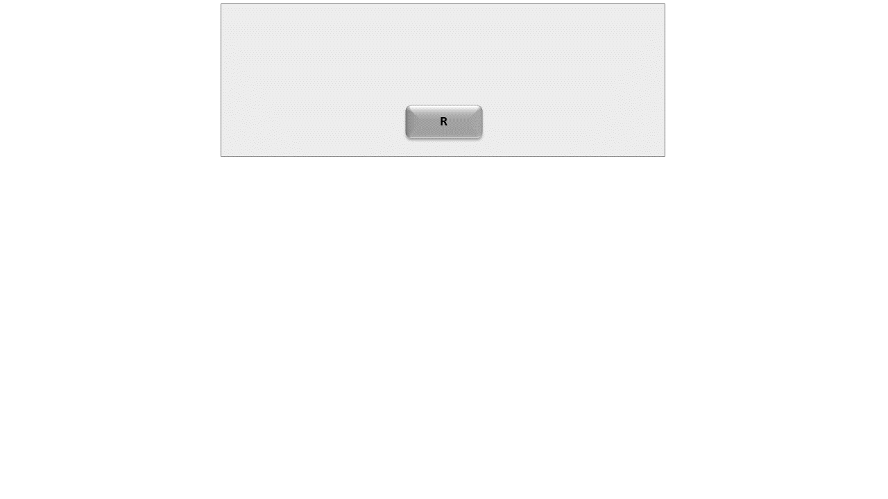
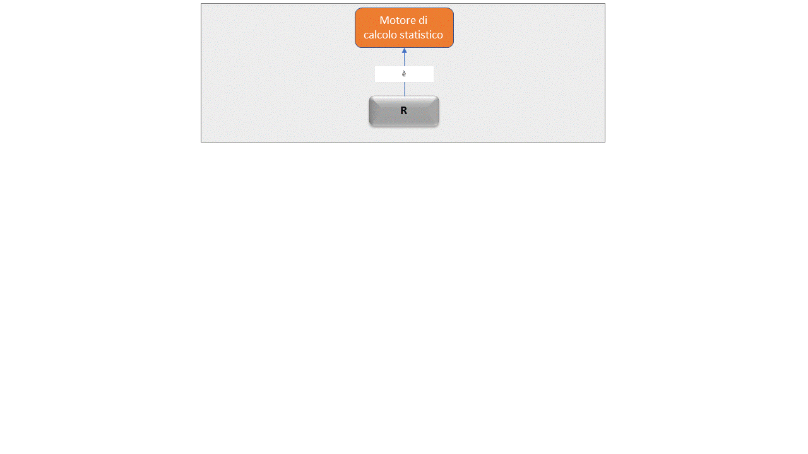
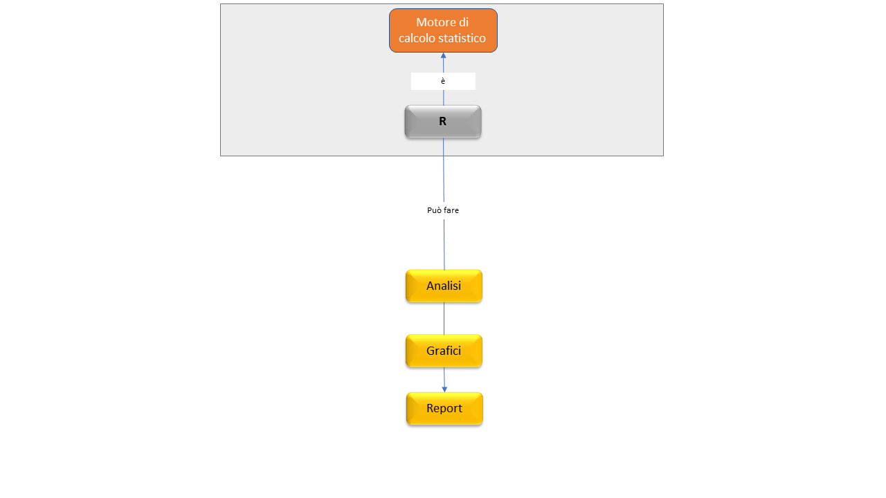
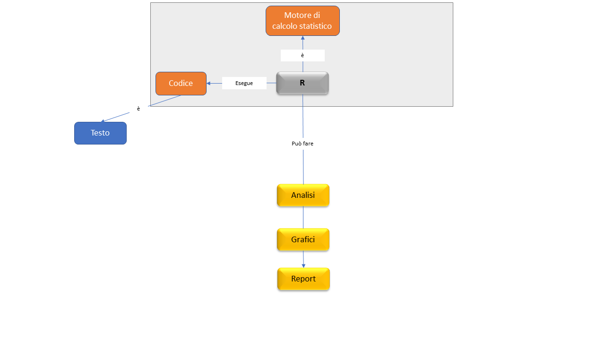
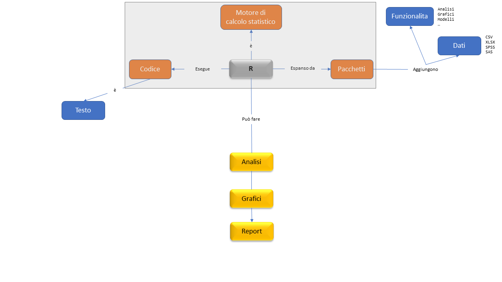
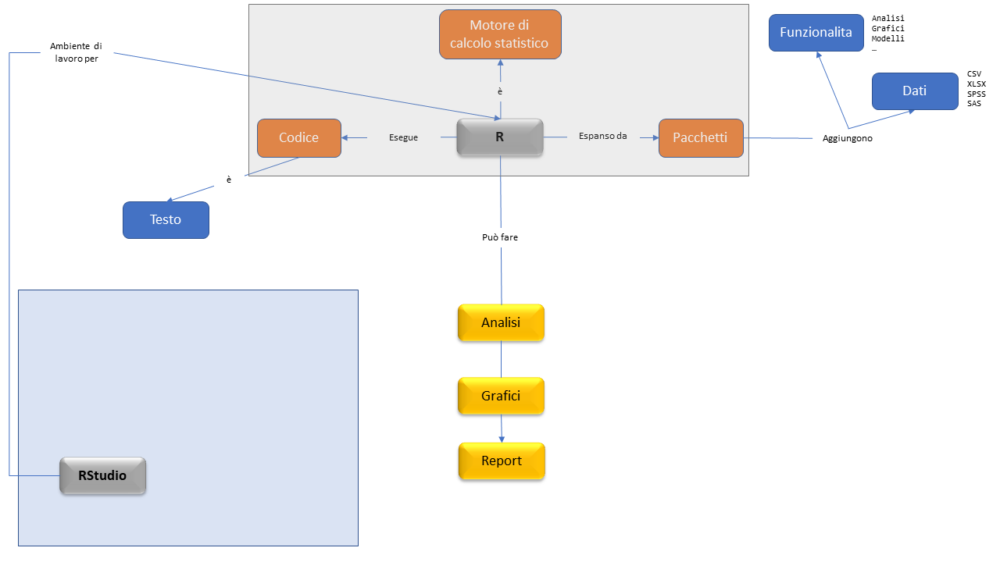
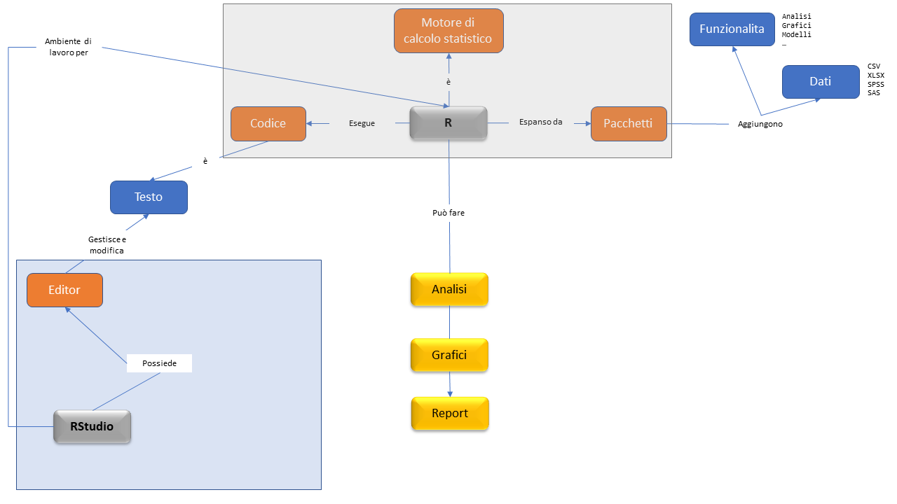
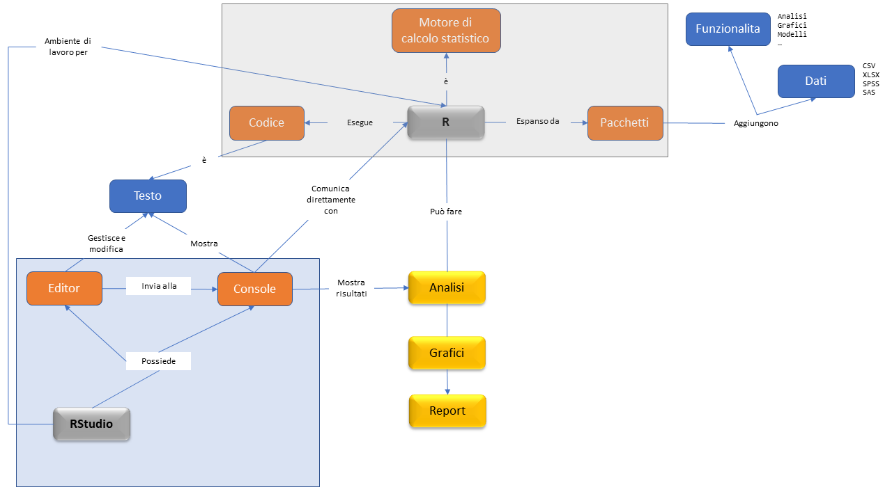
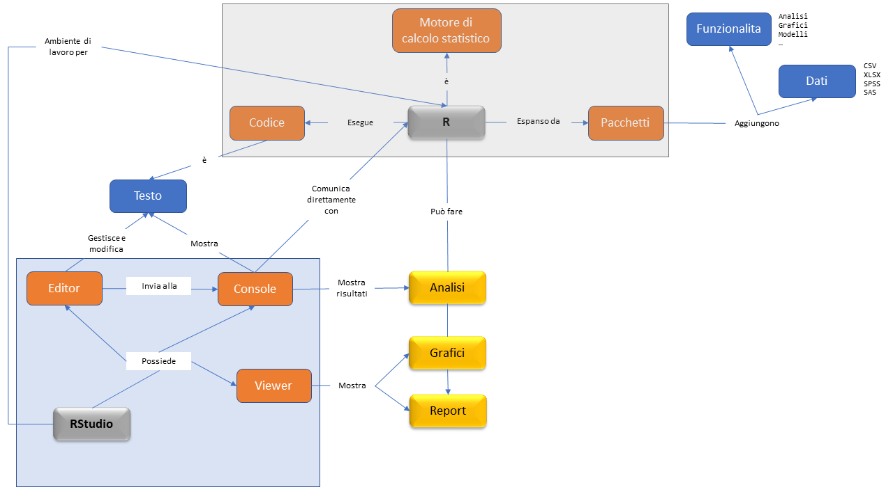
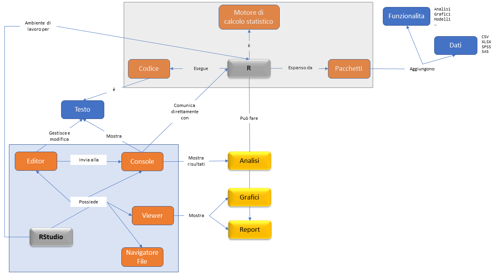

```{r setup, include=FALSE}
library(palmerpenguins)

knitr::opts_chunk$set(
  fig.retina = 3,
  warning = FALSE,
  message = FALSE,
  comment = "",
  out.width = "100%"
)
library(knitr)

library(tidyverse)
library(here)
library(gridExtra)

library(countdown)
library(DT)

options(width = 59) # fit into the right-column slides

```

## Cosa faremo {.inverse background-color="#03A696"}

Nella prossima ora vi fornirò un'introduzione all'uso di **R**, tramite **RStudio**. Vedremo **[cosa sono]{.orange}**, **[a cosa servono]{.orange}** (in cosa si differenziano) e come installarli.

L'obiettivo principale è quello di fornirvi gli elementi **base** per poter (se volete, vi fa piacere, o pensate possa esservi utile\*) seguire _anche_ la fase di codifica degli esempi interattivi ed esercitazioni che vi mostrerò nelle future lezioni.

Inoltre, ho messo a disposizione (**gratuitamente**) un ambiente di lavoro Posit Cloud attivabile da ciascuno di voi (vedremo come), in modo che possiate usare R/RStudio senza doverli installare, e con/su qualunque dispositivo vi troviate a operare.\*\*


<br><br><br><br>

::: {.small}

::: {.text-right}

\* La mia opinione in merito, chiaramente, è: _si_ `r emo::ji("wink")`.

\*\* Volendo, anche su smartphone e tablet, seppur piuttosto scomodo!

:::


:::

## Panoramica {.inverse .center .text-center background-color="#03A696"}


---

<br>



---

<br>



---

<br>



---

<br>



---

<br>



---

<br>



---

<br>



---

<br>



---

<br>



---

<br>



## {.inverse .center .text-center background-color="#03A696"}

```{r, echo=FALSE, out.width = "20%"}
knitr::include_graphics(c("img/R_logo.png"))
```

## Installazione

### Go to: https://cloud.r-project.org/

```{r, echo=FALSE}
knitr::include_url("https://cloud.r-project.org/")
```

## [Algebra]{.orange} elementare

In R possiamo operare tutte le operazioni algebriche di base, e anche di
più! Ottimo quindi anche come calcolatrice potenziata!

::: {.small}

::: {.small}

```{r algebra}
1 + 1  # sum

7 * 3  # product

abs(-2)  # absolute value

3^2  # power
sqrt(9)  # square root
```

:::

:::

## [Vettori]{.orange}

La struttura base dei dati in R è il vettore: sequenze di valori dello stesso tipo (numeri, testo, logici)

```{r vectors}
c(1, 2, 3, 7)  # concatenate

1:7  # sequence

seq_len(4)  # sequence

rep(2, 3)  # replicate

rev(c(1, 2, 3))  # reverse
```

## [Assegnamento]{.orange} ("memorizzazione")

Spesso può essere utile salvare il risultato di una operazione o della
chiamata di una funzione in un oggetto (che chiamiamo **variabile**) a
cui possiamo assegnare un nome.

```{r assignment}
first_vector <- 1:10
first_vector

first_vector + 5
```

## [Confronti]{.orange} (Booleani)

Possiamo fare confronti ottenendo dei risultati **logici**: `TRUE`/`FALSE`.

```{r logic_ord}
1 == 0
1 != 0
1 > 0
1 <= 0
```

## [Logica]{.orange} (Booleana)

Possiamo anche fare operazioni direttamente con vettori logici

```{r logic_bool}
TRUE & FALSE
TRUE | FALSE
!TRUE
```

## [Logica]{.orange} (Booleana, ... vettoriale)

```{r logic_vec}
c(TRUE, FALSE) & c(FALSE, FALSE)

c(1, 2, 3, 3, 2, 4) == 2
which(c(1, 2, 3, 3, 2, 4) == 2)

# WARNING
c(TRUE, FALSE, NA) & FALSE
c(TRUE, FALSE, NA) & TRUE
```

## [Dataframe]{.orange}

- ogni riga è un'osservazione (es: un paziente, o una visita)
- ogni colonna è una variabile (es: il genere, o l'età)

```{r df}
first_df <- data.frame(
  id     = c(7, 12, 31),
  gender = factor(
      c('m', 'm', 'f'),
      levels = c('f', 'm', 'non-binary', 'unknown')
  ),
  city   = c('Gorizia', 'Viterbo', 'Napoli'),
  height = c(1.84, 1.70, 1.59),
  weight = c(115, 70, 51),
  overweight = c(TRUE, FALSE, FALSE)
)
first_df
```

## [Pacchetti]{.orange} {background-image="img/culmen_depth.png" background-position="100% 0%" background-size="26%"}

Un pacchetto di espansione di R è una collezione di funzioni e/o di 
dati che possono essere "aggiunti" al proprio ambiente di lavoro.

Si installano una sola volta (in generale, salvo aggiornamenti) ma si caricano ogni volta (una sola volta) che si ricomincia a lavorare.

```{r pkgs, eval=FALSE}
library('tidyverse')
library('palmerpenguins')

ggplot(
    penguins,
    aes(x = bill_length_mm, y = bill_depth_mm, colour = species)
  ) +
  geom_point() +
  geom_smooth(method = lm) +
  facet_wrap(island~.) +
  labs(
    x = "Lunghezza becco (mm)",
    y = "Altezza becco (mm)",
    colour = "Specie",
    title = "Relazioni tra dimensioni del becco per specie di pinguino",
    subtitle = "Ogni riquadro riporta i dati di un'isola differente.",
    caption = "Dati: Palmer Archipelago (Antarctica) penguin data."
  ) +
  theme_bw()

```

---

```{r pkgs, echo=FALSE, eval=TRUE, out.width = "80%"}
```

## {.inverse .center .text-center background-color="#03A696"}

```{r, echo=FALSE, out.width = "30%"}
knitr::include_graphics(c("img/RStudio-Logo-Flat.png"))
```

## Installazione

#### Go to: https://posit.co/download/rstudio-desktop/

## [Vediamolo...<br>...sul _vostro_ cloud!]{.orange} {.center .text-center .inverse background-color="#03A696"}

[https://bit.ly/statmed-cl-rstudio](https://bit.ly/statmed-cl-rstudio)

## Risorse utili {.inverse background-color="#03A696"}

- [**Posit Cloud**](https://bit.ly/statmed-cl-rstudio): [bit.ly/statmed-cl-rstudio](https://bit.ly/statmed-cl-rstudio) gratis per voi per esplorare RStudio, le sue funzionalità, e allenarvi con R (link di iscrizione valido fino alla fine del corso).

- [Base R workshop for Data Science](https://bit.ly/ubep-rws-slide): [bit.ly/ubep-rws-slide](https://bit.ly/ubep-rws-slide) - materiale base per un workshop di 16 ore su R (4 ore x 4 giorni), con esempi, codice, esercizi, ambiente di lavoro. (NO modelli, NO (bio-)statistica)

- [**RStudio primers**](https://posit.cloud/learn/primers) ambiente gratuito dentro Posit Cloud per l'apprendimento delle basi di analisi di dati con R tramite tutorial interattivi. Una volta registrati, oltre all'accesso al _nostro_ spazio di lavoro, avete accesso libero anche ai _Primers_.

- [**R 4 Data Science**](https://r4ds.hadley.nz/): libro gratuito (on-line) di [**Hadley Wickham**](http://hadley.nz/), **Mine Çetinkaya-Rundel** e **Garrett Grolemund**

- [**Advanced R**](https://adv-r.hadley.nz/): libro gratuito (on-line) di [**Hadley Wickham**](http://hadley.nz/); suggeriti capitolo 1-6 (che non sono "Advanced" ma semplicemente "Correct").

## [Break]{.orange} {.text-center .center .inverse background-color="#03A696"}

Consigli: 

- alzarsi
- sgranchirsi
- guardare _lontano_ (rilassare gli occhi)
- bere
- andare in bagno

```{r, echo = FALSE}
countdown(minutes = 20, warn_when = 3, play_sound = TRUE,
          left = "65%", bottom = "5%")
```

## {.inverse .text-center .center background-color="#03A696"}

::: {.quote-box}

::: {.text-left}

_If you think the only acceptable performance is the "[perfect performance]{.orange}",<br>AI is not for you!<br>But, I've heard that even humans have made mistakes..._

:::


::: {.text-right}

— Daniel Oberski<br>2021/03/26 ASReview interview<br>https://daob.nl/

:::

:::


### [Grazie]{.orange} per l'attenzione! {.big}


Diapositive: [bit.ly/cl-statmed](https://bit.ly/cl-statmed)


[`r fontawesome::fa("link")`](https://www.unipd-ubep.it/) [**www.unipd-ubep.it**](https://www.unipd-ubep.it/) | 
[`r fontawesome::fa("envelope")`](mailto:Corrado.Lanera@ubep.unipd.it) [**Corrado.Lanera@ubep.unipd.it**](mailto:Corrado.Lanera@ubep.unipd.it)

[`r fontawesome::fa("github")`](https://github.com/corradolanera)
[`r fontawesome::fa("twitter")`](https://twitter.com/corradolanera)
[`r fontawesome::fa("telegram")`](https://telegram.me/CorradoLanera)
**\@CorradoLanera** |
[`r fontawesome::fa("calendar-check")` ](https://bit.ly/statmed-cl-ricevimento) [**bit.ly/statmed-cl-ricevimento**](https://bit.ly/statmed-cl-ricevimento)
