class: center, middle, bg_title, hide-count


```{r setup, include=FALSE}
options(htmltools.dir.version = FALSE)
knitr::opts_chunk$set(
  fig.retina = 3,
  warning = FALSE,
  message = FALSE,
  comment = "",
  out.width = "100%"
)

library(knitr)
library(xaringanExtra)
library(xaringanthemer)

library(tidyverse)
library(here)
library(gridExtra)

library(countdown)
library(metathis)
library(DT)

library(Hmisc)

options(width = 59) # fit into the right-column slides

```


```{r xaringans, echo=FALSE}
# https://github.com/gadenbuie/xaringanExtra
use_tachyons()
use_share_again()
use_panelset()
use_clipboard()
use_editable(expires = 1)
use_freezeframe()
use_extra_styles(
  hover_code_line = TRUE,         #<<
  mute_unhighlighted_code = TRUE  #<<
)
use_progress_bar(color = "#0051BA", location = "top")
use_logo("img/bit.ly_statmed-cl-corsi.png")
```

```{r style-share-again, echo=FALSE}
style_share_again(
  share_buttons = c("twitter", "linkedin", "pocket")
)
```

```{css, echo=FALSE}
.left-code {
  color: #777;
  width: 38%;
  height: 92%;
  float: left;
}
.right-code {
  color: #777;
  width: 55%;
  height: 92%;
  float: right;
  padding-top: 0.5em;
}
.left-plot {
  width: 43%;
  float: left;
}
.right-plot {
  width: 60%;
  float: right;
}
.hide-count .remark-slide-number {
  display: none;
}

.bg_title {
  position: relative;
  z-index: 1;
}

.bg_title::before {    
      content: "";
      background-image: url('img/bg1.png');
      background-size: contain;
      position: absolute;
      top: 0px;
      right: 0px;
      bottom: 0px;
      left: 0px;
      opacity: 0.3;
      z-index: -1;
}

```


```{r xaringan-themer, include=FALSE, warning=FALSE}
red <- "#f34213"
purple <- "#3e2f5b"
orange <- "#ff8811"
green <- "#136f63"
white <- "#FFFFFF"
pastel_orange <- "#F97B64"
blu_gray <- "#1F4257"
style_duo_accent(
    colors = c(
        red = red,
        purple = purple,
        orange = orange,
        green = green,
        white = white,
        pastel_orange = pastel_orange,
        blu_gray = blu_gray
    )
)
```


<br>
<br>
<br>

# **.orange[STATISTICA MEDICA]**

-- Analisi esplorativa e statistiche descrittive --

Corrado Lanera | [**Unità di Biostatistica, Epidemiologia e Salute Pubblica**](https://www.unipd-ubep.it/)


---
class: inverse, hide-count

# Cosa faremo

Prima di tutto richiameremo alcuni simboli, notazioni, oggetti
"matematici" che ci potranno tornare utili lungo la trattazione
dell'intero corso.

Andremo quindi a identificare quali sono gli **.orange[oggetti]** che ci
interessa analizzare, e di che **.orange[tipologie]** possono essere. 

Quindi vedremo come **.orange[localizzarli]**; ovvero, come (numericamente) avere
un'idea di dove si _collochino_ (rispetto a un dato riferimento o misura),
questo grazie all'individuazione di uno o più **.orange[punti di riferimento]**
(detti **centrali**) e una misura di quanto gli altri punti di interesse
siano **.orange[più o meno distanti]** da questi (**variabilità**).

Poiché **.orange[guardare]** numeri, a volte, può essere poco informativo, o
immediato, ci occuperemo di rappresentare i nostri dati **graficamente**,
individuando a seconda del tipo, quantità e interesse, il grafico più
opportuno tra quelli base, imparando anche a _leggere_ cosa
rappresentano.


---
class: hide-count

# .orange[Riconoscimenti]

- Le diapositive proposte sono state prodotte a partire anche da
  materiale generato da/con le seguenti persone gravitanti attorno
  all'UBEP*:
  
  + Danila Azzolina
  + Dario Gregori
  + Giulia Lorenzoni
  + Honoria Ocagli
  + Ileana Baldi
  + Luca Vedovelli
  + Matteo Martinato
  + Paola Berchialla

<br><br>
<small>
.right[\* In ordine alfabetico.]
</small>

<br><br>

> Un ringraziamento speciale a Cristiana Vettori per
l'aiuto e il supporto logistico e amministrativo che mi è stato offerto.


---
class: inverse, middle

# .center[**.orange[Panoramica]**]

**Oggetti in gioco**

**Localizzazione**

**Rappresentazione**


---
class: inverse, middle

# .center[**.orange[Oggetti] in gioco**]

**Notazioni di base**

**.orange[tipologie] di dati**


---
class: hide_logo 
# .orange[Notazioni]: Sommatoria fino a N

Sia $I$ un insieme di indici $i$ con $N$ elementi, utile a identificare
(in modo univoco) ciascun elemento $x$ di un insieme $X$ composto da $N$
numeri. Allora, indichiamo in modo generico con $x_i$ l'i-esimo elemento
di $X$.

Per esempio, quando consideriamo $i = 1$, allora $x_i$ è $x_1$, ovvero
il primo elemento di $X$.

Con tale notazione, utilizzando il simbolo $\Sigma$ (Sigma, maiuscola:
la "S" greca), indichiamo brevemente con 

$$\sum_{i = 1}^N x_i = x_1 + x_2 + \cdots + x_{N-1} + x_{N}$$

la somma di tutti gli $x_i$, e lo leggiamo "Sommatoria per i che va da 1
a N degli x-con-i".


---
# .orange[Notazioni]: Sommatoria su I

In modo analogo, se $I$ non fosse numerico ma, per esempio, l'insieme
dei codici identificativi dei pazienti in uno studio, e $X$ fosse 
l'insieme dei pesi di tali pazienti, ipotizzando che $R43$ sia l'id di 
un paziente, allora quando $i = R43$ abbiamo che $x_i = x_{R43}$ è il
peso del paziente identificato dal codice $R43$.

Ricordando inoltre che indichiamo con $x\in X$ la relazione di
.orange[appartenenza insiemistica] per l'elemento $x$ nell'insieme $X$,
possiamo scrivere

$$\sum_{i\in I} x_i$$

Con il medesimo significato di prima, ovvero la somma di tutti i pesi di
tutti i pazienti i cui indici (ovvero ID) stanno nell'insieme
considerato $I$, e lo leggiamo "Sommatoria per gli i in I degli
x-con-i".

---
# Proprietà della sommatoria

Sia $C$ una generica costante numerica, allora 


$$\sum_{i\in I} (C * x_i) = C * \sum_{i\in I} x_i$$

$$45=(5*2) + (5*3) + (5*4) = \sum_{i=2}^{4} (5 * i) = 5 * \sum_{i=2}^{4} i = 5*(2+3+4)=45$$


$$\sum_{i = 1}^N C = N * C$$

$$\sum_{i = 1}^3 5 = 5 + 5 + 5 = 3 * 5$$

---
# Esempio sommatoria
```{r epic, include=FALSE}
epic <- read_rds(here("slides/data/bain2015-epic.rds"))
ages <- (epic$age |> set_names(seq_along(epic$age)))[1:6]
```

Per esempio considerando
.left-column[
```{r sum_ages, echo = FALSE}
ages_db <- epic |> 
  mutate(I = row_number()) |> 
  select(I, age) |> 
  slice_head(n = 6) 

ages_db |> 
  kable(row.names = FALSE, caption = "Portion of \'EPIC-Norfolk cohort\' (Bain et al. 2015)")
```
]

.right-column[
Possiamo scrivere la somma di tutte le età 

```{r, echo = FALSE}
cat(paste(ages, collapse = " + "))
```


come $\sum_{i\in I} age_i =$ `r sum(ages)`.


]


---
# .orange[Unità] statistica

**Elemento di base** su cui si compie l’osservazione o la rilevazione dei dati.
In altre parole, è ciò che si osserva, misura o registra in una ricerca statistica.

📌 Caratteristiche principali:

- È l’oggetto elementare dell’indagine (può essere una persona, una famiglia, un’impresa, un animale, un prodotto, un evento, ecc.).
- È ben definita e distinguibile da altre unità della popolazione.
- Su ciascuna unità si rilevano variabili (caratteristiche qualitative o quantitative).
- L’insieme di tutte le unità statistiche considerate forma la popolazione statistica.

👉 Esempi:

- In un censimento della popolazione: l’unità statistica è l’individuo.
- In un’indagine sui redditi familiari: l’unità statistica è la famiglia.
- In uno studio clinico: l’unità statistica è il paziente arruolato.

---
# .orange[Unità] statistica

<small>

```{r, echo=FALSE, include=TRUE}
kable(epic |> slice_head(n = 10), row.names = FALSE, caption = 'Portion of "EPIC-Norfolk cohort" (Bain et al. 2015)')
```


---
# .orange[Tipologie] di dati

```{r, echo=FALSE, out.width="90%"}
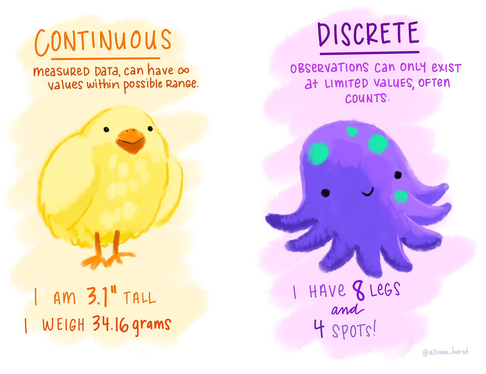
```

---
# .orange[Tipologie] di dati

```{r, echo=FALSE, out.width="90%"}
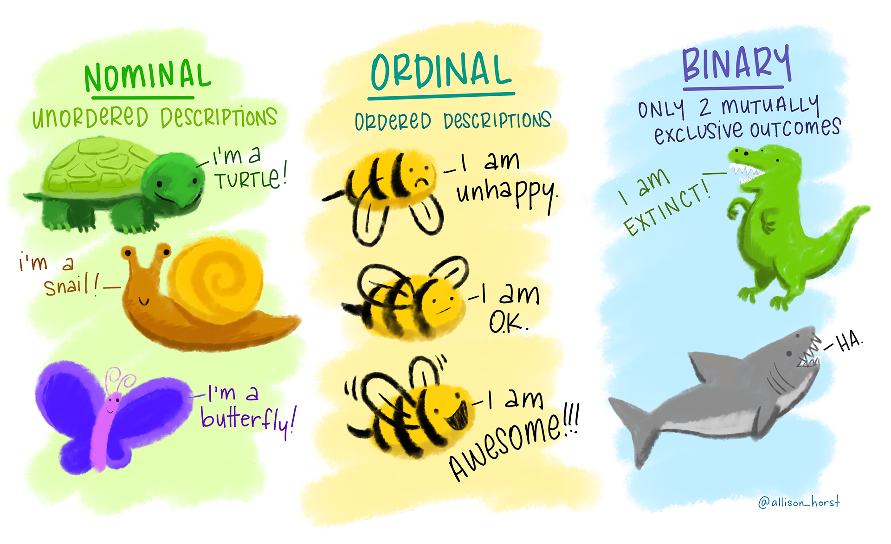
```


---
class: inverse, middle

## .orange[Sondaggio]

Per me: [Tipi di variabile](https://app.wooclap.com/events/STATMEDTYPE/0)

Per voi:   [bit.ly/statmed-sondaggio-tipi-variabili](https://bit.ly/statmed-sondaggio-tipi-variabili)


---
class: inverse, middle

# .center[**.orange[Localizzazione] (dati continui)**]

**Misure di .orange[centralità]**

**Misure di .orange[variabilità] (e confrontabilità)**

**Percentili**

**Accorpamenti, e misure ponderate**

```{r, echo=FALSE, fig.align = 'right', out.width="70%"}
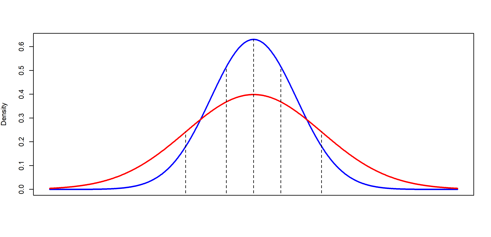
```


---
# Misure di .orange[centralità]: media

Data una variabile $x$, misurata su $n$ soggetti, la media aritmetica
.orange[campionaria] è pari a
$$\bar{x} = \frac{1}{n}\sum_{i=1}^n x_i$$

È molto sensibile ai valori estremi: se ce ne sono non è una buona misura di centralità.

> Es.: se in questa stanza entra Elon Musk, quale sarebbe la media del saldo dei conti in banca dei presenti (ma anche di tutta Rovigo...)? Sarebbe una buona misura di _centralità_ per tale distribuzione di valori?


---
class: hide_logo
# Media (_.orange[estremamente]_ sensibile)

Riprendendo le età del nostro sotto-campione di soggetti, la loro media è

.left-column[
```{r smean_ages, echo = FALSE}
ages_db |> 
  kable(row.names = FALSE, caption = "Portion of \'EPIC-Norfolk cohort\' (Bain et al. 2015)")
```
]

.right-column[

$\frac{1}{6}\sum_{i=1}^6 age_i =$ **`r round(mean(ages), 2)`**

<br><br>
La media è molto sensibile ai .orange[dati estremi]: sostituendo, per esempio, anche solamente il primo valore (55.1) con 5.51 (ipotizzando un errore di inserimento), la media cambia sensibilmente e diviene **`r round(mean(c(5.51, ages[-1])), 2)`**.

```{r, include=FALSE}
age <- c(55.1, 62.9, 53.1, 76.3, 64.2, 53.3)
sum(age) / length(age)
mean(age) |> round(2)

# cambiando il primo valore da 55.1 a 5.51
c(5.51, age[-1]) |> 
  mean() |> 
  round(2)
```
]


---
# Misure di .orange[centralità]: mediana

Ordiniamo ora le $n$ osservazioni. La mediana .orange[campionaria] è

- la $(\frac{n+1}{2})$-ma osservazione se $n$ è dispari (ovvero, **ha un centro**)
  > Se prendo $k=n/2$ ottengo una "posizione" con la virgola, quindi prendo la prima (intera) successiva.
  
- la media aritmetica della $(\frac{n}{2})$-ma e la $(\frac{n}{2}+1)$-ma
osservazione se $n$ è pari (ovvero, **non ha un centro**)
  > Se prendo $k=n/2$ ottengo un numero intero, e prendo allora la media tra la $k$-esima e la $k+1$-esima osservazione

---
# .orange[Mediana] (n pari)

Nel nostro esempio

.left-column[
```{r median_ages, echo = FALSE}
ages_db |> 
  arrange(age) |> 
  kable(row.names = TRUE, caption = "Portion of \'EPIC-Norfolk cohort\' (Bain et al. 2015)")
```
]

.right-column[

Siccome $n$ è pari (è 6), la mediana è la media tra la 3a e 4a osservazione (ordinate!)
$$\mbox{Mediana} = \frac{55.1 + 62.9}{2} = 59$$
E anche modificando il primo valore (55.1) con 5.51, la mediana cambia molto poco, diventando **58.1** (invece di 59).

```{r, include=FALSE}

# age_sorted <- c(53.1, 53.3, 55.1, 62.9, 64.2, 76.3)
age_sorted <- sort(age)
n <- length(age_sorted)
1/2 * (age_sorted[n / 2] + age_sorted[n / 2 + 1])

median(age)
median(c(5.51, age[-1]))
```

]

---
# .orange[Mediana] (n dispari)

.left-column[
```{r median_odd, echo=FALSE}
ages_db_dispari <- epic |> 
  mutate(I = row_number()) |> 
  select(I, age) |> 
  slice_head(n = 7) |> 
  arrange(age)

ages_db_dispari |> 
  kable(row.names = TRUE, caption = "Portion of \'EPIC-Norfolk cohort\' (Bain et al. 2015)")
```
]

.right-column[

Nel caso in cui $n$ sia dispari (prendiamo per esempio $n = 7$ ), prendiamo
direttamente il valore centrale (in posizione $4 = (7+1)/2$ ), ovvero **62.9**.

```{r, include=FALSE}
age <- c(55.1, 62.9, 53.1, 76.3, 64.2, 53.3, 65.7)
age_sorted <- sort(age)
age_sorted
n <- length(age_sorted)
age_sorted[(n + 1) / 2]
median(age, type = 2) # default is `type = 7` (for continuity)
```


]


---
# .orange[Confronto] media e mediana

Come indicatore semplice di .orange[asimmetria] (_skewness_) usiamo la
differenza

    Asimmetria = Media - Mediana

.pull-left[
La distribuzione dei dati sarà considerata:

- **simmetrica** se $Asimmetria \simeq 0$ (rispetto alla scala dei dati)

- **asimmetrica** (sbilanciata) a destra se $Asimmetria > 0$ (la media è più grande, .orange[distorta in eccesso])

- **asimmetrica** (sbilanciata) a sinistra se $Asimmetria < 0$ (la media è più piccola, .orange[distorta in difetto])
]
.pull-right[
```{r, echo=FALSE, out.width="100%", fig.cap = "\'EPIC-Norfolk cohort\' (Bain et al. 2015)"}
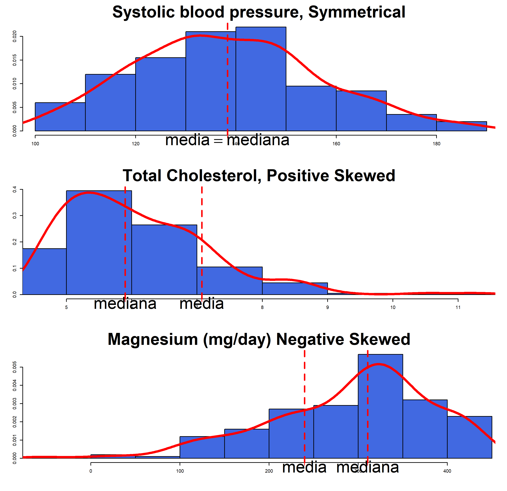
```
]


---
# Misure di .orange[centralità]: Moda
le mode sono ciascuno dei valori che si osservano con
**.orange[massima frequenza]**.

<small>

.left-column[
Sigarette al giorno

```{r, echo = FALSE}
epic_sigarette <- epic |> 
  count(sigarette)

epic_sigarette |> 
  kable(caption = "Portion of \'EPIC-Norfolk cohort\' (Bain et al. 2015)")
```
]

.right-column[


Moda di sigarette fumate al giorno
```{r echo=FALSE}
epic_sigarette |> 
  slice_max(n) |> 
  kable()
```

```{r, include=FALSE}
tab_siga <- rep(
    epic_sigarette$sigarette,
    times = epic_sigarette$n
  ) |>
  table()
tab_siga

names(tab_siga)[tab_siga == max(tab_siga)]


tab_siga <- rep(
    epic_sigarette$sigarette,
    times = epic_sigarette$n
  ) |>
  c(rep(3, 48)) |> table()
tab_siga

names(tab_siga)[tab_siga == max(tab_siga)]

```

> NOTA: una distribuzione può essere *unimodale*, *bimodale*, *trimodale*, ...

]
</small>

---
# Misure di .orange[variabilità]

Si considerino due campioni di misurazioni del colesterolo eseguite con
due tecniche, una autoanalitica e l'altra microenzimatica:

```{r, echo=FALSE}
colesterolo <- tibble(
  autoanalitica = c(177, 193, 195, 209, 226),
  microenzimatica = c(192, 197, 200, 202, 209)
)

kable(colesterolo)
```

Le medie campionarie (nonostante la differenza di variabilità) restano identiche:
```{r, echo=FALSE}
summarise(colesterolo, across(everything(), mean)) |> 
  kable()
```

---
# Misure di .orange[variabilità]: range (massimale)

Il **range** massimale è la differenza tra il valore massimo osservato e quello minimo.

Simbolicamente:
$$range = max(x_i)-min(x_i)$$

```{r, echo=FALSE}
summarise(colesterolo, across(everything(), ~diff(range(.x)))) |> 
  kable()
```

È molto semplice da calcolare ma molto sensibile ai valori estremi.

> Dipende dall'ampiezza campionaria $n$, e **tende ad aumentare** all'aumentare di $N$! (un campione più grande della stessa popolazione avrà estremi più lontani e non più vicini)


---
class: hide_logo
# Misure di .orange[variabilità]: varianza campionaria

La varianza campionaria è definita come

$$s^2 = \frac{\sum_{i=1}^n (x_i-\bar{x})^2}{n-1}$$

Questa è una misura di quanto, in media, sono grandi i **quadrati** degli
scarti dei dati dalla loro media.

È un valore non confrontabile con i dati stessi in quanto con un'altra
unità di misura. Si definisce quindi la **.orange[deviazione standard]** campionaria, come

$$s = \sqrt{s^2} = \sqrt{\frac{\sum_{i=1}^n (x_i-\bar{x})^2}{n-1}}$$

> Si noti che $\sum_{i=1}^n (x_i-\bar{x}) = 0$


---
class: hide_logo
# .orange[Varianza] campionaria: esempio

.left-plot[
```{r, echo=FALSE}
kable(colesterolo)
```

Medie:

```{r, echo=FALSE}
summarise(colesterolo, across(everything(), mean)) |> 
  kable()
```


]

.right-code[

.panelset[
.panel[.panel-name[Autoanalitica]
  $\begin{split}s^2& = \frac{(177-200)^2 + \ldots + (226-200)^2}{4}\\& = \frac{1360}{4} = 340\end{split}$
  
```{r, include = FALSE}
auto <- colesterolo[["autoanalitica"]]
sum(
  (auto - mean(auto))^2
) / (length(auto) - 1)
```
  
  $s = \sqrt{340} = 18.4$
  

]

.panel[.panel-name[Microenzimatica]
  $\begin{split}s^2& = \frac{(192-200)^2 + \ldots + (209-200)^2}{4}\\& = \frac{158}{4} = 39.5\end{split}$
  
```{r, include = FALSE}
micro <- colesterolo[["microenzimatica"]]
var(micro)
```
  $s = \sqrt{39.5} = 6.3$

```{r, include = FALSE}
sd(micro)
```


]
]

]

---
# .orange[Varianza] (formula alternativa)

Se la media è già calcolata, allora può essere utile usare
$$s^2=\frac{(\sum_{i=1}^n x_i^2) - n\bar{x}^2}{n-1}$$

Per la tecnica autoanalitica si ha
$$\sum_{i=1}^5 x_i^2 = 177^2+\ldots+226^2=201360$$
$$s^2 = \frac{201360 - 5 \times 200^2}{4}= 1360/4=340$$
```{r, include = FALSE}
n <- length(auto)
mean_auto <- mean(auto)
(sum(auto^2) - n * mean_auto^2) / (n - 1)
```


---
class: hide_logo
# Misure di .orange[variabilità]: coefficiente di variazione

Sebbene la deviazione standard sia della stessa unità di misura dei
dati, non permette di confrontare tra loro le variabilità di variabili con unità di misura differenti.

Il **coefficiente di variazione** $CV$ è definito come
$$CV = \frac{100s}{\bar{x}}$$
È una misura adimensionale, e quindi utilizzabile anche per confrontare variabili di natura differente (purché positive e con zero assoluto). È anche insensibile alla scala, ovvero a trasformazioni del tipo $cx$

---
### .orange[CV] (non-effetto scala)
<small>
I valori di Colesterolo raccolti dai 200 pazienti del database Epic sono i seguenti:

```{r, echo=FALSE}
epic$cole.tot |> 
  paste(collapse = ", ") |> 
  str_replace_all("((.+?, ){15})", "\\1\n") |> 
  cat()
```

Partendo dai dati così espressi in mmol/L: $CV = 1.12/6.07 \times 100 \simeq 18\%$
```{r, include=FALSE}
100 * sd(epic$cole.tot) / mean(epic$cole.tot)
```


e per gli stessi valori espressi in mg/dl (massa molare colesterolo: 386.65 g/mol) abbiamo:
$$CV = 43.35/234.83 \times 100 \simeq 18\%$$
</small>


---
class: inverse, middle

## .orange[Sondaggio]

Per me: [Localizzazione](https://app.wooclap.com/events/STATMEDLOCALIZZAZIONE/0)

Per voi:   [bit.ly/statmed-sondaggio-localizzazione](https://bit.ly/statmed-sondaggio-localizzazione)


---
class: inverse, middle

## .orange[Domande fin qui?]


---
# .orange[Percentili]

Il **percentile** $p$-esimo è un valore $V_p$ tale che almeno il $p$\% dei valori è minore o uguale a esso e almeno il $(100-p)$\% è maggiore o uguale.

Per un calcolo _a mano_, posto $k=\frac{p}{100}n$, il percentile $p$-esimo è definito come

- Se $k$ è un intero, la media tra la $k$-ma e la $(k + 1)$-ma osservazione
(ordinata).

- Se $k$ non è un intero, l'osservazione alla prima posizione (intera) superiore a $k$ (ordinata).

I **quartili** sono tre valori che dividono i dati in quattro gruppi contenenti un numero approssimativamente uguale di osservazioni. Il totale di 100% è diviso in quattro parti uguali: 25%, 50%, 75%, 100%.

  + .orange[Primo] **quartile** (Q1) è il $25$° percentile ($25\% = 1/4$), calcolato con la regola precedente
  
  + .orange[Terzo] **quartile** (Q3) è il $75$° percentile ($75\% = 3/4$), calcolato con la regola precedente


---
## .orange[Percentili] (esempio _intero_)
<small>
Si calcoli il $10$° e il $90$° percentile del campione del BMI su 10 soggetti.

.left-column[

```{r, echo=FALSE, caption = "Portion of \'EPIC-Norfolk cohort\' (Bain et al. 2015)"}
epic_10 <- epic |> 
  slice_head(n = 10) |> 
  select(id, bmi) |> 
  arrange(bmi)

epic_10 |> 
  kable(row.names = TRUE)
```
]

.right-column[

1. Si calcola $np/100$, pari a:
  - 10° percentile (p/100 = 0.1): $10 \times 0.1 = 1$
  
  - 90° percentile (p/100 = 0.9): $10 \times 0.9 = 9$

2. (Sono valori interi, quindi posti uguale a $k$ e) si calcola la media tra le osservazioni (**ordinate**):

  - 10°: posizioni 1 e 2 $\frac{23.3 + 24.9}{2} =$ `r mean(c(23.3, 24.9))`
  
  - 90°: posizioni 9 e 10 $\frac{41.6 + 42.6}{2} =$ `r mean(c(41.6, 42.6))`
  
```{r, include=FALSE}
# default type = 7 (continuo in p)
quantile(epic_10[["bmi"]], probs = c(0.1, 0.9), type = 2)
```

]

</small>

---
# .orange[Percentili] (esempio _decimale_)
Si calcoli il $20$° percentile del campione del BMI su 9 soggetti.

.left-column[

```{r, echo=FALSE, caption = "Portion of \'EPIC-Norfolk cohort\' (Bain et al. 2015)"}
epic_bmi_p2 <- epic |> 
  slice_head(n = 9) |> 
  select(id, bmi) |> 
  arrange(bmi)

epic_bmi_p2 |> 
  kable(row.names = TRUE)

```
]

.right-column[

1. Si calcola $k=np/100$, pari a:
  - 20° percentile (p/100 = 0.2): $9 \times 0.2 = 1.8$

2. (È un valore decimale, quindi) Si trova il primo numero intero superiore a 1.8: che è 2

3. Il 20° percentile è il $2$° (secondo) valore (ordinato!); ovvero, **`r epic_bmi_p2$bmi[[2]]`**.

```{r, include=FALSE}
# default type = 7 (per continuità in p)
quantile(epic_bmi_p2$bmi, probs = 0.2, type = 2)
```

]


---
class: inverse, middle

## .orange[Sondaggio]

Per me: [Percentili](https://app.wooclap.com/events/STATMEDPERCENTILI/0)

Per voi:  [bit.ly/statmed-sondaggio-percentili](https://bit.ly/statmed-sondaggio-percentili)


---
# .orange[Accorpamenti]

La struttura generale dei dati raggruppati è simile a


|Gruppi            | Punto medio $m_i$           | Frequenza
|:----------------:|:---------------------------:|:---------:
| $[y_1, y_2)$     | $\frac{y_1+y_2}{2}$         | $f_1$ 
| $\vdots$         | $\vdots$                    | $\vdots$
| $[y_k, y_{k+1})$ | $\frac{y_k+y_{k+1}}{2}$ | $f_k$


---
class: hide_logo

# .orange[Accorpamenti]: Epic - magnesio

Intake giornaliero di magnesio (mg/day) per $n = 100$ soggetti

```{r, echo=FALSE, message=FALSE, warning=FALSE}
sort(epic$mag[101:200]) |> 
  paste(collapse = ", ") |> 
  str_replace_all("((.+?, ){11})", "\\1\n") |> 
  cat()
```

---
class: hide_logo
# .orange[Accorpamenti]: Epic - magnesio

Accorpati in 8 gruppi con approssimativamente la stessa quantità di 
soggetti in ciascun gruppo:

```{r, echo=FALSE, message=FALSE, warning=FALSE}
discr <- cut2(epic$mag[101:200], g = 8, digits = 4)
matches <- regmatches(names(table(discr)), gregexpr("[[:digit:].]+", names(table(discr))))

ind <- sapply(matches, function(x) mean(as.numeric(x)))

dt <- data.frame(
  Gruppi = names(table(discr)),
  m = ind,
  frequenze = unname(table(discr))
)
dt <- dt[, -3]
colnames(dt)[[3]] <- "Freq"

kable(dt, row.names = FALSE, caption = "\'EPIC-Norfolk cohort\' (Bain et al. 2015)")
```


---
# misure .orange[ponderate]: media aritmetica ponderata

La media aritmetica campionaria ponderata è pari a
$$\bar{x}_g = \frac{\sum_{i=1}^k f_im_i}{\sum_{i=1}^k f_i}$$

Per il dataset accorpato sui dati di magnesio, è pari a
$$\bar{x}_g = \frac{13(105.95)+\ldots+12(352.05)}{13+\ldots+12}= 26387.55/100 = 263.8755$$
```{r, include=FALSE}
sum(dt$m * dt$Freq) / sum(dt$Freq)
weighted.mean(x = dt$m, w = dt$Freq)
```


---
class: hide_logo
## misure .orange[ponderate]: varianza ponderata

La varianza campionaria ponderata, con $n = \sum_{i=1}^k f_i$, è pari a
$$s_g^2 = \frac{\sum_{i=1}^k f_i(m_i-\bar{x}_g)^2}{(\sum_{i=1}^k f_i)-1} \quad\rm{ovvero}\quad s_g^2 = \frac{(\sum_{i=1}^k f_im_i^2)-n\bar{x}_g^2}{n-1}$$


Per il caso del magnesio è pari a

$$\begin{align*}s_g^2& = \frac{13(105.95 - 263.8755)^2+\ldots+12(352.05 - 263.8755)^2}{13 + \cdots + 12 - 1}\\& = 611233.5/99 = 6174.075\end{align*}$$
$$\begin{align*}s_g^2& = \frac{[13(105.95)^2+\ldots+12(352.05)^2]-100(263.8755^2)}{100-1}\\& = 611233.5/99 = 6174.075\end{align*}$$
```{r, include=FALSE}
w_mean <- weighted.mean(
  x = dt$m,
  w = dt$Freq
)
n <- sum(dt$Freq)

sum(
  dt$Freq * (dt$m - w_mean)^2
) / (n - 1)
#
#
#
#
#
#
(
  sum(dt$Freq * dt$m^2) -
  n * w_mean^2
) / (n - 1)
```

---
class: inverse, middle

# .center[**.orange[Rappresentazione]**]

### **Dati .orange[continui]**
- Istogrammi
- Box-plot

### **Dati .orange[categorici]**
- Grafici a barre

<!-- ### **.orange[Coppie] di dati** -->
<!-- - continui - continui (scatter) -->
<!-- - continui - categorici (jitter) -->
<!-- - categorici - categorici (... count?! `r emo::ji("thinking")`) -->


---
## Istogramma
<small>
L'istogramma è uno stimatore della distribuzione

```{r, out.width = "55%", echo=FALSE}
epic |> 
  slice(101:200) |> 
  ggplot(aes(x = mag, y = ..density..)) +
  geom_histogram(
    fill = "royalblue",
    bins = 8,
    breaks = as.numeric(unique(unlist(matches))),
    closed = "left"
  ) + 
  xlab("Mag [mg/day]")

```
</small>


---
# Dati continui: istogramma

Per il calcolo dell'istogramma, la tabella delle frequenze deve essere
estesa


|Gruppi            | Punto medio $m_i$           | Frequenza| Ampiezza            | Densità
|:----------------:|:---------------------------:|:--------:|:-------------------:|:-------
| $[y_1, y_2)$     | $\frac{y_1+y_2}{2}$         | $f_1$    | $a_1 = y_2-y_1$     | $\frac{f_1}{n*a_1}$
| $\vdots$         | $\vdots$                    | $\vdots$ | $\vdots$            | $\vdots$
| $[y_k, y_{k+1})$ | $\frac{y_k+y_{k+1}}{2}$     | $f_k$    | $a_k = y_{k+1}-y_k$ | $\frac{f_k}{n*a_k}$


---
## Istogramma: autocalcolato
<small>

Se ampiezze tutte uguali, la _forma_ standardizzata ad area unitaria è
proporzionale a quella con barre di altezza le frequenze

.panelset[
.panel[.panel-name[Count]
```{r, out.width = "50%", echo = FALSE}
epic |> 
  slice(101:200) |> 
  ggplot(aes(x = mag)) +
  geom_histogram(fill = "royalblue") + 
  xlab("Mag [mg/day]")
```
]
.panel[.panel-name[Hist]
```{r, out.width = "50%", echo=FALSE}
epic |> 
  slice(101:200) |> 
  ggplot(aes(x = mag, y = ..density..)) +
  geom_histogram(fill = "royalblue") + 
  xlab("Mag [mg/day]")
```
]

]
</small>


---
# Boxplot (general)
.center[
```{r, echo=FALSE, out.width="70%"}
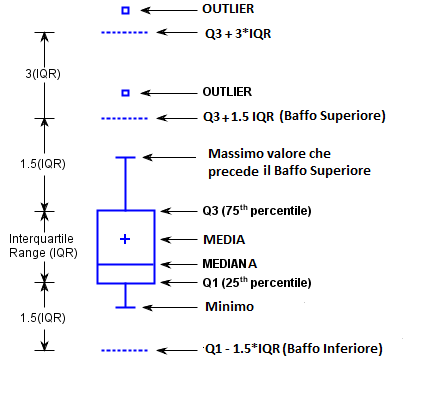
```
]


---
# Dati continui: box-plot

Il .orange[box-plot] è un modo per rappresentare graficamente una distribuzione
rispetto a __centralità e variabilità__. Per un campione di ampiezza $n$

- Il segmento all'interno del box è la mediana.

- il __primo quartile__ (h, o 25º percentile) è il bordo inferiore della scatola (box)

- il __terzo quartile__ (H, o 75º percentile) è il bordo superiore della scatola

- l'ampiezza della scatola (box) è il **.orange[Range Inter-Quartile] (IQR)**, ovvero la differenza tra il III e il I quartile ($H - h$).

- i __baffi__ arrivano fino al valore più lontano dalla scatola ma entro una volta e mezza l'IQR dai suoi bordi; i limiti $h - 1.5 \times (H-h)$ e $H + 1.5 \times (H-h)$ sono il baffo inferiore e superiore dello schema

- un __outlier__ è: un valore oltre i baffi, cioè che si allontana dai bordi della scatola più di una volta
  e mezza l'IQR, cioè
$$x > H + 1.5 \times (H-h)  \quad o \quad x < h - 1.5 \times (H-h)$$

- un __outlier estremo__ è: un valore che si allontana dai bordi della scatola più di tre volte l'IQR, cioè
$$x > H + 3 \times (H-h)  \quad o \quad x < h - 3 \times (H-h)$$

---
# Box-plot (calcolo)
Un'assunzione giornaliera di 43 mg/die di magnesio rappresenta un outlier

<small>
<small>
```{r, echo=FALSE, message=FALSE, warning=FALSE}
sort(epic$mag[101:200])
```


- $h$ è la media tra l'osservazione $(100 * 1/4)$ª e la $((100 * 1/4) + 1)$ª, ovvero
  $(215.3+215.4) / 2 = 215.35$
- $H$ è la media dell'osservazione $(100 * 3/4)$ª e la $((100 * 3/4) + 1)$ª, ovvero
  $(323.9+324) / 2 = 323.95$
- i limiti per gli outlier sono quindi:
$$x > 323.95 + 1.5 * (323.95 - 215.35) = 486.85$$
$$x < 215.35 - 1.5 * (323.95 - 215.35) = 52.45$$
- gli outlier estremi sarebbero: 
$$x > 323.95 + 3 * (323.95 - 215.35) = 649.75$$
$$x < 215.35 - 3 * (323.95 - 215.35) = -110.45$$
(valore negativo: un'assunzione non può essere negativa, quindi nessun outlier estremo inferiore)
</small>
</small>


---
# Dati categorici: barre

Volendo rappresentare confronti tra conteggi, possiamo usare grafici a
barre.

> ATTENZIONE 1: istogramma rappresenta una distribuzione per i valori 
  di una variabile continua; un grafico a barre rappresenta i valori
  (conteggi) dei livelli di una variabile categorica!

> ATTENZIONE 2: in un grafico a barre, la base delle barre DEVE essere 
  sempre (ben!!) definita, ovvero deve SEMPRE iniziare dall'opportuno
  "zero" (per esempio da 1 per scale logaritmiche, da 0 per i conteggi
  classici)

---

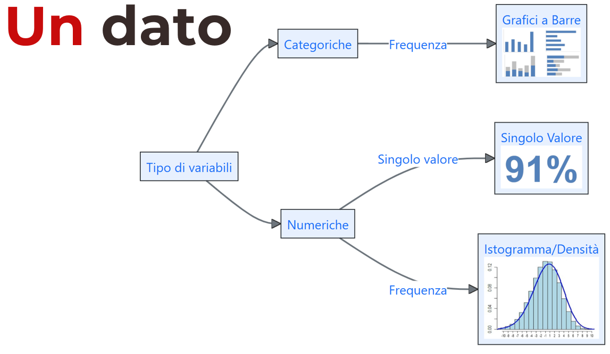

---

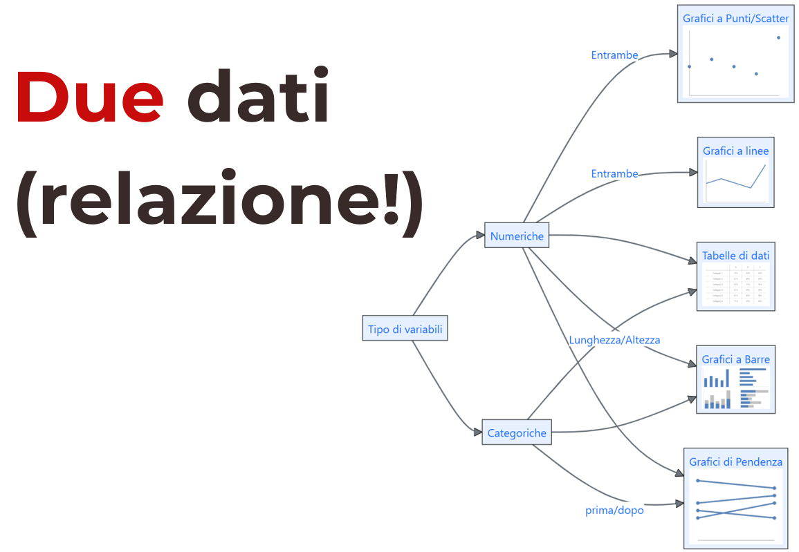

---

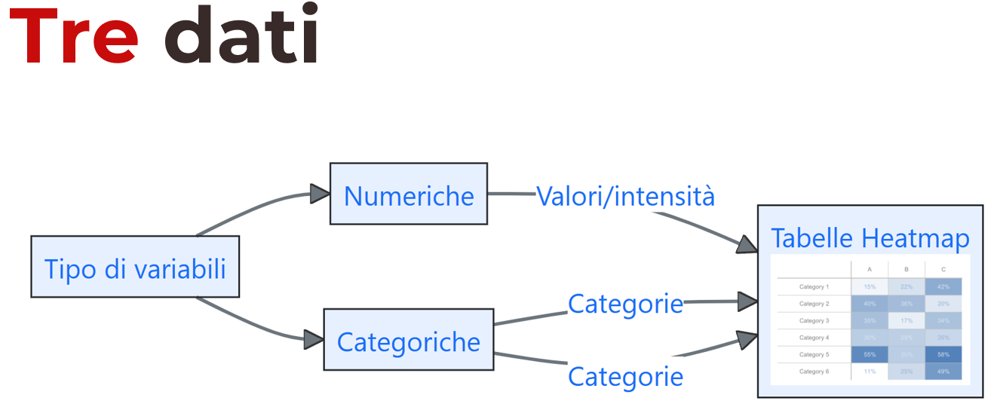

---

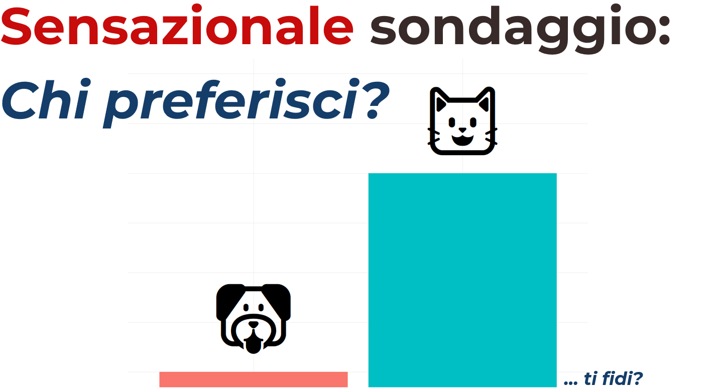

---

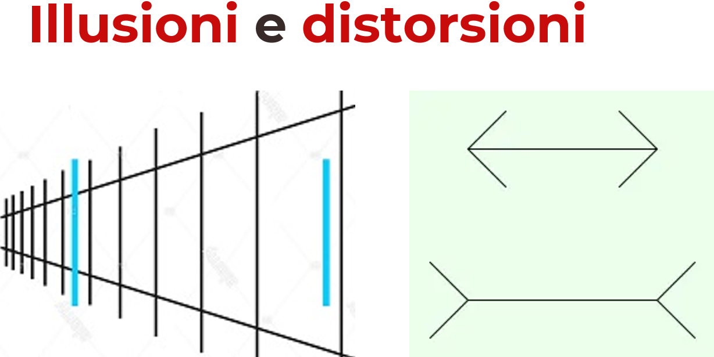

---

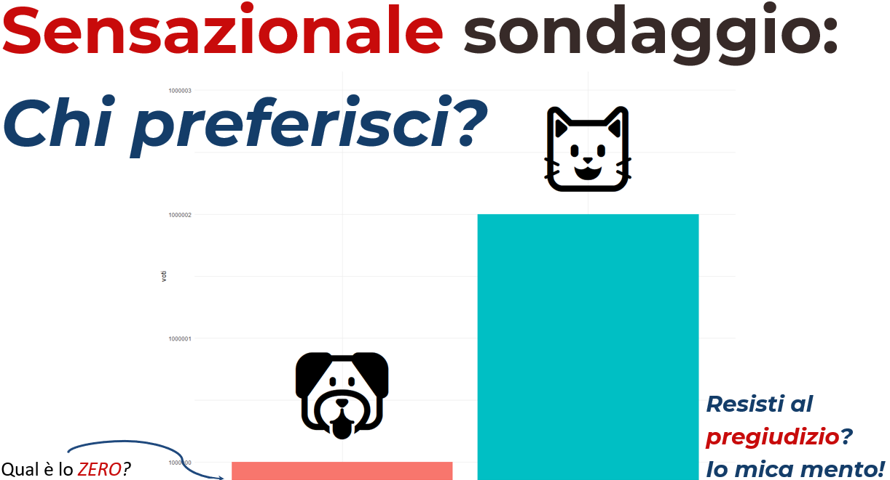

---

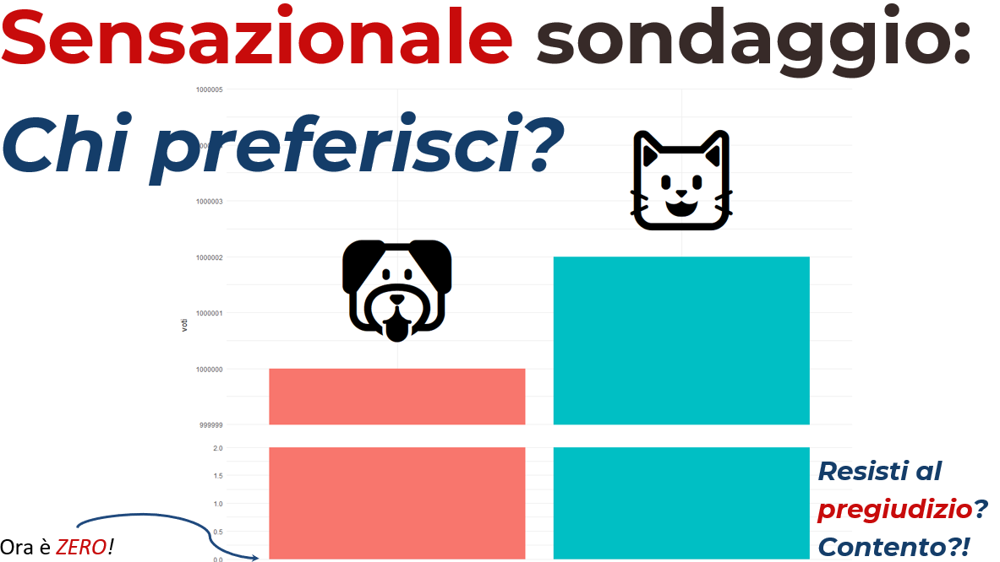


---

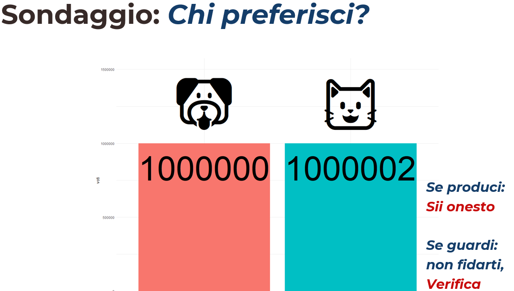

---

# Prima

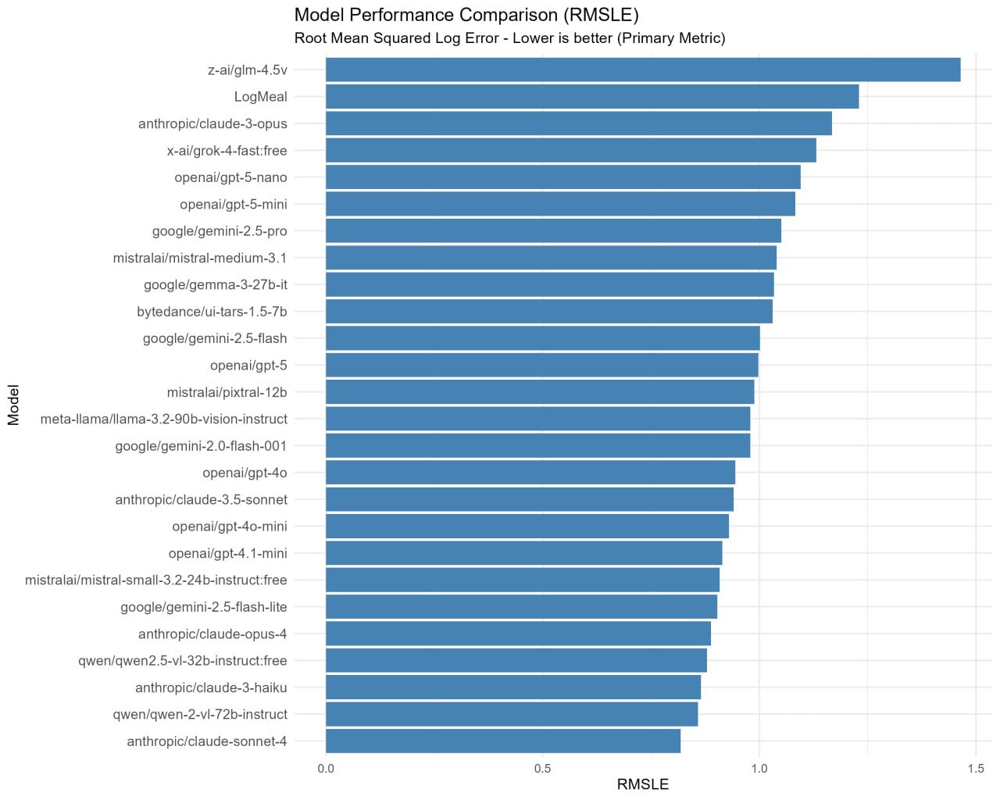
---

# Prima

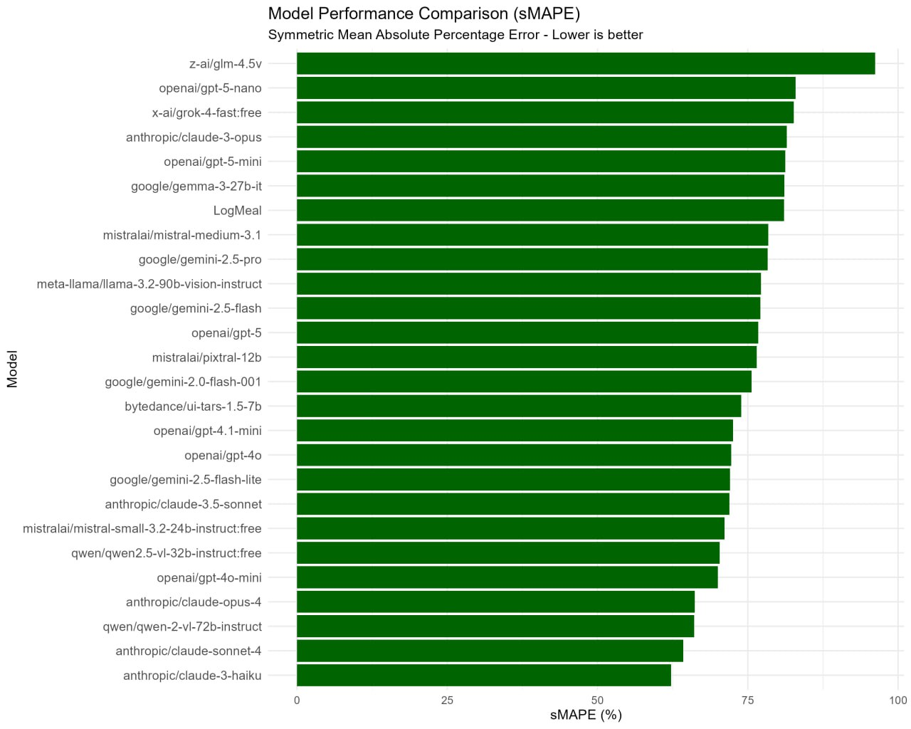

---

# Prima

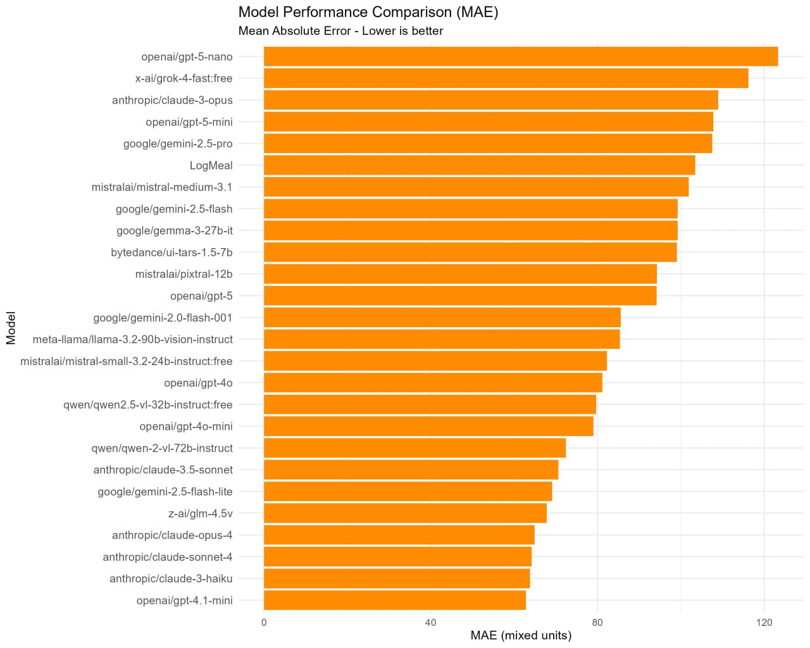

---

# Dopo

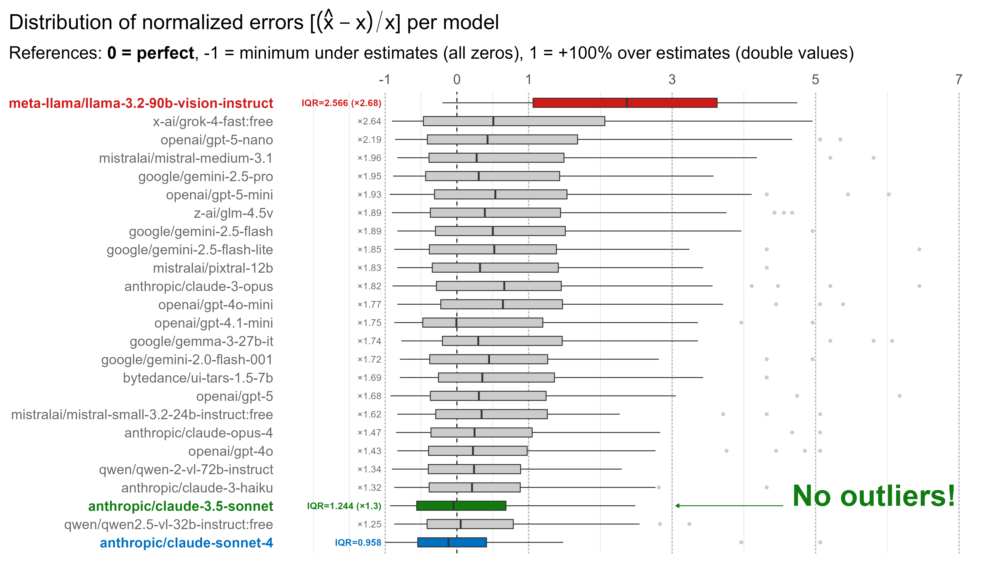


---
class: inverse, middle

## .orange[Sondaggio]

Per me: [Grafici](https://app.wooclap.com/events/STATMEDGRAFICI/0)

Per voi:  [bit.ly/statmed-sondaggio-grafici](https://bit.ly/statmed-sondaggio-grafici)


---
class: inverse

# Risorse utili

- [**RStudio Cloud**](https://bit.ly/statmed-cl-rstudio): [https://bit.ly/statmed-cl-rstudio](https://bit.ly/statmed-cl-rstudio) gratis per voi per esplorare RStudio, le sue funzionalità, e allenarvi con R (link di iscrizione valido fino alla fine del corso). NOTA: a vostra scelta, è utilizzabile anche come _supporto_ durante l'esame.

- [**RStudio primers**](https://rstudio.cloud/learn/primers) ambiente gratuito dentro RStudio Cloud per l'apprendimento delle basi di analisi di dati con R tramite tutorial interattivi. Una volta registrati, oltre all'accesso al _nostro_ spazio di lavoro, avete accesso libero anche ai _Primers_.

- [**R 4 Data Science**](https://r4ds.had.co.nz/): libro gratuito (on-line) di [**Hadley Wickham**](http://hadley.nz/) e [**Garrett Grolemund**](https://rstudio.com/speakers/garrett-grolemund/)

- [**GGplot2 cheatsheet**](https://raw.githubusercontent.com/rstudio/cheatsheets/main/data-visualization.pdf) schema dei possibili grafici di base rappresentabili in R con il pacchetto `{ggplot2}`, molto utile anche per conoscere le tipologie di grafico, e il loro utilizzo.

- [Statistica medica](https://www.maggiolieditore.it/statistica-medica.html) di [**Martin Bland**](https://www.york.ac.uk/healthsciences/our-staff/honoraryemeritus/martin-bland/), suggeriti capitoli 1, 4 e 5.

- [Perché n − 1 nella formula della deviazione standard
campionaria?](http://rdossena.altervista.org/Articoli/Book-Perch%E9%20n-1.pdf) di [Riccardo Dossena](http://rdossena.altervista.org) Traduzione dell'articolo **Book, S.A.**: _Why n − 1 in the formula for the sample standard deviation?_, The Two-Year College Mathematics Journal 10(5), 330–333 (1979)

---
class: inverse, center, middle, hide-count


.bg-washed-green.b--dark-green.ba.bw2.br3.shadow-5.ph4.mt5[
.left[
_Mathematical conventions are just that, conventions. They differ by field of mathematics. Don’t ask us why **matrix rows** **.orange[are numbered down]** but **graphs** **.orange[are numbered up]** the **y axis**, nor why **x .orange[comes before] y** but **row .orange[before] column**. But the matrix layout has always seemed illogical to me._
]

.tr[
—Brian D. Ripley<br>08/2004 - R-help<br>
]
]


# .orange[Grazie] per l'attenzione!


Diapositive: [bit.ly/statmed-cl-corsi](https://bit.ly/statmed-cl-corsi)


[`r fontawesome::fa("link")`](https://www.unipd-ubep.it/) [**www.unipd-ubep.it**](https://www.unipd-ubep.it/) | 
[`r fontawesome::fa("envelope")`](mailto:Corrado.Lanera@ubep.unipd.it) [**Corrado.Lanera@ubep.unipd.it**](mailto:Corrado.Lanera@ubep.unipd.it)

[`r fontawesome::fa("github")`](https://github.com/corradolanera)
[`r fontawesome::fa("twitter")`](https://twitter.com/corradolanera)
[`r fontawesome::fa("telegram")`](https://telegram.me/CorradoLanera)
**@CorradoLanera** |
[`r fontawesome::fa("calendar-check")` ](https://bit.ly/statmed-cl-ricevimento) [**bit.ly/statmed-cl-ricevimento**](https://bit.ly/statmed-cl-ricevimento)


