```{r setup, include=FALSE}
knitr::opts_chunk$set(
  fig.retina = 3,
  warning = FALSE,
  message = FALSE,
  comment = "",
  out.width = "100%"
)

library(knitr)

library(tidyverse)
library(here)
library(gridExtra)

library(countdown)
library(DT)

library(Hmisc)

options(width = 59) # fit into the right-column slides

```

## Cosa faremo {.inverse background-color="#03A696"}

Prima di tutto richiameremo alcuni simboli, notazioni, oggetti
"matematici" che ci potranno tornare utili lungo la trattazione
dell'intero corso.

Andremo quindi a identificare quali sono gli **[oggetti]{.orange}** che ci
interessa analizzare, e di che **[tipologie]{.orange}** possono essere. 

Quindi vedremo come **[localizzarli]{.orange}**; ovvero, come (numericamente) avere
un'idea di dove si _collochino_ (rispetto a un dato riferimento o misura),
questo grazie all'individuazione di uno o più **[punti di riferimento]{.orange}**
(detti **centrali**) e una misura di quanto gli altri punti di interesse
siano **[più o meno distanti]{.orange}** da questi (**variabilità**).

Poiché **[guardare]{.orange}** numeri, a volte, può essere poco informativo, o
immediato, ci occuperemo di rappresentare i nostri dati **graficamente**,
individuando a seconda del tipo, quantità e interesse, il grafico più
opportuno tra quelli base, imparando anche a _leggere_ cosa
rappresentano.

## [Riconoscimenti]{.orange}

- Le diapositive proposte sono state prodotte a partire anche da
  materiale generato da/con le seguenti persone gravitanti attorno
  all'UBEP*:
  
  + Danila Azzolina
  + Dario Gregori
  + Giulia Lorenzoni
  + Honoria Ocagli
  + Ileana Baldi
  + Luca Vedovelli
  + Matteo Martinato
  + Paola Berchialla

<br><br>

::: {.small}

::: {.text-right}

\* In ordine alfabetico.

:::

:::

<br><br>

> Un ringraziamento speciale a Cristiana Vettori per
l'aiuto e il supporto logistico e amministrativo che mi è stato offerto.

## **[Panoramica]{.orange}** {.text-center .inverse .center background-color="#03A696"}

**Oggetti in gioco**

**Localizzazione**

**Rappresentazione**

## **[Oggetti]{.orange} in gioco** {.text-center .inverse .center background-color="#03A696"}

**Notazioni di base**

**[unità]{.orange} statistiche e tabelle ordinate**

**[tipologie]{.orange} di dati**

## [Notazioni]{.orange}: Sommatoria

Sia $X$ un insieme di $N$ numeri: indichiamo con $x_i$ l'i-esimo elemento
di $X$ (per $i = 1$, $x_1$ è il primo).

Con il simbolo $\Sigma$ (Sigma maiuscola, la "S" greca) scriviamo

$$\sum_{i = 1}^N x_i = x_1 + x_2 + \cdots + x_{N-1} + x_{N}$$

la somma di tutti gli $x_i$, che leggiamo "Sommatoria per i che va da 1
a N degli x-con-i".

Gli indici possono essere anche codici, per esempio gli id dei pazienti
in un insieme $I$ (con $R43$ id di un paziente, $x_{R43}$ è il suo peso).
Allora scriviamo

$$\sum_{i\in I} x_i$$

e leggiamo "Sommatoria per gli i in I degli x-con-i": la somma dei pesi di
tutti i pazienti con id in $I$.

## Esempio sommatoria

```{r epic, include=FALSE}
epic <- read_rds(here("slides/data/bain2015-epic.rds"))
ages <- (epic$age |> set_names(seq_along(epic$age)))[1:6]
```

Per esempio considerando

:::: {.columns}

::: {.column width="22%"}

```{r sum_ages, echo = FALSE}
ages_db <- epic |> 
  mutate(I = row_number()) |> 
  select(I, age) |> 
  slice_head(n = 6) 

ages_db |> 
  kable(row.names = FALSE)
```

:::

::: {.column width="75%"}

Possiamo scrivere la somma di tutte le età 

```{r, echo = FALSE}
cat(paste(ages, collapse = " + "))
```


come $\sum_{i\in I} age_i =$ `r sum(ages)`.

:::

::::

## Una tabella [disordinata]{.orange}

Quattro pazienti, con la pressione misurata in due giorni, registrati in un
foglio di calcolo come capita spesso:

| Paziente | M | F | Età | Pressione_g1 | Pressione_g2 |
|:---------|:-:|:-:|----:|:------------:|:------------:|
| P01      |   | X |  54 | 130/85       | 125/80       |
| P02      | X |   |  61 | 145/95       | 140/90       |
| P03      |   | X |  47 | 120/80       | 120/75       |
| P04      | X |   |  70 | 150/90       | 155/95       |

::: {.small}

Pressione in mmHg; `_g1` e `_g2`: primo e secondo giorno di rilevazione.

:::

<br>

- Quante sono le righe? E quante le misurazioni della pressione?
- Qual è l'**[unità statistica]{.orange}**?
- Quante e quali sono le **[variabili]{.orange}**?

## Dati [ordinati]{.orange}

Una tabella è **ordinata** (in inglese _tidy_) quando rispetta tre regole:

1. Ogni **variabile** è una **colonna**, e ogni colonna è una variabile.
2. Ogni **osservazione** (l'unità statistica) è una **riga**, e ogni riga
   è un'osservazione.
3. Ogni **valore** è una **cella**, e ogni cella contiene un solo valore.

<br>

La tabella di prima le viola tutte e tre:

1. il **sesso** occupa due colonne (M e F), e così la **pressione**;
   inoltre il **giorno** della rilevazione, che è un'altra variabile, sta
   nascosto nel nome delle colonne (`_g1`, `_g2`);
2. ogni riga contiene **due misurazioni**, cioè due osservazioni, una per
   giorno;
3. **«130/85»** sono due valori in una cella: pressione sistolica e
   diastolica.

## La stessa tabella, [ordinata]{.orange}

| Paziente | Sesso | Età (anni) | Giorno | PAS (mmHg) | PAD (mmHg) |
|:---------|:-----:|-----------:|:------:|-----------:|-----------:|
| P01      | F     |         54 | 1      |        130 |         85 |
| P01      | F     |         54 | 2      |        125 |         80 |
| P02      | M     |         61 | 1      |        145 |         95 |
| P02      | M     |         61 | 2      |        140 |         90 |
| P03      | F     |         47 | 1      |        120 |         80 |
| P03      | F     |         47 | 2      |        120 |         75 |
| P04      | M     |         70 | 1      |        150 |         90 |
| P04      | M     |         70 | 2      |        155 |         95 |

::: {.small}

PAS e PAD: pressione arteriosa sistolica e diastolica.

:::

- **8 righe**, una per misurazione. Ogni riga è un'**unità statistica**,
  ciò su cui si misura: qui la misurazione (un paziente in un giorno), non
  il paziente.
- **Sesso** ed **età** si ripetono: sono caratteristiche del paziente,
  uguali in tutte le sue misurazioni.

## Un esempio [reale]{.orange}

Le prime 10 delle 200 righe della coorte EPIC-Norfolk, che useremo negli
esempi che seguono: ogni riga è un partecipante (l'unità statistica), ogni
colonna una variabile.

::: {.small}

```{r, echo=FALSE, include=TRUE}
kable(epic |> slice_head(n = 10), row.names = FALSE)
```

:::

## [Tipologie]{.orange} di dati

```{r, echo=FALSE, out.width="90%"}
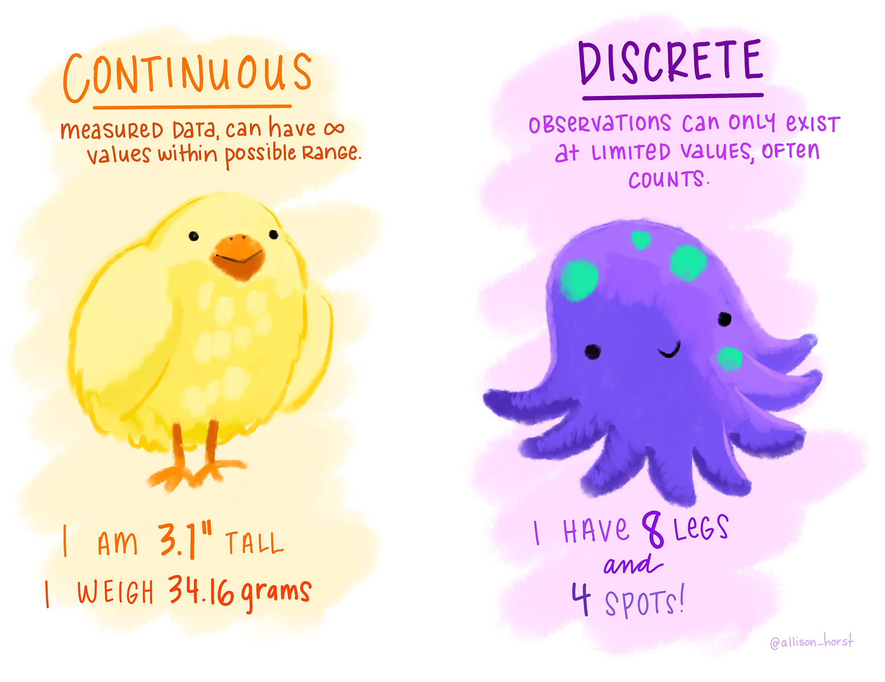
```

## [Tipologie]{.orange} di dati

```{r, echo=FALSE, out.width="90%"}
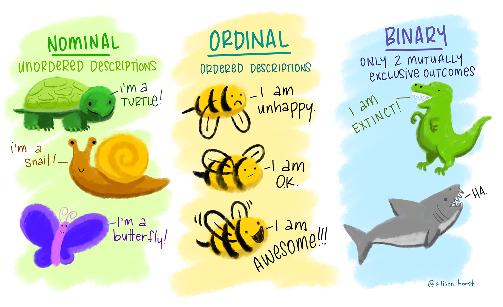
```

## [Tipologie]{.orange} di dati: in sintesi

- **Continue**: possono assumere qualunque valore in un intervallo;
  nascono da una **misura** (età, peso, pressione, colesterolo).
- **Discrete**: possono assumere solo valori separati.
  + **nominali**: categorie senza un ordine (gruppo sanguigno, farmaco
    assunto);
  + **ordinali**: categorie con un ordine (stadio del tumore; attività
    fisica: mai, 1-2 volte, 3 volte a settimana);
  + **dicotomiche** (o binarie): solo due categorie, che si escludono a
    vicenda (fumatore: sì/no);
  + **[cardinali]{.orange}**: **conteggi**, rispondono a «quanti?»
    (numero di figli, ricoveri nell'ultimo anno, sigarette al giorno).

::: {.small}

**Cardinale non vuol dire numerica**: 130 mmHg è un numero, ma non conta
niente: è una misura, quindi continua. Una cardinale conta qualcosa: 3
ricoveri sono uno in più di 2, mentre fra «mai» e «1-2 volte» (ordinale)
c'è solo un ordine.

:::

## [Sondaggio]{.orange} {.inverse .center background-color="#03A696"}

Per me: [Tipi di variabile](https://app.wooclap.com/events/STATMEDTYPE/0)

Per voi:   [bit.ly/statmed-sondaggio-tipi-variabili](https://bit.ly/statmed-sondaggio-tipi-variabili)



## **[Localizzazione]{.orange} (dati continui)** {.text-center .inverse .center background-color="#03A696"}

**Misure di [centralità]{.orange}**

**Misure di [variabilità]{.orange} (e confrontabilità)**

**Percentili**

**Accorpamenti, e misure ponderate**

```{r, echo=FALSE, fig.align = 'right', out.width="70%"}
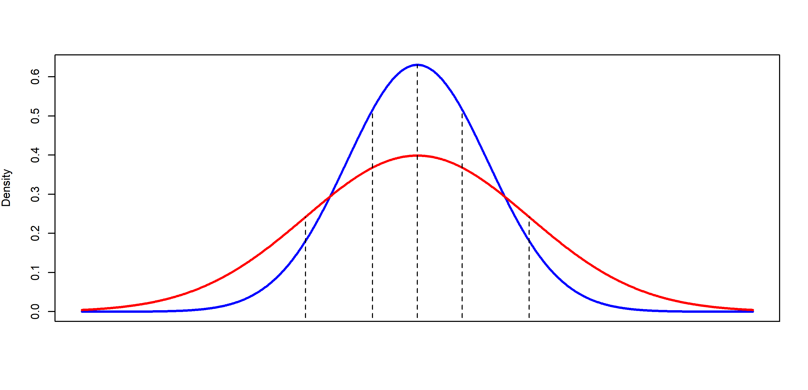
```

## Misure di [centralità]{.orange}: media

Data una variabile $x$, misurata su $n$ soggetti, la media aritmetica
[campionaria]{.orange} è pari a
$$\bar{x} = \frac{1}{n}\sum_{i=1}^n x_i$$

È molto sensibile ai valori estremi: se ce ne sono non è una buona misura di centralità.

> Es.: se in questa stanza entra Elon Musk, quale sarebbe la media del saldo dei conti in banca dei presenti (ma anche di tutta Rovigo...)? Sarebbe una buona misura di _centralità_ per tale distribuzione di valori?

## Media (_[estremamente]{.orange}_ sensibile)

Riprendendo le età del nostro sotto-campione di soggetti, la loro media è


:::: {.columns}

::: {.column width="22%"}

```{r smean_ages, echo = FALSE}
ages_db |> 
  kable(row.names = FALSE)
```

:::

::: {.column width="75%"}

$\frac{1}{6}\sum_{i=1}^6 age_i =$ **`r round(mean(ages), 2)`**

<br><br>
La media è molto sensibile ai [dati estremi]{.orange}: sostituendo, per esempio, anche solamente il primo valore (55.1) con 5.51 (ipotizzando un errore di inserimento), la media cambia sensibilmente e diviene **`r round(mean(c(5.51, ages[-1])), 2)`**.

```{r, include=FALSE}
age <- c(55.1, 62.9, 53.1, 76.3, 64.2, 53.3)
sum(age) / length(age)
mean(age) |> round(2)

# cambiando il primo valore da 55.1 a 5.51
c(5.51, age[-1]) |> 
  mean() |> 
  round(2)
```

:::

::::

## Misure di [centralità]{.orange}: mediana

Ordiniamo ora le $n$ osservazioni. La mediana [campionaria]{.orange} è

- la $(\frac{n+1}{2})$-ma osservazione se $n$ è dispari (ovvero, **ha un centro**)
  > Se prendo $k=n/2$ ottengo una "posizione" con la virgola, quindi prendo la prima (intera) successiva.
  
- la media aritmetica della $(\frac{n}{2})$-ma e la $(\frac{n}{2}+1)$-ma
osservazione se $n$ è pari (ovvero, **non ha un centro**)
  > Se prendo $k=n/2$ ottengo un numero intero, e prendo allora la media tra la $k$-esima e la $k+1$-esima osservazione

## [Mediana]{.orange} (n pari)

Nel nostro esempio


:::: {.columns}

::: {.column width="22%"}

```{r median_ages, echo = FALSE}
ages_db |> 
  arrange(age) |> 
  kable(row.names = TRUE)
```

:::

::: {.column width="75%"}

Siccome $n$ è pari (è 6), la mediana è la media tra la 3a e 4a osservazione (ordinate!)
$$\mbox{Mediana} = \frac{55.1 + 62.9}{2} = 59$$
E anche modificando il primo valore (55.1) con 5.51, la mediana cambia molto poco, diventando **58.1** (invece di 59).

```{r, include=FALSE}

# age_sorted <- c(53.1, 53.3, 55.1, 62.9, 64.2, 76.3)
age_sorted <- sort(age)
n <- length(age_sorted)
1/2 * (age_sorted[n / 2] + age_sorted[n / 2 + 1])

median(age)
median(c(5.51, age[-1]))
```

:::

::::

## [Mediana]{.orange} (n dispari)

:::: {.columns}

::: {.column width="22%"}

```{r median_odd, echo=FALSE}
ages_db_dispari <- epic |> 
  mutate(I = row_number()) |> 
  select(I, age) |> 
  slice_head(n = 7) |> 
  arrange(age)

ages_db_dispari |> 
  kable(row.names = TRUE)
```

:::

::: {.column width="75%"}

Nel caso in cui $n$ sia dispari (prendiamo per esempio $n = 7$), prendiamo
direttamente il valore centrale (in posizione $4 = (7+1)/2$), ovvero **62.9**.

```{r, include=FALSE}
age <- c(55.1, 62.9, 53.1, 76.3, 64.2, 53.3, 65.7)
age_sorted <- sort(age)
age_sorted
n <- length(age_sorted)
age_sorted[(n + 1) / 2]
median(age, type = 2) # default is `type = 7` (for continuity)
```

:::

::::

## [Media]{.orange} o mediana?

:::: {.columns}

::: {.column width="48%"}

Con dati a **coda lunga** (degenze, trigliceridi, redditi) pochi valori molto
grandi **tirano la media** verso la coda; la mediana no.

In questi casi la **media** non descrive il valore tipico, e si descrivono i
dati con la **mediana** (e con i quartili, che vedremo più avanti).

:::

::: {.column width="48%"}

```{r, echo=FALSE, out.width="100%"}
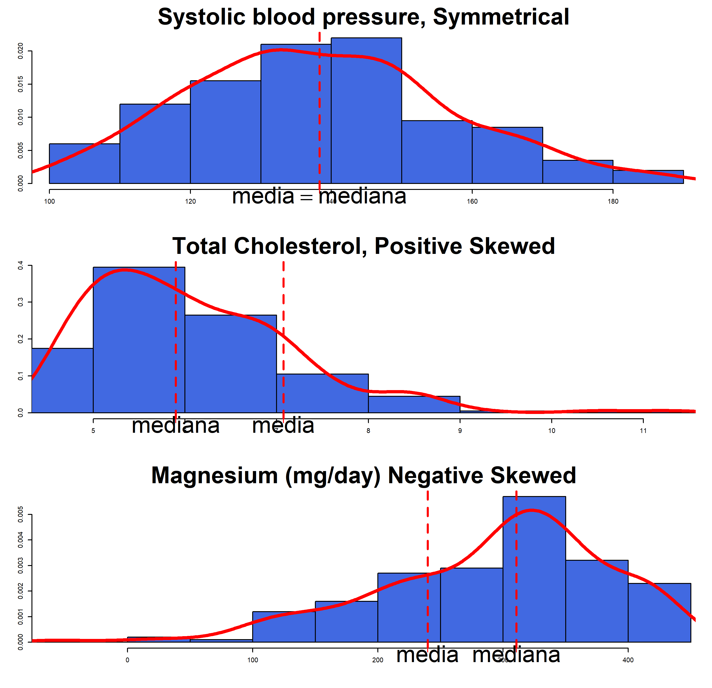
```

:::

::::

## Misure di [centralità]{.orange}: Moda

le mode sono ciascuno dei valori che si osservano con
**[massima frequenza]{.orange}**.

::: {.small}


:::: {.columns}

::: {.column width="22%"}

Sigarette al giorno

```{r, echo = FALSE}
epic_sigarette <- epic |> 
  count(sigarette)

epic_sigarette |> 
  kable()
```

:::

::: {.column width="75%"}

Moda di sigarette fumate al giorno
```{r echo=FALSE}
epic_sigarette |> 
  slice_max(n) |> 
  kable()
```

```{r, include=FALSE}
tab_siga <- rep(
    epic_sigarette$sigarette,
    times = epic_sigarette$n
  ) |>
  table()
tab_siga

names(tab_siga)[tab_siga == max(tab_siga)]


tab_siga <- rep(
    epic_sigarette$sigarette,
    times = epic_sigarette$n
  ) |>
  c(rep(3, 48)) |> table()
tab_siga

names(tab_siga)[tab_siga == max(tab_siga)]

```

> NOTA: una distribuzione può essere *unimodale*, *bimodale*, *trimodale*, ...

:::

::::

:::

## Misure di [variabilità]{.orange}

Si considerino due campioni di misurazioni del colesterolo eseguite con
due tecniche, una autoanalitica e l'altra microenzimatica:

```{r, echo=FALSE}
colesterolo <- tibble(
  autoanalitica = c(177, 193, 195, 209, 226),
  microenzimatica = c(192, 197, 200, 202, 209)
)

kable(colesterolo)
```

Le medie campionarie (nonostante la differenza di variabilità) restano identiche:
```{r, echo=FALSE}
summarise(colesterolo, across(everything(), mean)) |> 
  kable()
```

## Misure di [variabilità]{.orange}: range (massimale)

Il **range** massimale è la differenza tra il valore massimo osservato e quello minimo.

Simbolicamente:
$$range = max(x_i)-min(x_i)$$

```{r, echo=FALSE}
summarise(colesterolo, across(everything(), ~diff(range(.x)))) |> 
  kable()
```

È molto semplice da calcolare ma molto sensibile ai valori estremi.

> Dipende dall'ampiezza campionaria $n$, e **tende ad aumentare** all'aumentare di $N$! (un campione più grande della stessa popolazione avrà estremi più lontani e non più vicini)

## Misure di [variabilità]{.orange}: varianza campionaria

La varianza campionaria è definita come

$$s^2 = \frac{\sum_{i=1}^n (x_i-\bar{x})^2}{n-1}$$

Questa è una misura di quanto, in media, sono grandi i **quadrati** degli
scarti dei dati dalla loro media.

È un valore non confrontabile con i dati stessi in quanto con un'altra
unità di misura. Si definisce quindi la **[deviazione standard]{.orange}** campionaria, come

$$s = \sqrt{s^2} = \sqrt{\frac{\sum_{i=1}^n (x_i-\bar{x})^2}{n-1}}$$

> Si noti che $\sum_{i=1}^n (x_i-\bar{x}) = 0$

## [Varianza]{.orange} campionaria: esempio

:::: {.columns}

::: {.column width="40%"}

```{r, echo=FALSE}
kable(colesterolo)
```

Medie:

```{r, echo=FALSE}
summarise(colesterolo, across(everything(), mean)) |> 
  kable()
```

:::

::: {.column width="57%"}

::: {.panel-tabset}

### Autoanalitica

  $\begin{split}s^2& = \frac{(177-200)^2 + \ldots + (226-200)^2}{4}\\& = \frac{1360}{4} = 340\end{split}$
  
```{r, include = FALSE}
auto <- colesterolo[["autoanalitica"]]
sum(
  (auto - mean(auto))^2
) / (length(auto) - 1)
```
  
  $s = \sqrt{340} = 18.4$
  


### Microenzimatica

  $\begin{split}s^2& = \frac{(192-200)^2 + \ldots + (209-200)^2}{4}\\& = \frac{158}{4} = 39.5\end{split}$
  
```{r, include = FALSE}
micro <- colesterolo[["microenzimatica"]]
var(micro)
```
  $s = \sqrt{39.5} = 6.3$

```{r, include = FALSE}
sd(micro)
```

:::

:::

::::

## [Varianza]{.orange} (formula alternativa)

Se la media è già calcolata, allora può essere utile usare
$$s^2=\frac{(\sum_{i=1}^n x_i^2) - n\bar{x}^2}{n-1}$$

Per la tecnica autoanalitica si ha
$$\sum_{i=1}^5 x_i^2 = 177^2+\ldots+226^2=201360$$
$$s^2 = \frac{201360 - 5 \times 200^2}{4}= 1360/4=340$$
```{r, include = FALSE}
n <- length(auto)
mean_auto <- mean(auto)
(sum(auto^2) - n * mean_auto^2) / (n - 1)
```

## Misure di [variabilità]{.orange}: coefficiente di variazione

Sebbene la deviazione standard sia della stessa unità di misura dei
dati, non permette di confrontare tra loro le variabilità di variabili con unità di misura differenti.

Il **coefficiente di variazione** $CV$ è definito come
$$CV = \frac{100s}{\bar{x}}$$
È una misura adimensionale, e quindi utilizzabile anche per confrontare variabili di natura differente (purché positive e con zero assoluto). È anche insensibile alla scala, ovvero a trasformazioni del tipo $cx$

## [CV]{.orange} (non-effetto scala)

::: {.small}

I valori di Colesterolo raccolti dai 200 pazienti del database Epic sono i seguenti:

```{r, echo=FALSE}
epic$cole.tot |> 
  paste(collapse = ", ") |> 
  str_replace_all("((.+?, ){15})", "\\1\n") |> 
  cat()
```

Partendo dai dati così espressi in mmol/L: $CV = 1.12/6.07 \times 100 \simeq 18\%$
```{r, include=FALSE}
100 * sd(epic$cole.tot) / mean(epic$cole.tot)
```


e per gli stessi valori espressi in mg/dl (massa molare colesterolo: 386.65 g/mol) abbiamo:
$$CV = 43.35/234.83 \times 100 \simeq 18\%$$

:::

## [Sondaggio]{.orange} {.inverse .center background-color="#03A696"}

Per me: [Localizzazione](https://app.wooclap.com/events/STATMEDLOCALIZZAZIONE/0)

Per voi:   [bit.ly/statmed-sondaggio-localizzazione](https://bit.ly/statmed-sondaggio-localizzazione)

## [Domande fin qui?]{.orange} {.inverse .center background-color="#03A696"}


## [Percentili]{.orange}

Il **percentile** $p$-esimo è un valore $V_p$ tale che almeno il $p$\% dei valori è minore o uguale a esso e almeno il $(100-p)$\% è maggiore o uguale.

Per un calcolo _a mano_, posto $k=\frac{p}{100}n$, il percentile $p$-esimo è definito come

- Se $k$ è un intero, la media tra la $k$-ma e la $(k + 1)$-ma osservazione
(ordinata).

- Se $k$ non è un intero, l'osservazione alla prima posizione (intera) superiore a $k$ (ordinata).

I **quartili** sono tre valori che dividono i dati in quattro gruppi contenenti un numero approssimativamente uguale di osservazioni. Il totale di 100% è diviso in quattro parti uguali: 25%, 50%, 75%, 100%.

  + [Primo]{.orange} **quartile** (Q1) è il $25$° percentile ($25\% = 1/4$), calcolato con la regola precedente
  
  + [Terzo]{.orange} **quartile** (Q3) è il $75$° percentile ($75\% = 3/4$), calcolato con la regola precedente

## [Percentili]{.orange} (esempio _intero_)

::: {.small}

Si calcoli il $10$° e il $90$° percentile del campione del BMI su 10 soggetti.


:::: {.columns}

::: {.column width="22%"}

```{r, echo=FALSE}
epic_10 <- epic |> 
  slice_head(n = 10) |> 
  select(id, bmi) |> 
  arrange(bmi)

epic_10 |> 
  kable(row.names = TRUE)
```

:::

::: {.column width="75%"}

1. Si calcola $np/100$, pari a:
   - 10° percentile (p/100 = 0.1): $10 \times 0.1 = 1$
  
   - 90° percentile (p/100 = 0.9): $10 \times 0.9 = 9$

2. (Sono valori interi, quindi posti uguale a $k$ e) si calcola la media tra le osservazioni (**ordinate**):

   - 10°: posizioni 1 e 2 $\frac{23.3 + 24.9}{2} =$ `r mean(c(23.3, 24.9))`
  
   - 90°: posizioni 9 e 10 $\frac{41.6 + 42.6}{2} =$ `r mean(c(41.6, 42.6))`
  
```{r, include=FALSE}
# default type = 7 (continuo in p)
quantile(epic_10[["bmi"]], probs = c(0.1, 0.9), type = 2)
```

:::

::::


:::

## [Percentili]{.orange} (esempio _decimale_)

Si calcoli il $20$° percentile del campione del BMI su 9 soggetti.


:::: {.columns}

::: {.column width="22%"}

```{r, echo=FALSE}
epic_bmi_p2 <- epic |> 
  slice_head(n = 9) |> 
  select(id, bmi) |> 
  arrange(bmi)

epic_bmi_p2 |> 
  kable(row.names = TRUE)

```

:::

::: {.column width="75%"}

1. Si calcola $k=np/100$, pari a:
   - 20° percentile (p/100 = 0.2): $9 \times 0.2 = 1.8$

2. (È un valore decimale, quindi) Si trova il primo numero intero superiore a 1.8: che è 2

3. Il 20° percentile è il $2$° (secondo) valore (ordinato!); ovvero, **`r epic_bmi_p2$bmi[[2]]`**.

```{r, include=FALSE}
# default type = 7 (per continuità in p)
quantile(epic_bmi_p2$bmi, probs = 0.2, type = 2)
```

:::

::::

## [Range interquartile]{.orange} (IQR)

```{r iqr-mag, include=FALSE}
iqr_x <- epic$mag[101:200]
iqr_q <- quantile(iqr_x, c(0.25, 0.75), type = 2) # regola vista a lezione
iqr_v <- iqr_q[[2]] - iqr_q[[1]]
iqr_r <- range(iqr_x)
iqr_err <- c(4.3, iqr_x[iqr_x != min(iqr_x)]) # il 43 scritto 4.3 per errore
iqr_q_err <- quantile(iqr_err, c(0.25, 0.75), type = 2)
```

$$\text{IQR} = Q_3 - Q_1$$

::: {.small}

|                          | Range massimale      | IQR                   |
|:-------------------------|:---------------------|:----------------------|
| Definizione              | massimo − minimo     | $Q_3 - Q_1$           |
| Che cosa contiene        | **tutte** le osservazioni (100%) | il **50% centrale** delle osservazioni, fra $Q_1$ e $Q_3$ |
| Magnesio ($n = 100$)     | `r iqr_r[[2]]` − `r iqr_r[[1]]` = **`r iqr_r[[2]] - iqr_r[[1]]`** | `r iqr_q[[2]]` − `r iqr_q[[1]]` = **`r iqr_v`** |
| Se il `r iqr_r[[1]]` fosse scritto 4.3 | `r iqr_r[[2]]` − 4.3 = **`r max(iqr_err) - min(iqr_err)`** | `r iqr_q_err[[2]]` − `r iqr_q_err[[1]]` = **`r iqr_q_err[[2]] - iqr_q_err[[1]]`** (non cambia) |
| Valori estremi           | molto sensibile      | non sensibile         |

:::

```{r iqr-plot, echo=FALSE, fig.width=9, fig.height=2.3}
tibble(x = iqr_x) |>
  ggplot(aes(x = x, y = 1)) +
  geom_point(position = position_jitter(height = 0.06, seed = 1),
             alpha = 0.6, colour = "royalblue") +
  annotate("errorbarh", y = 1.32, xmin = iqr_r[[1]], xmax = iqr_r[[2]],
           height = 0.08, colour = "grey30") +
  annotate("text", y = 1.45, x = mean(iqr_r), size = 4,
           label = "range massimale: 100% dei valori") +
  annotate("errorbarh", y = 0.68, xmin = iqr_q[[1]], xmax = iqr_q[[2]],
           height = 0.08, colour = "#F28705", linewidth = 1) +
  annotate("text", y = 0.55, x = mean(iqr_q), size = 4, colour = "#C25E00",
           label = "IQR: 50% centrale") +
  scale_y_continuous(limits = c(0.48, 1.52), breaks = NULL) +
  labs(x = "Mag [mg/day]", y = NULL) +
  theme_minimal(base_size = 13)
```

## [Sondaggio]{.orange} {.inverse .center background-color="#03A696"}

Per me: [Percentili](https://app.wooclap.com/events/STATMEDPERCENTILI/0)

Per voi:  [bit.ly/statmed-sondaggio-percentili](https://bit.ly/statmed-sondaggio-percentili)

## [Accorpamenti]{.orange}

La struttura generale dei dati raggruppati è simile a


|Gruppi            | Punto medio $m_i$           | Frequenza | Frequenza relativa
|:----------------:|:---------------------------:|:---------:|:-----------------:
| $[y_1, y_2)$     | $\frac{y_1+y_2}{2}$         | $f_1$     | $f_1/n$
| $\vdots$         | $\vdots$                    | $\vdots$  | $\vdots$
| $[y_k, y_{k+1})$ | $\frac{y_k+y_{k+1}}{2}$     | $f_k$     | $f_k/n$

- **frequenza** (assoluta) $f_i$: quante osservazioni cadono nel gruppo $i$;
- **[frequenza relativa]{.orange}** $f_i/n$: la loro proporzione sul totale $n$. Le frequenze relative sommano a 1.

## [Accorpamenti]{.orange}: Epic - magnesio

Intake giornaliero di magnesio (mg/day) per $n = 100$ soggetti

```{r, echo=FALSE, message=FALSE, warning=FALSE}
sort(epic$mag[101:200]) |> 
  paste(collapse = ", ") |> 
  str_replace_all("((.+?, ){11})", "\\1\n") |> 
  cat()
```

## [Accorpamenti]{.orange}: Epic - magnesio

Accorpati in 8 gruppi con approssimativamente la stessa quantità di 
soggetti in ciascun gruppo:

```{r, echo=FALSE, message=FALSE, warning=FALSE}
discr <- cut2(epic$mag[101:200], g = 8, digits = 4)
matches <- regmatches(names(table(discr)), gregexpr("[[:digit:].]+", names(table(discr))))

ind <- sapply(matches, function(x) mean(as.numeric(x)))

dt <- data.frame(
  Gruppi = names(table(discr)),
  m = ind,
  frequenze = unname(table(discr))
)
dt <- dt[, -3]
colnames(dt)[[3]] <- "Freq"

kable(transform(dt, `Freq. relativa` = Freq / sum(Freq), check.names = FALSE),
      row.names = FALSE)
```

## misure [ponderate]{.orange}: media aritmetica ponderata

La media aritmetica campionaria ponderata è pari a
$$\bar{x}_g = \frac{\sum_{i=1}^k f_im_i}{\sum_{i=1}^k f_i}$$

Per il dataset accorpato sui dati di magnesio, è pari a
$$\bar{x}_g = \frac{13(105.95)+\ldots+12(352.05)}{13+\ldots+12}= 26387.55/100 = 263.8755$$
```{r, include=FALSE}
sum(dt$m * dt$Freq) / sum(dt$Freq)
weighted.mean(x = dt$m, w = dt$Freq)
```



## **[Rappresentazione]{.orange}** {.text-center .inverse .center background-color="#03A696"}

#### **Dati [continui]{.orange}**
- Istogrammi
- Box-plot

#### **Dati [discreti]{.orange}**
- Grafici a barre

<!-- ### **.orange[Coppie] di dati** -->
<!-- - continui - continui (scatter) -->
<!-- - continui - categorici (jitter) -->
<!-- - categorici - categorici (... count?! `r emo::ji("thinking")`) -->

## Istogramma

::: {.small}

L'istogramma è uno stimatore della distribuzione

```{r, out.width = "55%", echo=FALSE}
epic |> 
  slice(101:200) |> 
  ggplot(aes(x = mag, y = ..density..)) +
  geom_histogram(
    fill = "royalblue",
    bins = 8,
    breaks = as.numeric(unique(unlist(matches))),
    closed = "left"
  ) + 
  xlab("Mag [mg/day]")

```

:::

## Dati continui: istogramma

Per il calcolo dell'istogramma, la tabella delle frequenze deve essere
estesa


|Gruppi            | Punto medio $m_i$           | Frequenza| Ampiezza            | Densità
|:----------------:|:---------------------------:|:--------:|:-------------------:|:-------
| $[y_1, y_2)$     | $\frac{y_1+y_2}{2}$         | $f_1$    | $a_1 = y_2-y_1$     | $\frac{f_1}{n*a_1}$
| $\vdots$         | $\vdots$                    | $\vdots$ | $\vdots$            | $\vdots$
| $[y_k, y_{k+1})$ | $\frac{y_k+y_{k+1}}{2}$     | $f_k$    | $a_k = y_{k+1}-y_k$ | $\frac{f_k}{n*a_k}$

La densità è la frequenza relativa divisa per l'ampiezza: l'area di ogni barra è la frequenza relativa del suo gruppo, e l'area totale dell'istogramma è 1.

## Istogramma: dalla tabella al grafico

::: {.small}

:::: {.columns}

::: {.column width="48%"}

```{r mag-tab-ist, echo=FALSE}
mag_br <- as.numeric(unique(unlist(matches)))
mag_tab <- tibble(
  Gruppo = names(table(discr)),
  `$m_i$` = dt$m,
  `$f_i$` = dt$Freq,
  `$f_i/n$` = dt$Freq / sum(dt$Freq),
  `$a_i$` = diff(mag_br),
  `Densità` = dt$Freq / (sum(dt$Freq) * diff(mag_br))
)
mag_tab |>
  kable(digits = c(0, 2, 0, 2, 1, 4), align = "lcrrrr")
```

:::

::: {.column width="52%"}

::: {.panel-tabset}

### Frequenze

```{r, echo=FALSE, fig.width=5.5, fig.height=4.6}
epic |>
  slice(101:200) |>
  ggplot(aes(x = mag)) +
  geom_histogram(
    fill = "royalblue", colour = "white",
    breaks = mag_br, closed = "left"
  ) +
  geom_text(
    data = mag_tab,
    aes(x = `$m_i$`, y = `$f_i$`, label = `$f_i$`),
    vjust = -0.4, size = 4
  ) +
  labs(x = "Mag [mg/day]", y = "Frequenza") +
  theme_minimal(base_size = 13)
```

Altezza = frequenza: i gruppi larghi sembrano pesare di più.

### Densità

```{r, echo=FALSE, fig.width=5.5, fig.height=4.6}
epic |>
  slice(101:200) |>
  ggplot(aes(x = mag, y = after_stat(density))) +
  geom_histogram(
    fill = "royalblue", colour = "white",
    breaks = mag_br, closed = "left"
  ) +
  geom_text(
    data = mag_tab,
    aes(x = `$m_i$`, y = `Densità`, label = round(`Densità`, 4)),
    vjust = -0.4, size = 3.2
  ) +
  labs(x = "Mag [mg/day]", y = "Densità") +
  theme_minimal(base_size = 13)
```

Altezza = densità: l'area di ogni barra è la frequenza relativa.

:::

:::

::::

:::

## Istogramma: autocalcolato

::: {.small}

Se ampiezze tutte uguali, la _forma_ standardizzata ad area unitaria è
proporzionale a quella con barre di altezza le frequenze

:::: {.columns}

::: {.column width="52%"}

::: {.panel-tabset}

### Count

```{r, echo=FALSE, fig.width=5.5, fig.height=4.4}
mag_br_eq <- seq(40, 370, by = 30) # gruppi tutti ampi 30
mag_tab_eq <- tibble(
  da = head(mag_br_eq, -1),
  a = tail(mag_br_eq, -1),
  m = (da + a) / 2,
  f = as.vector(table(cut(epic$mag[101:200], mag_br_eq, right = FALSE)))
)
epic |> 
  slice(101:200) |> 
  ggplot(aes(x = mag)) +
  geom_histogram(
    fill = "royalblue", colour = "white",
    breaks = mag_br_eq, closed = "left"
  ) +
  geom_text(data = mag_tab_eq, aes(x = m, y = f, label = f),
            vjust = -0.4, size = 4) +
  labs(x = "Mag [mg/day]", y = "Frequenza") +
  theme_minimal(base_size = 13)
```

### Hist

```{r, echo=FALSE, fig.width=5.5, fig.height=4.4}
epic |> 
  slice(101:200) |> 
  ggplot(aes(x = mag, y = after_stat(density))) +
  geom_histogram(
    fill = "royalblue", colour = "white",
    breaks = mag_br_eq, closed = "left"
  ) +
  geom_text(data = mag_tab_eq,
            aes(x = m, y = f / (100 * 30), label = round(f / (100 * 30), 4)),
            vjust = -0.4, size = 3) +
  labs(x = "Mag [mg/day]", y = "Densità") +
  theme_minimal(base_size = 13)
```

:::

:::

::: {.column width="48%"}

```{r, echo=FALSE}
mag_tab_eq |>
  transmute(
    Gruppo = paste0("[", da, ", ", a, ")"),
    `$m_i$` = m,
    `$f_i$` = f,
    `$f_i/n$` = f / 100,
    `$a_i$` = a - da,
    `Densità` = f / (100 * (a - da))
  ) |>
  kable(digits = c(0, 0, 0, 2, 0, 4), align = "lrrrrr")
```

:::

::::

:::

## Boxplot (general)

::: {.text-center}

```{r, echo=FALSE, out.width="70%"}
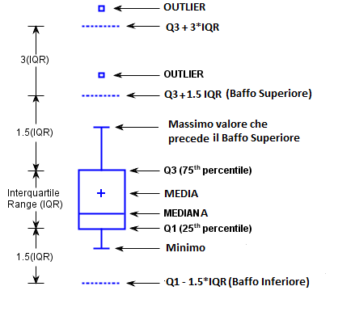
```

:::

## Dati continui: box-plot

Il [box-plot]{.orange} è un modo per rappresentare graficamente una distribuzione
rispetto a **centralità e variabilità**. Per un campione di ampiezza $n$

- Il segmento all'interno del box è la mediana.

- il **primo quartile** (h, o 25º percentile) è il bordo inferiore della scatola (box)

- il **terzo quartile** (H, o 75º percentile) è il bordo superiore della scatola

- l'ampiezza della scatola (box) è il **[Range Inter-Quartile]{.orange} (IQR)**, ovvero la differenza tra il III e il I quartile ($H - h$).

- i **baffi** arrivano fino al valore più lontano dalla scatola ma entro una volta e mezza l'IQR dai suoi bordi; i limiti $h - 1.5 \times (H-h)$ e $H + 1.5 \times (H-h)$ sono il baffo inferiore e superiore dello schema

- un **valore estremo** è: un valore oltre i baffi, cioè che si allontana dai bordi della scatola più di una volta
  e mezza l'IQR, cioè
$$x > H + 1.5 \times (H-h)  \quad o \quad x < h - 1.5 \times (H-h)$$

- un **valore anomalo** è: un valore che si allontana dai bordi della scatola più di tre volte l'IQR, cioè
$$x > H + 3 \times (H-h)  \quad o \quad x < h - 3 \times (H-h)$$

## Box-plot (calcolo)

Un'assunzione giornaliera di 43 mg/die di magnesio rappresenta un valore estremo

::: {.small}

::: {.small}

```{r, echo=FALSE, message=FALSE, warning=FALSE}
sort(epic$mag[101:200])
```


- $h$ è la media tra l'osservazione $(100 * 1/4)$ª e la $((100 * 1/4) + 1)$ª, ovvero
  $(215.3+215.4) / 2 = 215.35$
- $H$ è la media dell'osservazione $(100 * 3/4)$ª e la $((100 * 3/4) + 1)$ª, ovvero
  $(323.9+324) / 2 = 323.95$
- i limiti per i valori estremi sono quindi:
$$x > 323.95 + 1.5 * (323.95 - 215.35) = 486.85$$
$$x < 215.35 - 1.5 * (323.95 - 215.35) = 52.45$$

- i valori anomali sarebbero:
$$x > 323.95 + 3 * (323.95 - 215.35) = 649.75$$
$$x < 215.35 - 3 * (323.95 - 215.35) = -110.45$$
(valore negativo: un'assunzione non può essere negativa, quindi nessun valore anomalo inferiore)

:::

:::

## Box-plot (il grafico)

Il box-plot dei 100 valori di magnesio, con quartili e limiti calcolati come sopra (la regola dei percentili vista a lezione)

```{r mag-boxplot, echo=FALSE, fig.width=9, fig.height=4.2}
mag <- epic$mag[101:200]
mag_q <- quantile(mag, c(0.25, 0.5, 0.75), type = 2) # la regola vista a lezione
mag_iqr <- mag_q[[3]] - mag_q[[1]]
mag_lim <- c(mag_q[[1]] - 1.5 * mag_iqr, mag_q[[3]] + 1.5 * mag_iqr)
mag_lim3 <- c(mag_q[[1]] - 3 * mag_iqr, mag_q[[3]] + 3 * mag_iqr)
mag_in <- mag[mag >= mag_lim[[1]] & mag <= mag_lim[[2]]]
mag_baffi <- range(mag_in)
mag_fuori <- mag[mag < mag_lim[[1]] | mag > mag_lim[[2]]]

ggplot() +
  geom_vline(xintercept = mag_lim, linetype = "dashed", colour = "grey50") +
  annotate("text", x = mag_lim, y = 1.62, hjust = c(-0.05, 1.05), size = 3.2,
           colour = "grey35",
           label = c("estremi
h - 1.5 × IQR
= 52.45", "estremi
H + 1.5 × IQR
= 486.85")) +
  geom_vline(xintercept = mag_lim3, linetype = "dotted", colour = "#F28705",
             linewidth = 0.8) +
  annotate("text", x = mag_lim3, y = 1.62, hjust = c(-0.05, 1.05), size = 3.2,
           colour = "#C25E00",
           label = c("anomali
h - 3 × IQR
= -110.45", "anomali
H + 3 × IQR
= 649.75")) +
  geom_boxplot(
    aes(xmin = mag_baffi[[1]], xlower = mag_q[[1]], xmiddle = mag_q[[2]],
        xupper = mag_q[[3]], xmax = mag_baffi[[2]], y = 1),
    stat = "identity", orientation = "y", width = 0.4,
    fill = "#9FC4E7", colour = "royalblue4"
  ) +
  geom_point(aes(x = mean(mag), y = 1), shape = 3, size = 3,
             colour = "royalblue4") +
  geom_point(aes(x = mag_fuori, y = 1), colour = "#F28705", size = 3) +
  annotate("text", size = 3.5,
           x = c(mag_baffi[[1]], mag_q[[1]], mag_q[[2]], mag_q[[3]],
                 mag_baffi[[2]], mag_fuori),
           y = c(0.6, 1.27, 0.72, 1.27, 0.6, 1.13),
           hjust = c(rep(0.5, 5), rep(0.2, length(mag_fuori))),
           label = c(
             paste0("min. nei limiti\n", mag_baffi[[1]]),
             paste0("h = ", mag_q[[1]]),
             paste0("mediana\n", mag_q[[2]]),
             paste0("H = ", mag_q[[3]]),
             paste0("max. nei limiti\n", mag_baffi[[2]]),
             paste0("valore estremo: ", mag_fuori)
           )) +
  scale_y_continuous(limits = c(0.5, 1.75), breaks = NULL) +
  scale_x_continuous(breaks = seq(-100, 650, by = 50)) +
  labs(x = "Mag [mg/day]", y = NULL) +
  theme_minimal(base_size = 14)
```

::: {.small}
La croce è la media (`r round(mean(epic$mag[101:200]), 2)`). Tratteggiati i limiti per i valori estremi, punteggiati quelli per i valori anomali: nessun valore oltre questi ultimi, quindi nessun valore anomalo.
:::

## Dati discreti: barre

Volendo rappresentare confronti tra conteggi, possiamo usare grafici a
barre: ciascuna barra è il conteggio di un valore di una variabile
discreta (nominale, ordinale, dicotomica, o cardinale con pochi valori).

> ATTENZIONE 1: per una variabile continua si usa l'istogramma, che ne
  rappresenta la distribuzione; per una variabile discreta si usa il
  grafico a barre, che rappresenta i conteggi dei suoi valori!

> ATTENZIONE 2: in un grafico a barre, la base delle barre DEVE essere 
  sempre (ben!!) definita, ovvero deve SEMPRE iniziare dall'opportuno
  "zero" (per esempio da 1 per scale logaritmiche, da 0 per i conteggi
  classici)

---

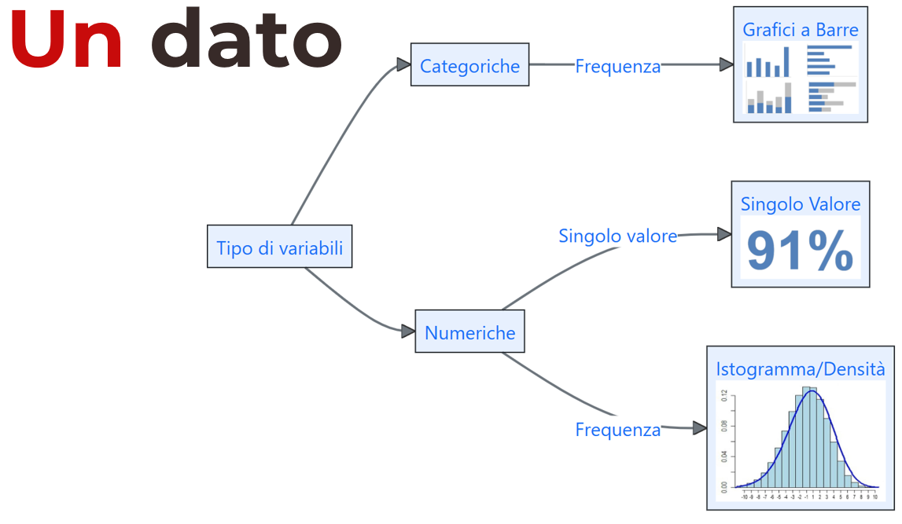

---

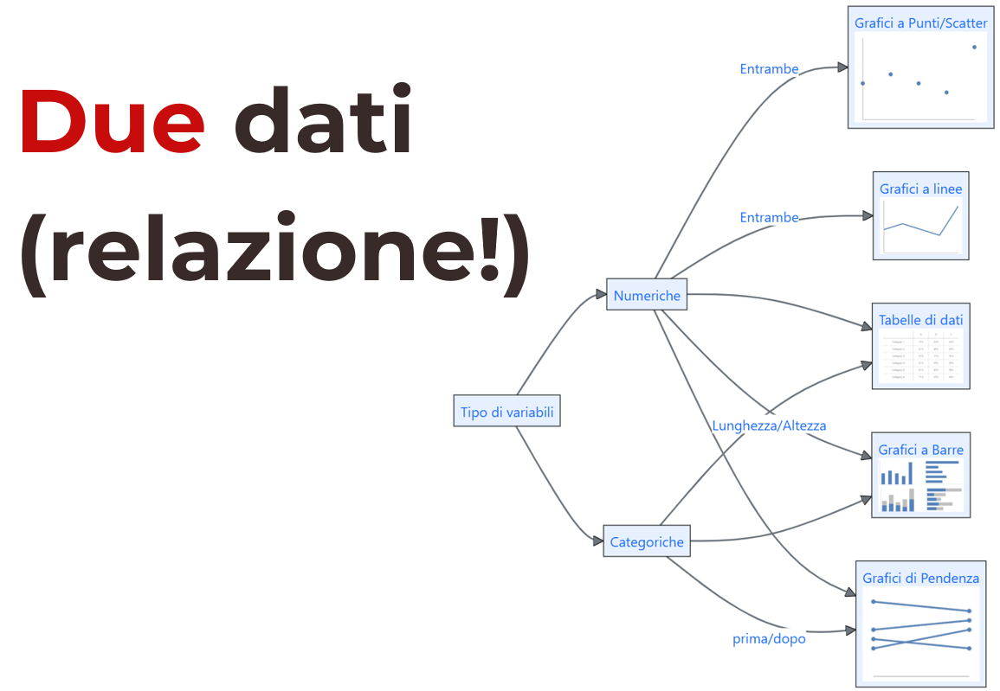

---

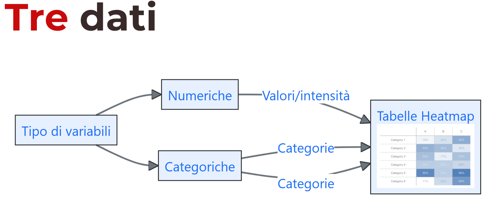

---

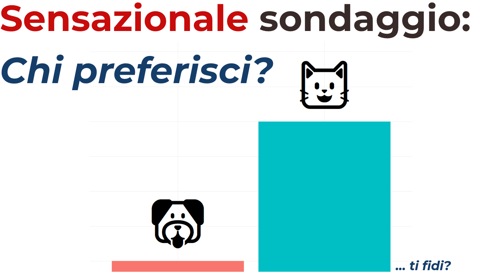

---

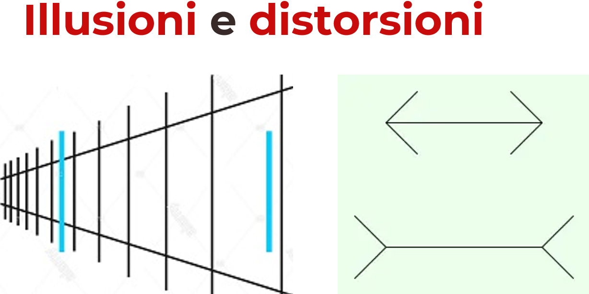

---

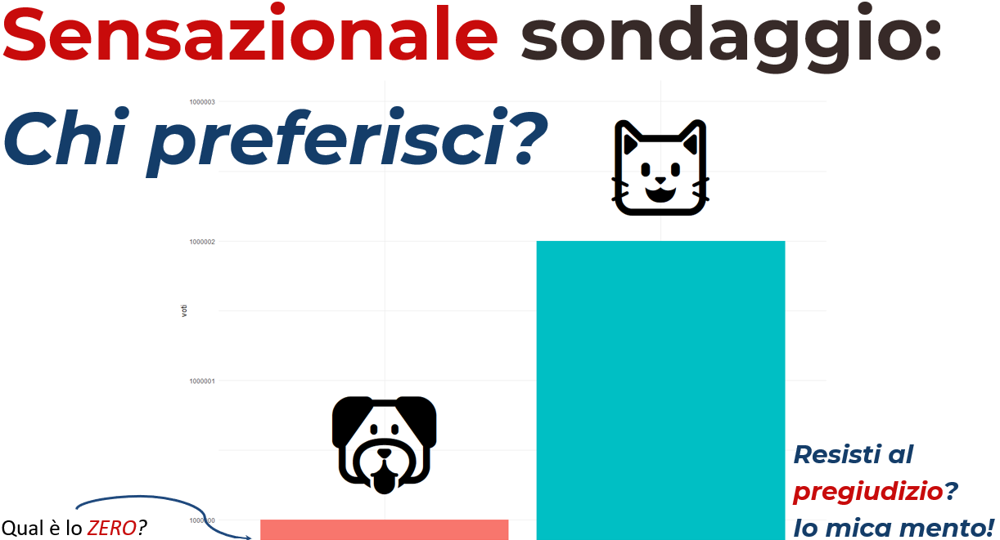

---

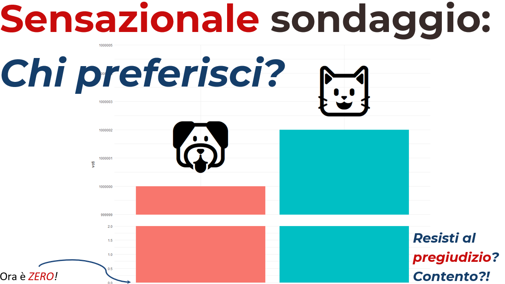

---

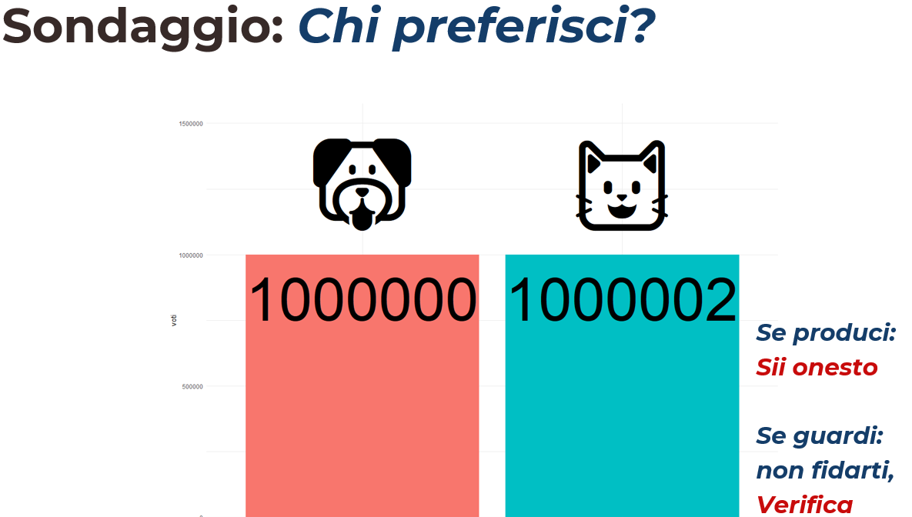

## Prima

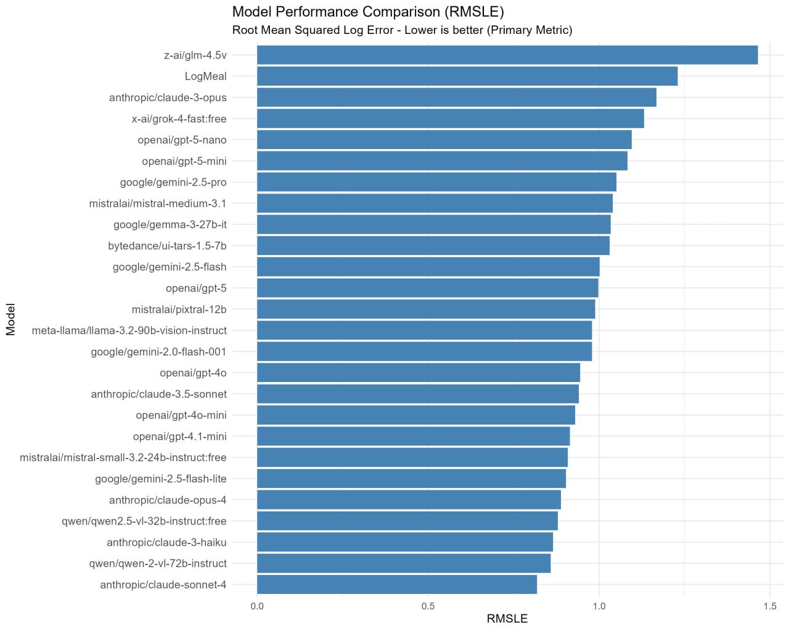

## Prima

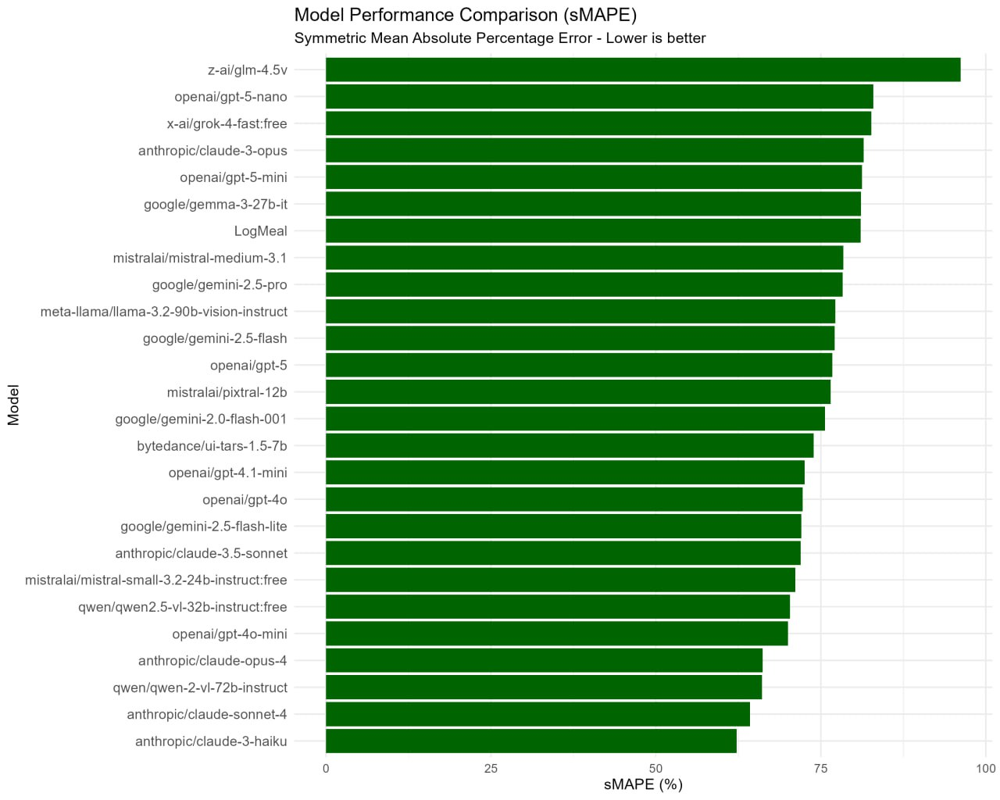

## Prima

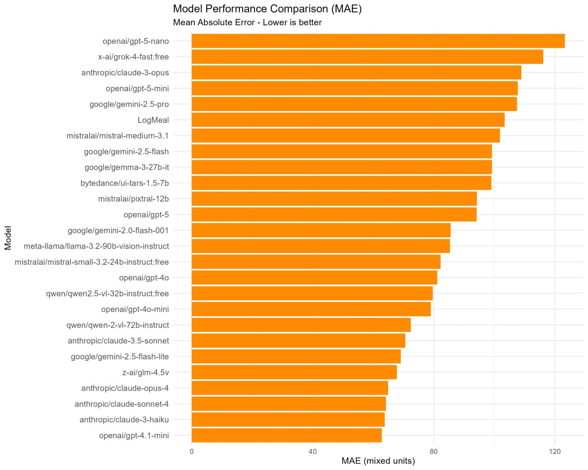

## Prima: tutti e tre insieme

:::: {.columns}

::: {.column width="33%"}

:::

::: {.column width="33%"}

:::

::: {.column width="33%"}

:::

::::

## Dopo

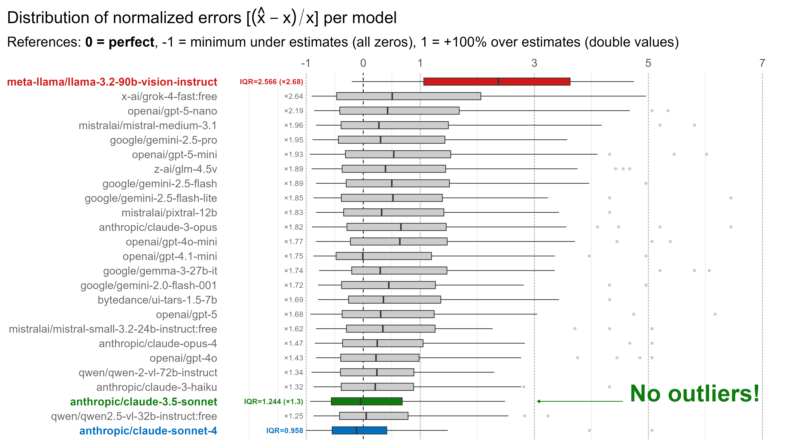

## [Sondaggio]{.orange} {.inverse .center background-color="#03A696"}

Per me: [Grafici](https://app.wooclap.com/events/STATMEDGRAFICI/0)

Per voi:  [bit.ly/statmed-sondaggio-grafici](https://bit.ly/statmed-sondaggio-grafici)





## Risorse utili {.inverse background-color="#03A696"}

- Broman KW, Woo KH. [Data Organization in Spreadsheets](https://doi.org/10.1080/00031305.2017.1375989). _The American Statistician_ 2018;72(1):2-10. Come organizzare i dati in un foglio di calcolo (dati ordinati).

- Wickham H. [Tidy Data](https://doi.org/10.18637/jss.v059.i10). _Journal of Statistical Software_ 2014;59(10). L'articolo che ha dato il nome ai dati ordinati (_tidy data_).

- [Statistica medica](https://www.maggiolieditore.it/statistica-medica.html) di [**Martin Bland**](https://www.york.ac.uk/healthsciences/our-staff/honoraryemeritus/martin-bland/), suggeriti capitoli 1, 4 e 5.
- _Fundamentals of Biostatistics_ (8ª ed., Cengage, 2016) di **Bernard Rosner**, suggerito il capitolo 2.

- [Perché n − 1 nella formula della deviazione standard
campionaria?](http://rdossena.altervista.org/Articoli/Book-Perch%E9%20n-1.pdf) di [Riccardo Dossena](http://rdossena.altervista.org) Traduzione dell'articolo **Book, S.A.**: _Why n − 1 in the formula for the sample standard deviation?_, The Two-Year College Mathematics Journal 10(5), 330–333 (1979)

## Fonti {.inverse background-color="#03A696"}

- Dati degli esempi della coorte EPIC-Norfolk: Bain LKM, Myint PK, Jennings A,
  Lentjes MAH, Luben RN, Khaw KT, Wareham NJ, Welch AA. [The relationship
  between dietary magnesium intake, stroke and its major risk factors,
  blood pressure and cholesterol, in the EPIC-Norfolk
  cohort](https://doi.org/10.1016/j.ijcard.2015.05.166). _International
  Journal of Cardiology_ 2015;196:108-114.

- Illustrazioni dei tipi di dati: [Allison Horst](https://allisonhorst.com).

## {.inverse .text-center .center background-color="#03A696"}

::: {.quote-box}

::: {.text-left}

_Mathematical conventions are just that, conventions. They differ by field of mathematics. Don’t ask us why **matrix rows** **[are numbered down]{.orange}** but **graphs** **[are numbered up]{.orange}** the **y axis**, nor why **x [comes before]{.orange} y** but **row [before]{.orange} column**. But the matrix layout has always seemed illogical to me._

:::


::: {.text-right}

—Brian D. Ripley<br>08/2004 - R-help<br>

:::

:::


### [Grazie]{.orange} per l'attenzione! {.big}


Diapositive: [bit.ly/cl-statmed](https://bit.ly/cl-statmed)


[`r fontawesome::fa("link")`](https://www.unipd-ubep.it/) [**www.unipd-ubep.it**](https://www.unipd-ubep.it/) | 
[`r fontawesome::fa("envelope")`](mailto:Corrado.Lanera@ubep.unipd.it) [**Corrado.Lanera@ubep.unipd.it**](mailto:Corrado.Lanera@ubep.unipd.it)

[`r fontawesome::fa("github")`](https://github.com/corradolanera)
[`r fontawesome::fa("twitter")`](https://twitter.com/corradolanera)
[`r fontawesome::fa("telegram")`](https://telegram.me/CorradoLanera)
**\@CorradoLanera** |
[`r fontawesome::fa("calendar-check")` ](https://bit.ly/statmed-cl-ricevimento) [**bit.ly/statmed-cl-ricevimento**](https://bit.ly/statmed-cl-ricevimento)
