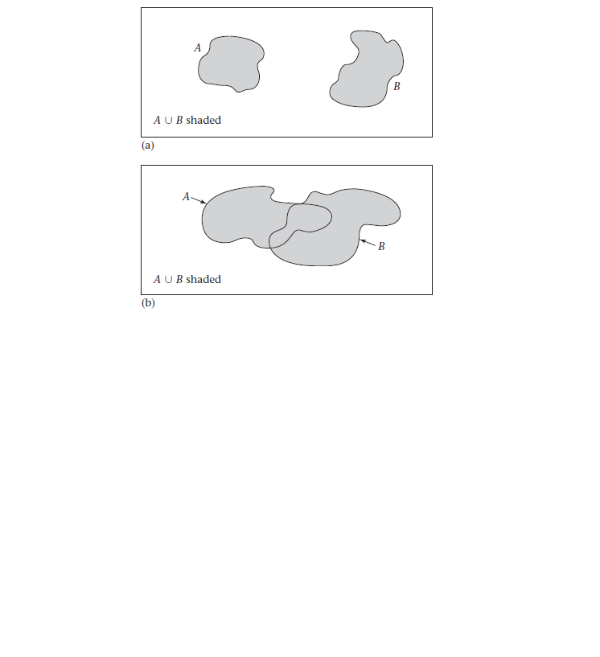
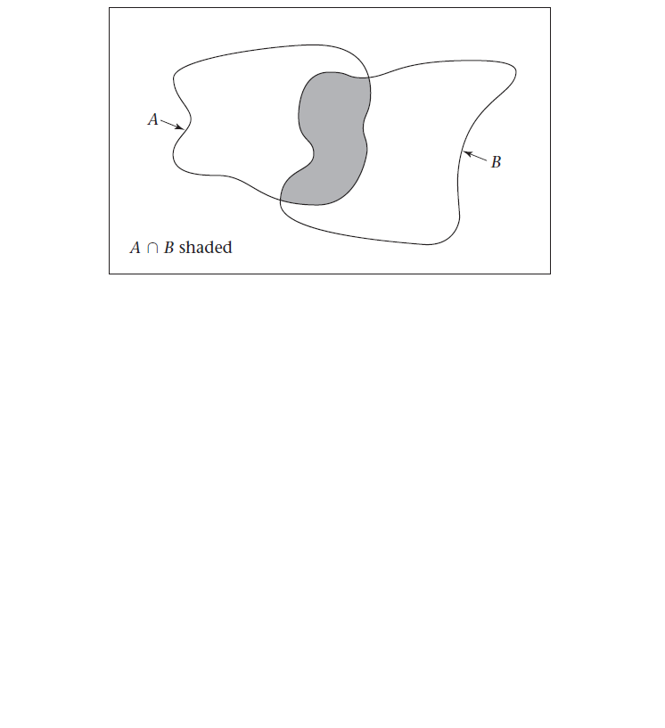
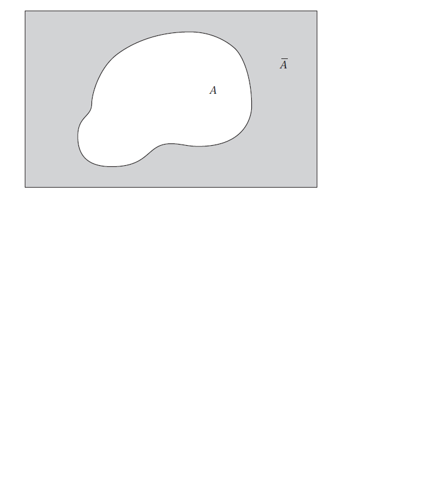
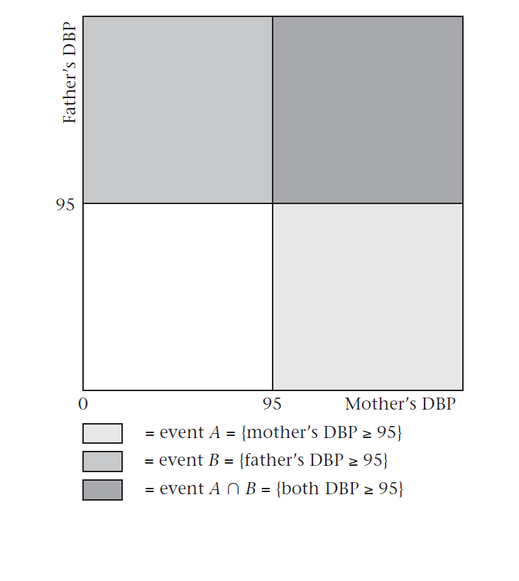
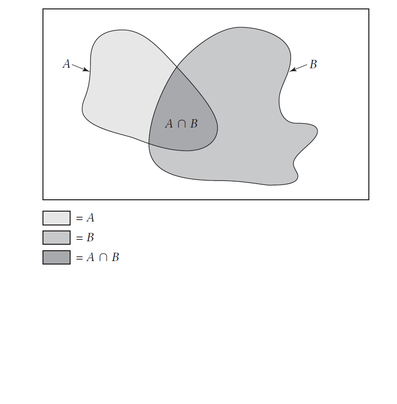
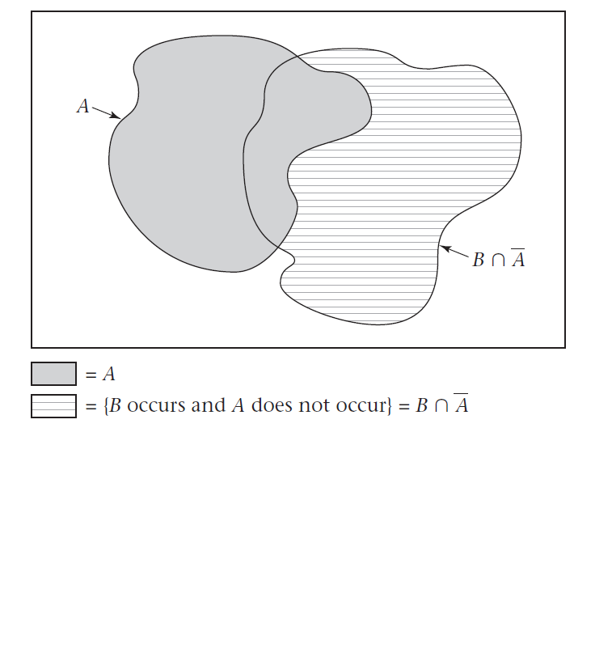

```{r setup, include=FALSE}
knitr::opts_chunk$set(
  fig.retina = 3,
  warning = FALSE,
  message = FALSE,
  comment = "",
  out.width = "100%"
)
library(knitr)

library(tidyverse)
library(here)
library(gridExtra)

library(countdown)
library(DT)

options(width = 59) # fit into the right-column slides

```

## Cosa faremo {.inverse background-color="#03A696"}

Inizieremo richiamando alcune definizioni e proprietà base della probabilità come il concetto di **[evento]{.orange}** e **[probabilità]{.orange}** stessa. 

Vedremo come questi elementi si combinano tra loro con le operazioni di base quali **[somma]{.orange}**, **[prodotto]{.orange}**, e **[complemento]{.orange}** (corrispondenti agli analoghi insiemistici di _unione_, _intersezione_, e _complementare_). In particolare introdurremo il concetto di **[indipendenza]{.orange}** e vedremo come questo interagisce con le operazioni base.

A questo punto saremo pronti per introdurre la parte interessante della probabilità, ovvero come la conoscenza del verificarsi di un dato evento **[condizioni]{.orange}** la nostra conoscenza sulla probabilità del verificarsi di un altro. Ne vedremo una prima applicazione al caso dei **[rischi relativi]{.orange}** e alle misure di valutazione per i **[test di screening]{.orange}**.

Quest'ultime ci daranno il pretesto per apprezzare la differenza fondamentale, quando siamo di fronte a due eventi, tra quello eventualmente noto e quello ignoto, e come poter _girare_ i condizionamenti tramite il **[teorema di Bayes]{.orange}** in modo da poter calcolare le misure che ci interessano (e non possiamo conoscere a priori) a partire da quelle che conosciamo (o possiamo conoscere a priori), anche quando i test sono due, fatti uno dopo l'altro.

## [Riconoscimenti]{.orange}

- Le diapositive proposte sono state prodotte a partire anche da
  materiale generato da/con le seguenti persone gravitanti attorno
  all'UBEP*:
  
  + Danila Azzolina
  + Dario Gregori
  + Giulia Lorenzoni
  + Honoria Ocagli
  + Ileana Baldi
  + Luca Vedovelli
  + Matteo Martinato
  + Paola Berchialla

<br><br>

::: {.small}

::: {.text-right}

\* In ordine alfabetico.

:::

:::

<br><br>

> Un ringraziamento speciale a Cristiana Vettori per
l'aiuto e il supporto logistico e amministrativo che mi è stato offerto.

## **[Panoramica]{.orange}** {.text-center .inverse .center background-color="#03A696"}

**Definizioni**,  **proprietà** e **notazioni** fondamentali

**Operazioni** base tra eventi

**Condizionamento**, **rischio relativo**, e misure per **test di screening**

**Teorema di Bayes**

## **[Definizioni]{.orange}, [proprietà]{.orange} e [notazioni]{.orange} fondamentali** {.text-center .inverse .center background-color="#03A696"}

- **Eventi** e **probabilità**

- Eventi **mutuamente esclusivi**

- **Intersezione**, **unione**, e **complemento**

## [Definizione]{.orange}: evento e probabilità

Lo **spazio degli eventi** $\Omega$ è l'insieme di tutti i possibili risultati di un esperimento probabilistico.

Un **evento** è un qualsiasi insieme di risultati di un esperimento probabilistico (ovvero, un sottoinsieme di $\Omega$ ).

Un **risultato** di un esperimento probabilistico _verifica_ un evento se ne fa parte.

La **probabilità** di un evento è la [frequenza relativa]{.orange} dei risultati che lo definiscono, valutata su **infinite ripetizioni** dell'esperimento probabilistico.

> Es.: 

- Esperimento: misura della pressione diastolica (DBP) di una persona presa a caso, in un determinato momento, nella popolazione.
- Spazio degli eventi $\Omega$: ogni possibile misura di DBP.
- Evento $A$ : DBP $\geq 95$ mmHg.
- Risultato (mio, ora): DBP $= 70$ mmHg. (Non fa parte dell'evento, quindi non lo verifica)
- Probabilità di $A$ : misurando la DBP, ora, a tutta la popolazione, la porzione di persone con DBP $\geq 95$ mmHg.

## [Proprietà]{.orange}: eventi mutuamente esclusivi

La probabilità di un evento $E$, indicata come $P(E)$, soddisfa [sempre]{.orange} la condizione

$$0 \leq P(E) \leq 1$$

Se $A$ e $B$ sono due eventi che [non possono]{.orange} verificarsi [contemporaneamente]{.orange}, allora si ha che

$$P(\textrm{si verifichi } A \textrm{ o che si verifichi } B) = P(A) + P(B)$$

##### Esempio:

- $A$ l'evento DBP normale ( $\mbox{DBP} < 90$ )
- $B$ l'evento DBP borderline ( $90\leq \mbox{DBP} < 95$ )
- $C$ l'evento DBP $< 95$.

**Se**:

- $P(A)=0.7$
- $P(B)=0.1$

**Allora**: $P(C) = P(A) + P(B) = 0.7 + 0.1 = 0.8$.

## [Proprietà]{.orange}: eventi mutuamente esclusivi

Due eventi $A$ e $B$ si dicono **mutuamente esclusivi** se [non possono]{.orange} verificarsi [contemporaneamente]{.orange}.

##### Esempio

**Siano**:

- $x$ la DBP.
- $C$ l'evento ( $x \geq 90$ )
- $D$ l'evento ( $75\leq x\leq 100$ ).

**Allora** in questo caso:

$C$ e $D$ **non** sono mutuamente esclusivi, in quanto entrambi si
verificano quando $90 \leq x \leq 100$.

## [Notazione]{.orange}: unione

- il simbolo $\{ \}$ si usa per indicare un evento
- il simbolo $\cup$ si usa come operatore per indicare l'evento unione $A \cup B$, ovvero tale per cui si verifichi $A$ o $B$ (o entrambi).

##### Esempio

**Sia** ( $x$ la DBP): 

- $A = \{x < 90 \}$
- $B = \{90 \leq x < 95 \}$
- $C = \{ x \geq 90 \}$
- $D = \{75 \leq x \leq 100 \}$

**Allora**:

$$A \cup B = \{ x < 95 \}$$

$$C \cup D = \{ x \geq 75 \}$$

## [Eventi e spazio]{.orange} $\Omega$

```{r, echo=FALSE, out.width="100%"}

```

## [Notazione]{.orange}: intersezione

Il simbolo $\cap$ indica l'evento $A \cap B$, per cui sia $A$ che $B$ si verificano [contemporaneamente]{.orange}.

##### Esempio

**Dati** ( $x$ la DBP):

- $C = \{x\geq 90\}$
- $D = \{75 \leq x \leq 100 \}$

**Allora**:

$$C \cap D = \{90 \leq x \leq 100  \}$$

## [Intersezione]{.orange} di eventi

```{r, echo=FALSE, out.width="100%"}

```

## [Notazione]{.orange}: complemento

Con $\bar{A}$ si indica l'evento per cui $A$ non si verifica e si chiama
[complemento]{.orange} di $A$.

Vale **sempre**:

$$P(\bar{A}) = 1-P(A)$$

##### Esempio


**Dati** ( $x$ la DBP):

- $A = \{x < 90 \}$, con $P(A) = 0.7$
- $C =\{x \geq 90 \}$

**Allora**:

$$\bar{A}=C$$

**Da cui**:

$$P(C) = P(\bar{A}) = 1-0.7 = 0.3$$

## Evento [complementare]{.orange}

```{r, echo=FALSE, out.width="100%"}

```



## **[Operazioni]{.orange} di base** {.text-center .inverse .center background-color="#03A696"}

- **Prodotto** (e **indipendenza**)

- **Somma** (e **indipendenza**)

## [Prodotto]{.orange}: indipendenza

Due eventi sono [indipendenti]{.orange} se 

$$P(A \cap B) = P(A)P(B)$$

### Teorema del [prodotto]{.orange}

**Se**: $A_1, \ldots, A_k$ sono [mutuamente indipendenti]{.orange}

**Allora**: $P(A_1 \cap A_2 \cap \ldots \cap A_k) = P(A_1)P(A_2)\ldots P(A_k)$

## [Prodotto]{.orange}: esempio

Si considerino gli eventi

- $A=\{\mbox{DBP madre}\geq 95\}$ 
- $B=\{\mbox{DBP padre}\geq 95\}$

con probabilità

- $P(A \cap B) = 0.05$
- $P(A) = 0.1$
- $P(B) = 0.2$

**Allora**:

$$P(A \cap B) = 0.05 > 0.02 = P(A)P(B)$$

Per cui gli eventi **non sono indipendenti**, ovvero sono [dipendenti]{.orange}.

## [indipendenza]{.orange}

```{r, echo=FALSE, out.width="60%"}

```

## Teorema della [somma]{.orange}

**Siano**:

- $A$ e $B$ due eventi [qualsiasi]{.orange}

**Allora**:

$$P(A \cup B) = P(A)+P(B)-P(A\cap B)$$

## [Teorema della somma]{.orange}: es.

Due medici, $A$ e $B$, diagnosticano tutti i pazienti afferenti a un centro per le malattie a trasmissione sessuale.

**Siano**:

- $A^+$ l'evento per cui il medico $A$ fa diagnosi [positiva]{.orange}
- $B^+$ l'evento per cui il medico $B$ fa diagnosi [positiva]{.orange}

con:

- $P(A^+)=0.1$
- $P(B^+)=0.17$
- $P(A^+ \cap B^+)=0.08$.

Si supponga che un paziente sia riferito per test laboratoristici supplementari se in presenza di **almeno una** diagnosi positiva.

La [probabilità che]{.orange} un paziente [venga riferito]{.orange} ai laboratori è

$$P(A^+ \cup B^+) = P(A^+) + P(B^+) - P(A^+ \cap B^+) = 0.1+0.17-0.08=0.19$$

## [Somma]{.orange}

```{r, echo=FALSE, out.width="100%"}

```

## [Somma]{.orange}: indipendenza

**Sempre** (indipendenti o no):

$$P(A \cup B) = P(A) + P(B \cap \bar{A})$$

perché $A$ e $B \cap \bar{A}$ sono [incompatibili]{.orange} (figura nella slide seguente).

**Se** $A$ e $B$ sono **[indipendenti]{.orange}** (allora lo sono anche $\bar{A}$ e $B$):

$$P(B \cap \bar{A}) = P(B)P(\bar{A})$$

**quindi**:

$$P(A \cup B) = P(A) + P(B)[1 - P(A)]$$

## Somma [indipendente]{.orange}

```{r, echo=FALSE, out.width="80%"}

```

## Somma eventi [indipendenti]{.orange}: esempio

Si considerino gli eventi

- $P(A)=P(\{\mbox{DBP madre}\geq 95 \})=0.1$ 
- $P(B)=P(\{\mbox{DBP padre}\geq 95 \})=0.2$

Si definisca come **famiglia ipertesa** quella in cui [almeno uno]{.orange} dei genitori è iperteso.

**Allora** (ipotizzando $A$ e $B$ indipendenti):

$$\begin{split} P(\{\mbox{famiglia ipertesa}\})& = P(A \cup B)\\&= P(A) + P(B\cap\bar{A}) \quad \mbox{(sempre)}\\&= P(A) + P(B)P(\bar{A}) \quad \mbox{(indipendenza)}\\& = P(A) +  P(B)[1-P(A)]\\& = 0.1 + (0.2)[1-0.1]\\& = 0.28\end{split}$$

## [Sondaggio]{.orange} {.inverse .center background-color="#03A696"}

Per me: [Probabilità](https://app.wooclap.com/events/STATMEDPROB/0)

Per voi:  [bit.ly/statmed-sondaggio-prob](https://bit.ly/statmed-sondaggio-prob)



## [Break]{.orange} {.text-center .inverse .text-center .center background-color="#03A696"}

::: {.text-left}

- sgranchirsi
- guardare _lontano_ (rilassare gli occhi)
- bere
- andare in bagno

:::


```{r, echo = FALSE}
countdown(minutes = 15, warn_when = 3, play_sound = TRUE,
          left = "70%", bottom = "20%")
```

## **[Condizionamento]{.orange},<br>[rischio relativo]{.orange},<br>misure per [test di screening]{.orange}** {.text-center .inverse .center background-color="#03A696"}

- **Condizionamento**

- **Rischio relativo**

- **Sensibilità**, **specificità** e **valori predittivi**

## [Condizionamento]{.orange}: definizione

La **[probabilità condizionata]{.orange}** $P(B|A)$ (con $P(A) > 0$) è definita come

$$P(B|A)=\frac{P(A \cap B)}{P(A)}$$

**Se** due eventi sono [indipendenti]{.orange}, **allora**


$$P(B|A)=P(B|\bar{A})=P(B)$$

Al contrario, **se** due eventi sono [dipendenti]{.orange}, **allora**

$$P(B) \neq P(B|A) \neq P(B|\bar{A}) \neq P(B)$$
$$P(A \cap B) \neq P(A)P(B)$$

## [Condizionamento]{.orange}: proprietà

Per qualsiasi evento $A$ e $B$ (con $0 < P(A) < 1$), si ha che

$$P(B) = P(B|A)P(A)+P(B|\bar{A})P(\bar{A})$$


che si deriva considerando che

$$P(B) = P(B\cap A)+P(B \cap \bar{A})$$
e ricordando la definizione
$$P(B|A)=\frac{P(A \cap B)}{P(A)}$$

da cui

$$P(A \cap B) = P(B|A)P(A)$$

## [Condizionamento]{.orange}: esempio

Si ipotizzi che:

- **1 persona su 100** con skin test (SKT) [positivo]{.orange} abbia la tubercolosi (TB)
- **1 persona ogni 10000** con SKT [negativo]{.orange} abbia la TB
- l'1\% della popolazione abbia SKT positivo

**Si calcoli** la [probabilità di tubercolosi (TB) nella popolazione]{.orange} $P(TB)$, ovvero, si stimi la porzione di malati di tubercolosi nella popolazione (chiamata: la **prevalenza** della malattia)

**Soluzione**
$$\begin{split}P(TB)& =P(TB|SKT^+)P(SKT^+) + P(TB|SKT^-)P(SKT^-)\\& = (0.01)(0.01) + (0.0001)(1-0.01)\\& = 0.000199\end{split}$$

## Teorema delle [probabilità totali]{.orange}

Un insieme di eventi $\mathscr{A} = \{A_1, \ldots, A_k\}$ è detto **[esaustivo]{.orange}** se almeno uno di tali eventi **deve** verificarsi.

**Sia** $\mathscr{A} = \{A_1, \ldots, A_k\}$ un insieme [esaustivo]{.orange} di eventi [mutuamente esclusivi]{.orange}.

**Allora**, per qualunque evento $B$, la probabilità di $B$, $P(B)$, può essere scritta come:

$$\begin{split}P(B)& =\sum_{i=1}^k P(B|A_i)P(A_i)\\&\\&=\sum_{A\in \mathscr{A}} P(B|A)P(A)\end{split}$$
Ovvero, la **somma pesata** delle probabilità condizionali di $B$ dato $A_i$, $P(B|A_i)$ per le corrispondenti probabilità degli $A_i$ al variare di $i$ tra $1$ e $k$.

## [Probabilità totali]{.orange}: esempio problema

```{r, echo = FALSE}
countdown(minutes = 3, warn_when = 1, play_sound = TRUE,
          left = "70%", bottom = "10%")
```


::: {.panel-tabset}

### Problema

::: {.small}

Si vuole pianificare uno studio sulla [cataratta]{.orange} in una popolazione di **5000 persone** di età superiore a 60 anni.

Dal censimento è noto che la probabilità di appartenere a una delle seguenti classi di età 60-64, 65-69, 70-74, $\geq 75$ è pari rispettivamente a 0.45, 0.28, 0.20, 0.07.

Dal Framingham Eye Study è noto che la probabilità di sviluppare una cataratta a 5 anni di distanza è pari, rispettivamente per le classi di età indicate, a 0.024, 0.046, 0.088, 0.153.

Si vuole conoscere **la percentuale di persone che potrebbe sviluppare una cataratta nei prossimi 5 anni**, e una stima del loro numero.

```{r, echo=FALSE}
cataratta <- tibble::tibble(
  classe = c("60-64", "65-69", "70-74", "75+"),
  p_classe = c(0.45, 0.28, 0.20, 0.07),
  p_cataratta5y_classe = c(0.024, 0.046, 0.088, 0.153)
)
knitr::kable(cataratta)
```

:::


### Soluzione

La percentuale di popolazione (o probabilità, su tale popolazione) $P(B)$ per l'evento $B$ di sviluppare cataratta a 5 anni equivale, per il teorema delle [probabilità totali]{.orange}, alla somma delle probabilità di svilupparla per ciascuna classe di età (che rappresentano un insieme **esaustivo** a elementi **mutuamente disgiunti**) pesate per la probabilità di appartenere a tali classi.


### Conti

::: {.small}

```{r, echo=FALSE}
tibble::tibble(
  insieme = paste0("A_", 1:4),
  classe = c("60-64", "65-69", "70-74", "75+"),
  p_classe = c(0.45, 0.28, 0.20, 0.07),
  p_cataratta5y_classe = c(0.024, 0.046, 0.088, 0.153)
) |> 
  knitr::kable()
```


Per esempio:

- Probabilità di sviluppo cataratta a 5 anni **se** nella classe "60-64": $P(B|A_1) = 0.024$
- Probabilità di appartenere alla classe "60-64": $P(A_1) = 0.45$

$$\begin{split}P(B)& = \sum_{i=1}^4 P(B|A_i)P(A_i)\\& =
(0.024)(0.45)+\ldots+(0.153)(0.07)\\& \simeq 0.052\end{split}$$

e il numero stimato di persone con cataratta sarà: $5000 \times 0.052 \simeq 260$ persone.

:::

```{r, include=FALSE}
p_cataratta5y <- sum(
    cataratta$p_classe * cataratta$p_cataratta5y_classe
  ) |> 
  round(3)
p_cataratta5y

5000 * p_cataratta5y
```

:::

## [Rischio relativo]{.orange}

Il rischio relativo (**RR**) di osservare, in una data popolazione, un evento $B$ su chi è esposto a un fattore $A$ rispetto a chi non ne è esposto ( $\bar{A}$ ) è definito, tramite [probabilità condizionate]{.orange}, come

$$\frac{P(B|A)}{P(B|\bar{A})}$$
> NOTA:
>
> **Se**: $A$ e $B$ sono [indipendenti]{.orange}
> 
> **Allora**:  $RR = 1$ (infatti $P(B|A) = P(B|\bar{A}) = P(B)$ )

## [Rischio relativo]{.orange}: esempio

Si ipotizzi che:

- **1 persona su 100** con skin test (SKT) [positivo]{.orange} abbia la tubercolosi (TB)
- **1 persona ogni 10000** con SKT [negativo]{.orange} abbia la TB

Il rischio relativo di avere la TB nel caso di un test positivo rispetto a un test negativo è

$$RR=\frac{P(B|A)}{P(B|\bar{A})}=\frac{1/100}{1/10000}=\frac{0.01}{0.0001}=100$$

dove abbiamo indicato con $B$ l'evento di avere la TB, e con $A$ quello di avere un test positivo (ovvero con $\bar{A}$ di averlo negativo).

## [Rischio relativo]{.orange}: attenzione al gonfiaggio

Il RR dice **quante volte** è più probabile l'evento, non **quanti** casi in più ci sono. Va letto insieme al rischio di partenza, $P(B \mid \bar{A})$.

- **Esempio della TB**: $RR = 100$, eppure fra i positivi allo skin test solo **1 su 100** ha la TB ($P(TB \mid SKT^+) = 0.01$); gli altri 99 no.

- **Il caso tipico degli articoli**: il rischio passa da 1 su 10000 a 2 su 10000.

  $$RR = \frac{2/10000}{1/10000} = 2$$

  «Il rischio raddoppia!», ma è **1 caso in più ogni 10000** persone.

## [Rischio relativo]{.orange}: esempio problema

```{r, echo = FALSE}
countdown(minutes = 3, warn_when = 1, play_sound = TRUE,
          left = "70%", bottom = "5%")
```


::: {.panel-tabset}

### Problema

Per i dati sul centro delle malattie a trasmissione sessuale, si è 
interessati a calcolare:

- la probabilità che il medico $B$ faccia diagnosi positiva data la diagnosi positiva del medico $A$
- il corrispondente rischio relativo.

Ricordando che

- $P(A^+) = 0.1$
- $P(B^+) = 0.17$
- $P(A^+ \cap B^+) = 0.08$


### Soluzione $P(B^+|A^+)$

Partendo da $P(A \cap B) = P(B|A)P(A)$ otteniamo:


:::: {.columns}

::: {.column width="22%"}

- $P(A^+)=0.1$
- $P(B^+)=0.17$
- $P(A^+ \cap B^+)=0.08$

:::

::: {.column width="75%"}

::: {.text-right}

$$\begin{split}P(B^+|A^+)& = \frac{P(B^+\cap A^+)}{P(A^+)}\\& = 0.08/0.1\\& = 0.8\end{split}$$

:::

:::

::::


### Soluzione RR

:::: {.columns}

::: {.column width="22%"}

::: {.middle}

- $P(A^+)=0.1$
- $P(B^+)=0.17$
- $P(A^+ \cap B^+)=0.08$
- $P(B^+|A^+) = 0.8$


<br>
<br>
<br>
<br>
<br>

> Ricordiamo: $P(B^+)=P(B^+ \cap A^+)+P(B^+ \cap A^-)$

:::

:::

::: {.column width="75%"}

::: {.text-right}

$$\begin{split}P(B^+|A^-)& = \frac{P(B^+\cap A^-)}{P(A^-)}\\& = \frac{P(B^+)-P(B^+\cap A^+)}
{P(A^-)}\\& =\frac{0.17-0.08}{0.9}\\& = 0.1\end{split}$$


::: {.text-left}

$$RR=\frac{P(B^+|A^+)}{P(B^+|A^-)}=\frac{0.8}{0.1}=8$$

:::

:::

:::

::::

:::

## [Test di screening]{.orange}: valori predittivi

Il **valore predittivo positivo** (o anche **precisione**) $PV^+$ di un test di screening è la probabilità che la persona abbia la malattia dato un test positivo

$$PV^+ = P(\mbox{malattia}|\mbox{test}^+)$$

Il **valore predittivo negativo** $PV^-$ di un test di screening è la probabilità che la persona **[non]{.orange}** abbia la malattia dato un test negativo

$$PV^- = P(\mbox{no malattia}|\mbox{test}^-)$$

Per esempio, nel caso della tubercolina si ha che

$$P(TB|SKT^+) = 0.01 = PV^+$$

$$P(\bar{TB}|SKT^-) = 1-P(TB|SKT^-) = 0.9999 = PV^-$$

## [Test di screening]{.orange}: sensibilità e specificità

La **sensibilità** (o anche **richiamo**) di un test o un sintomo è la probabilità di essere [positivo]{.orange} al test quando si è [malati]{.orange}

$$\mbox{sens} = P(\mbox{test}^+|\mbox{malattia})$$

La **specificità** di un test o un sintomo è la probabilità di essere [negativo]{.orange} al test quando si è [sani]{.orange}

$$\mbox{spec} = P(\mbox{test}^-|\mbox{no malattia})$$

Si definisce:

- **falso negativo** la persona [malata]{.orange} che ha un [test negativo]{.orange}
- **falso positivo** la persona [sana]{.orange} che ha un test [positivo]{.orange}

## [Test di screening]{.orange}: esempi

:::: {.columns}

::: {.column width="48%"}

Si ipotizzi che:

- la [malattia]{.orange} sia: il cancro al polmone

- il "[test]{.orange}" sia: il fumo di sigarette

- la probabilità di fumare per un soggetto [malato]{.orange} sia pari a: 0.90

- la probabilità di fumare per un soggetto [sano]{.orange} sia pari a: 0.50

**Allora**, per il _test_ fumo di sigarette rispetto al(la _malattia_) cancro polmonare:

- [sensibilità]{.orange} (o richiamo) = 0.90
- [specificità]{.orange} = 0.5 ( $1 - 0.5$ ) 

:::

::: {.column width="48%"}

Si ipotizzi che:

- la [malattia]{.orange} sia: il cancro al seno nelle donne
- il [sintomo]{.orange} sia la familiarità per tumore al seno (madre o sorella con il cancro al seno)
- la probabilità di avere familiarità per la malattia per una donna [malata]{.orange} sia pari a: 0.05
- la probabilità di avere familiarità per la malattia per una donna [sana]{.orange} sia pari a: 0.02

**Allora**, per il _sintomo_ familiarità rispetto al(la _malattia_) cancro al seno nelle donne:

- [sensibilità]{.orange} (o richiamo) = 0.05
- [specificità]{.orange} = 0.98 ( $1 - 0.02$ ) 

:::

::::



## Teorema di **Bayes** {.text-center .inverse .center background-color="#03A696"}

- **Enunciato** base con traccia di **derivazione** ed **esempi**

- **Due test in sequenza**: il $PV^+$ del primo diventa la probabilità a priori del secondo

## [Teorema di Bayes]{.orange}: base

$$(PV^+ = )\ P(M|T) = \frac{P(T|M)P(M)}{P(T)} = \frac{P(T|M)P(M)}{P(T|M)P(M)+P(T|\bar{M})P(\bar{M})}$$


**Siano**: $T$ _test positivo_ e $M$ _avere la malattia_

**Dati**: $\mbox{SENS} = P(T|M) \quad \mbox{SPEC} = P(\bar{T}|\bar{M})$

**Considerando che**: $\mbox{1 - SENS} = P(\bar{T}|M) \quad \mbox{1 - SPEC} = P(T|\bar{M})$

**Calcoliamo**: $PV^+ = P(M|T) \quad PV^-=P(\bar{M}|\bar{T})$

> Nota: [In assenza di altre informazioni]{.orange}, $P(M)$ è la **prevalenza** della malattia nella popolazione di 
riferimento

$$PV^+=\frac{SENS\cdot prev}{(SENS\cdot prev) + (1- SPEC)\cdot(1 - prev)}$$
$$PV^-=\frac{SPEC\cdot(1 - prev)}{SPEC\cdot(1 - prev) + (1- SENS)\cdot prev}$$

## [Teorema di Bayes]{.orange}: derivazione

Dalla definizione di [probabilità condizionata]{.orange} si ha che

$$P(M|T) := \frac{P(M \cap T)}{P(T)} \quad\quad P(M \cap T) = P(T \cap M) = P(T|M)P(M)$$

Dal teorema delle [probabilità totali]{.orange} si ha che

$$P(T)=P(T|M)P(M)+P(T|\bar{M})P(\bar{M})$$
Sostituendo:

$$(PV^+ = )\ P(M|T) = \frac{P(T|M)P(M)}{P(T|M)P(M)+P(T|\bar{M})P(\bar{M})}$$

## [Teorema di Bayes]{.orange}: esempio

```{r, echo = FALSE}
countdown(minutes = 5, warn_when = 1, play_sound = TRUE,
          left = "70%", bottom = "5%")
```


::: {.panel-tabset}

### Problema

**Si ipotizzi** che:

- la probabilità che un iperteso sia [correttamente classificato]{.orange} come tale da una macchina per la misurazione automatica della pressione sia pari a 0.84
- la probabilità che un normoteso sia [erroneamente classificato]{.orange} come iperteso, sia pari a 0.23.
- la prevalenza dell'ipertensione nella popolazione è del 20\%

**Si calcolino**: i valori predittivi (positivo e negativo) della macchina.


### Soluzione PV+

Dai dati:

- **sensibilità** = 0.84
- **specificità** = 1 - 0.23 = 0.77
- **prevalenza** = 0.2 (20\%)

Dal teorema di Bayes:


$$\begin{split}PV^+& = \frac{SENS\cdot prev}{(SENS\cdot prev) + (1- SPEC)\cdot(1 - prev)}\\& =  \frac{(0.84)0.2}{(0.84)0.2 + (0.23)0.8}\\& = \frac{0.168}{0.352}\\& = 0.48\end{split}$$


### Soluzione PV-

Dai dati:

- **sensibilità** = 0.84
- **specificità** = 1 - 0.23 = 0.77
- **prevalenza** = 0.2 (20\%)

Dal teorema di Bayes:

$$\begin{split}PV^-& = \frac{SPEC\cdot(1 - prev)}{SPEC\cdot(1 - prev) + (1- SENS)\cdot prev}\\& = \frac{(0.77)0.8}{(0.77)0.8 + (0.16)0.2}\\& = \frac{0.616}{0.648}\\& = 0.95\end{split}$$


### Nota sui conteggi

$VP/(VP+FP)$ (veri positivi su tutti i positivi) calcolato su una tabella dà il VPP giusto **solo se** la prevalenza della tabella è quella della popolazione su cui usate il test.

Per esempio, provando la macchina su 100 ipertesi e 100 normotesi (prevalenza 0.5 nella tabella): $VP = 84$, $FP = 23$, $VP/(VP+FP) = 84/107 = 0.79$. Nella popolazione, con prevalenza 0.2, il $PV^+$ è 0.48.

Con Bayes la prevalenza la scegliete voi.

:::

## [Sondaggio]{.orange} {.inverse .center background-color="#03A696"}

Per me: [Bayes](https://app.wooclap.com/events/STATMEDBAYES/0)

Per voi:  [bit.ly/statmed-sondaggio-bayes](https://bit.ly/statmed-sondaggio-bayes)

## [Teorema di Bayes]{.orange}: due test in sequenza

Dopo un primo test positivo, la probabilità di malattia non è più la prevalenza: è il $PV^+$ del primo test.

Per un **secondo test** si usa di nuovo Bayes, con il $PV^+$ del primo al posto della prevalenza (la probabilità **a priori**). Con $T_1$ e $T_2$ primo e secondo test positivi:

$$P(M \mid T_1 \cap T_2) = \frac{SENS_2 \cdot PV^+_1}{SENS_2 \cdot PV^+_1 + (1 - SPEC_2)\cdot(1 - PV^+_1)}$$

**Ipotesi**: a parità di stato di malattia, i due test sbagliano [indipendentemente]{.orange} l'uno dall'altro (**indipendenza condizionata**). Per esempio, fra i malati: $P(T_2 \mid M \cap T_1) = P(T_2 \mid M)$.

Con lo **stesso strumento ripetuto** di solito l'ipotesi non vale: chi è classificato male la prima volta tende a esserlo anche la seconda.

## [Due test in sequenza]{.orange}: esempio

```{r, echo = FALSE}
countdown(minutes = 5, warn_when = 1, play_sound = TRUE,
          left = "70%", bottom = "5%")
```


::: {.panel-tabset}

### Problema

Riprendiamo la macchina per la misurazione automatica della pressione: sensibilità 0.84, specificità 0.77, prevalenza 0.2, da cui $PV^+ = 0.48$.

A chi risulta positivo si fa un **secondo esame, diverso** (per esempio il monitoraggio della pressione nelle 24 ore). **Si ipotizzi** che:

- il secondo esame abbia sensibilità 0.95 e specificità 0.90
- a parità di stato (iperteso o normoteso) i due esami sbaglino indipendentemente

**Si calcoli** la probabilità di ipertensione:

- dopo due esiti positivi
- dopo un primo esito positivo e un secondo negativo


### Due positivi

Dai dati:

- **probabilità a priori** = $PV^+$ del primo esame = 0.48
- **sensibilità** del secondo = 0.95
- **specificità** del secondo = 0.90

$$\begin{split}P(M \mid T_1 \cap T_2)& = \frac{SENS_2\cdot PV^+_1}{SENS_2\cdot PV^+_1 + (1- SPEC_2)\cdot(1 - PV^+_1)}\\& = \frac{(0.95)0.48}{(0.95)0.48 + (0.10)0.52}\\& = \frac{0.456}{0.508}\\& = 0.90\end{split}$$

Da 0.2 (prevalenza) a 0.48 dopo il primo positivo, a 0.90 dopo il secondo.


### Positivo poi negativo

Il secondo esame è negativo ($\bar{T}_2$): al posto della sensibilità si usa $1 - SENS_2 = P(\bar{T}_2 \mid M)$, al posto di $1 - SPEC_2$ si usa $SPEC_2 = P(\bar{T}_2 \mid \bar{M})$.

$$\begin{split}P(M \mid T_1 \cap \bar{T}_2)& = \frac{(1 - SENS_2)\cdot PV^+_1}{(1 - SENS_2)\cdot PV^+_1 + SPEC_2\cdot(1 - PV^+_1)}\\& = \frac{(0.05)0.48}{(0.05)0.48 + (0.90)0.52}\\& = \frac{0.024}{0.492}\\& \simeq 0.05\end{split}$$

Il secondo esame negativo porta la probabilità a 0.05, sotto la prevalenza di partenza (0.2).

:::





## Risorse utili {.inverse background-color="#03A696"}

- _Fundamentals of Biostatistics_ (8ª ed., Cengage, 2016) di **Bernard Rosner**, suggerito il capitolo 3.

- [VPP: formula frequentista e bayesiana a confronto](https://rpubs.com/CorradoLanera/vpp-freq-bayes-ita) di [**Corrado Lanera**](https://www.corradolanera.it/)

## {.inverse .text-center .center background-color="#03A696"}

::: {.quote-box}

::: {.text-left}

_If you believe that witnessing **[an additional white swan]{.orange}** will bring **confirmation** that there are **[no black swans]{.orange}**, then you should also accept the statement, on purely logical grounds, that the sighting of a **[red Mini Cooper]{.orange}** **should confirm** that there are **[no black swans]{.orange}**. [...] "**all** swans **are** white" implies that "all **nonwhite** objects are **not swans**"._

:::


::: {.text-right}

—Nassim Nicholas Taleb<br>The black swan - "Saw Another Red Mini", p.59<br>

:::

:::


### **[Grazie]{.orange}** per l'attenzione! {.big}

Diapositive: [bit.ly/cl-statmed](https://bit.ly/cl-statmed)


[`r fontawesome::fa("link")`](https://www.unipd-ubep.it/) [**www.unipd-ubep.it**](https://www.unipd-ubep.it/) | 
[`r fontawesome::fa("envelope")`](mailto:Corrado.Lanera@ubep.unipd.it) [**Corrado.Lanera@ubep.unipd.it**](mailto:Corrado.Lanera@ubep.unipd.it)

[`r fontawesome::fa("github")`](https://github.com/corradolanera)
[`r fontawesome::fa("twitter")`](https://twitter.com/corradolanera)
[`r fontawesome::fa("telegram")`](https://telegram.me/CorradoLanera)
**\@CorradoLanera** |
[`r fontawesome::fa("calendar-check")` ](https://bit.ly/statmed-cl-ricevimento) [**bit.ly/statmed-cl-ricevimento**](https://bit.ly/statmed-cl-ricevimento)
