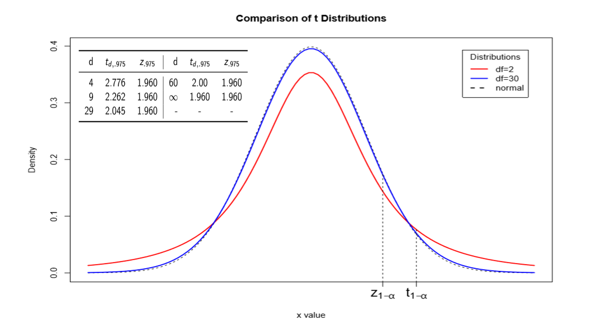
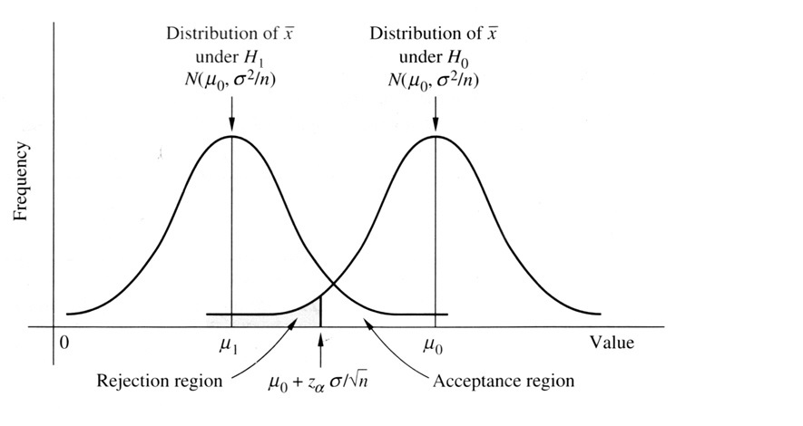
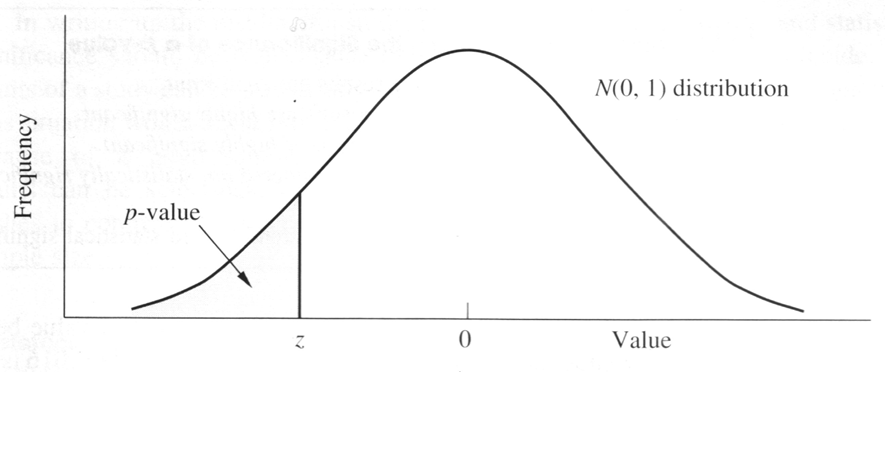
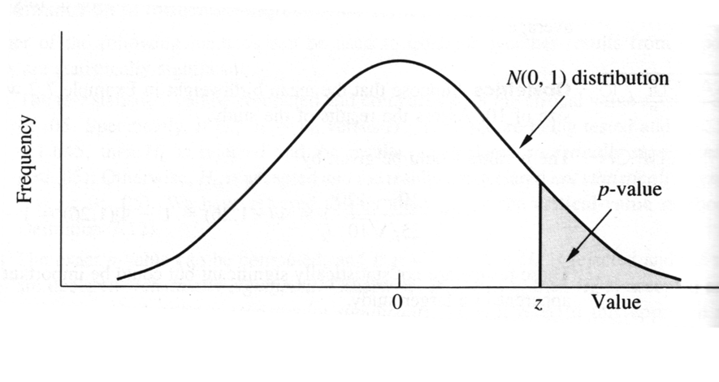
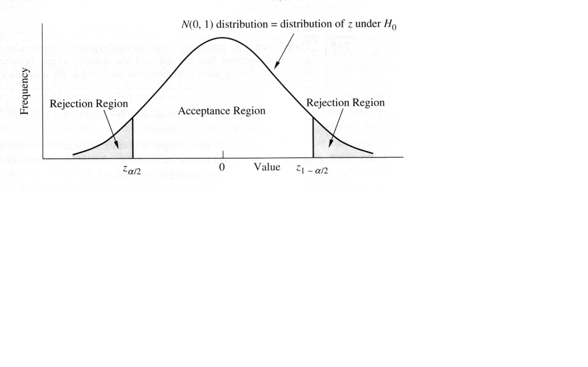
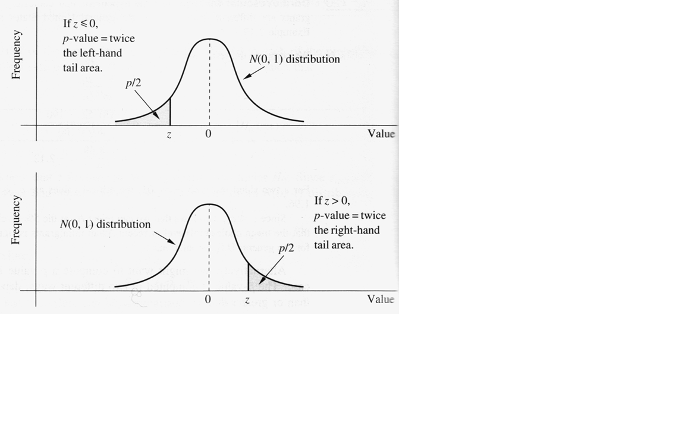
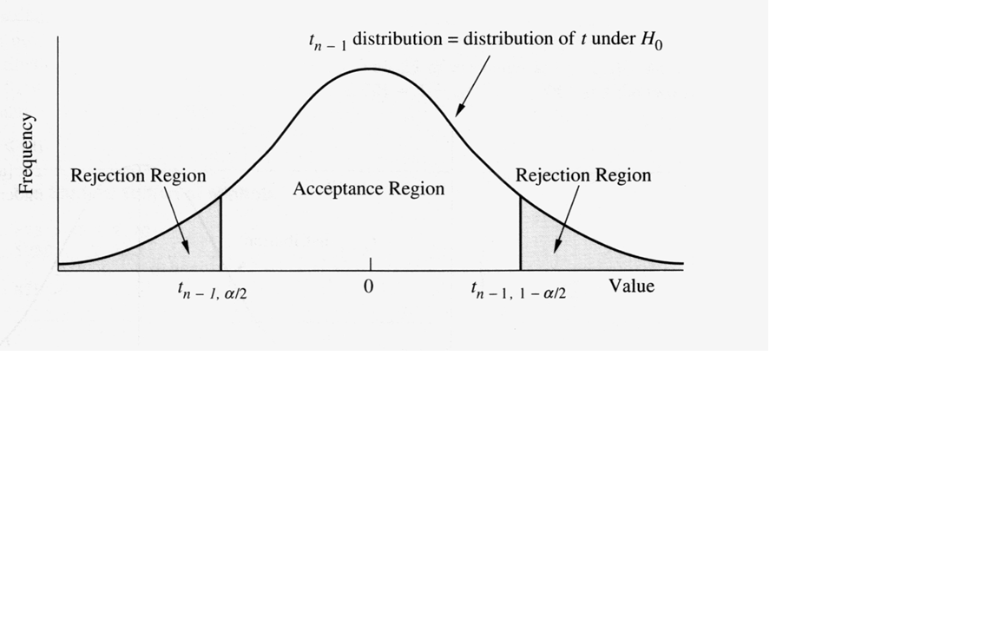

```{r setup, include=FALSE}
knitr::opts_chunk$set(
  fig.retina = 3,
  warning = FALSE,
  message = FALSE,
  comment = "",
  out.width = "100%"
)
library(knitr)

library(tidyverse)
library(here)
library(gridExtra)

library(countdown)
library(DT)

options(width = 59) # fit into the right-column slides

```

## Cosa faremo {.inverse background-color="#03A696"}

In questa lezione ci occuperemo di **[stime]{.orange}** effettuate su **[campioni]{.orange}** di popolazioni. In questo senso, cercheremo di  capire come **[stimare la media]{.orange}** e la **[varianza]{.orange}**  partendo da un campione. 

In seguito ci occuperemo di capire come avere una misura di **[precisione]{.orange}** per queste stime, introducendo gli **[Intervalli di confidenza]{.orange}**.

Dopo aver proposto degli esempi e fatto qualche osservazione in merito, introdurremo la distribuzione **[t di Student]{.orange}**, utile quando la varianza della popolazione non è nota.

Introdurremo quindi il concetto di **[test d'ipotesi]{.orange}**, delle tipologie di errore, e di **p-value**. Vedremo quindi come questi concetti si legano a quello degli intervalli di confidenza.

## [Riconoscimenti]{.orange}

- Le diapositive proposte sono state prodotte a partire anche da
  materiale generato da/con le seguenti persone gravitanti attorno
  all'UBEP*:
  
  + Danila Azzolina
  + Dario Gregori
  + Giulia Lorenzoni
  + Ileana Baldi
  + Luca Vedovelli
  + Matteo Martinato
  + Paola Berchialla

<br><br>

::: {.small}

::: {.text-right}

\* In ordine alfabetico.

:::

:::

<br><br>

> Un ringraziamento speciale a Cristiana Vettori e a Mariasole Rizzi per
l'aiuto e il supporto logistico e amministrativo che mi è stato offerto,
e ad Andrea Francavilla per avermi aiutato nella revisione del
materiale.

## **[Panoramica]{.orange}** {.text-center .inverse .center background-color="#03A696"}

Definizione e caratteristiche del **[problema inferenziale]{.orange}**

Stime puntuali: media e varianza... della media! **[Teorema del limite centrale]{.orange}**

Precisione delle stime puntuali: **[Intervalli di confidenza]{.orange}**

**[Esempi]{.orange}** e **[osservazioni]{.orange}**

Distribuzione **[t di Student]{.orange}**

**[Test d'ipotesi]{.orange}**: errori del I e II tipo, **p-value**

Relazione tra p-value e IC

## **[inferenza]{.orange}** {.text-center .inverse .center background-color="#03A696"}

- **definizione**

- **campioni e popolazione**

## [Inferenza]{.orange}: di cosa si tratta

Dato un insieme di osservazioni definito **campione**, si vuole derivare una conoscenza della distribuzione di probabilità che ha generato i dati osservati (generalmente per estrapolare informazioni sulle _non-osservazioni_ della stessa popolazione)

## Inferenza: [campioni]{.orange} e [popolazioni]{.orange}

- Un campione casuale è una **[selezione]{.orange}** di alcuni membri di una popolazione tale che ogni membro è scelto **indipendentemente** dagli altri ed ha una **probabilità non nulla** di essere selezionato

- Un campione casuale **semplice** è un campione casuale in cui ogni membro ha la **[stessa probabilità]{.orange}** di essere selezionato

- La **[popolazione target]{.orange}** è il gruppo di soggetti, **da cui è estratto** il campione, che si intende studiare e che **[si ipotizza essere infinita]{.orange}**



## Stime **[puntuali]{.orange}** e **[teorema del limite centrale]{.orange}** {.text-center .inverse .center background-color="#03A696"}

- Stimatore puntuale della **media**

- **Errore standard** della media 

- **Teorema del Limite Centrale** (TLC)

## Stima puntuale: [media]{.orange}

Lo **stimatore puntuale** [della media]{.orange} di una distribuzione è

$$\bar{X} = \frac{\sum_{i=1}^n X_i}{n}$$


La distribuzione campionaria di $\bar{X}$ è la distribuzione dei valori di $\bar{X}$ su **tutti i possibili campioni** di ampiezza $n$ estratti dalla popolazione target.

Se $X_1, \ldots, X_n$ è un campione casuale estratto da una popolazione con **media di popolazione** $\mu$ allora per la [media campionaria]{.orange} vale $E(\bar{X}) = \mu$

Si dice che la media campionaria è uno **stimatore non distorto** della media di popolazione.

## Stima puntuale: [errore standard]{.orange}

Riguardo alla **varianza** dello stimatore della media, abbiamo

$$\begin{split}\mbox{var}(\bar{X})&= \mbox{var}\left(\frac{\sum_{i=1}^n X_i}{n}\right) =* \frac{1}{n^2} \mbox{var}\left(\sum_{i=1}^n X_i\right) \stackrel{\mbox{ind.}}{=} \frac{1}{n^2} \sum_{i=1}^n \mbox{var}(X_i)\\& \stackrel{\mbox{def}}{=} \frac{1}{n^2} \sum_{i=1}^n\sigma^2 = \frac{1}{n^2} n\sigma^2 = \frac{\sigma^2}{n}\end{split}$$


- $\frac{\sigma}{\sqrt{n}}$ è chiamato [errore standard della media]{.orange}, stimato da $\frac{s}{\sqrt{n}}$

- il passaggio $\stackrel{\mbox{ind.}}{=}$ vale perché le $X_i$ sono **indipendenti**


$$*)\begin{split}\mbox{var}(aX) &= \frac{\sum_1^n\left(ax_i-\frac{\sum_1^nax_j}{n}\right)^2}{n}= \frac{\sum_1^n\left(ax_i-\frac{a\sum_1^nx_j}{n}\right)^2}{n}\\&= \frac{\sum_1^n\left(a\left(x_i-\mu\right)\right)^2}{n}= \frac{\sum_1^na^2\left(x_i-\mu\right)^2}{n}\\&=\frac{a^2\sum_1^n\left(x_i-\mu\right)^2}{n}=a^ 2\mbox{var}(X)\end{split}$$ 

## [Teorema del Limite Centrale]{.orange}

**Sia**

- $X_1, \ldots, X_n$ un campione casuale semplice estratto da una popolazione qualsiasi con media $\mu$ e varianza $\sigma^2$.

**Allora**, per $n$ abbastanza grande:

$$\bar{X} \sim N \left( \mu, \frac{\sigma^2}{n} \right)$$

> ... anche se la distribuzione $X$ della popolazione non è normale!

## [Sondaggio]{.orange} {.inverse .center background-color="#03A696"}

Per me: [Stimatore della media](https://app.wooclap.com/events/STATMEDTLC/0)

Per voi:  [bit.ly/statmed-sondaggio-tlc](https://bit.ly/statmed-sondaggio-tlc)



## **[Precisione]{.orange}** delle stime {.text-center .inverse .center background-color="#03A696"}

- **Intervalli di Confidenza**

- **Ampiezza** dell'intervallo di confidenza

## [Intervalli di Confidenza]{.orange}: Obiettivo

Associare alla stima puntuale una misura della sua precisione

## I.C.: Derivazione

::: {.panel-tabset}

### Passaggio a Z

Se $X$ è normale (oppure, per il T.L.C., se $n$ è abbastanza grande, e in questo caso in modo approssimato) sappiamo che

$$Z =\frac{\bar{X}-\mu}{\frac{\sigma}{\sqrt{n}}}$$

si distribuisce come una variabile casuale normale standardizzata $Z \sim N(0,1)$


In questo caso, il 95% delle osservazioni è compreso tra -1.96
e 1.96, ovvero

$$\mbox{P}(-1.96\leq Z\leq 1.96)= 0.95$$


### Ritorno alle stime

Sostituendo alla $Z$ la sua espressione estesa

$$P \left (-1.96 \leq \frac{\bar{X}-\mu}{\frac{\sigma}{\sqrt{n}}}
\leq 1.96 \right ) = 0.95$$

Moltiplicando tutti i termini per ${\frac{\sigma}{\sqrt{n}}}$

$$P \left (-1.96 {\frac{\sigma}{\sqrt{n}}} \leq
\frac{\bar{X}-\mu}{\frac{\sigma}{\sqrt{n}}}
{\frac{\sigma}{\sqrt{n}}}\leq 1.96 {\frac{\sigma}{\sqrt{n}}}\right
) = 0.95$$

Semplificando


$$P \left (-1.96 {\frac{\sigma}{\sqrt{n}}} \leq \bar{X}-\mu\leq 1.96
{\frac{\sigma}{\sqrt{n}}}\right ) = 0.95$$


### Conclusione

$$P \left (-1.96 {\frac{\sigma}{\sqrt{n}}} \leq \bar{X}-\mu\leq 1.96
{\frac{\sigma}{\sqrt{n}}}\right ) = 0.95$$


Sottraendo $\bar{X}$ da ogni termine

$$P \left (-1.96 {\frac{\sigma}{\sqrt{n}}}-\bar{X} \leq \bar{X}-\mu
-\bar{X}\leq 1.96 {\frac{\sigma}{\sqrt{n}}-\bar{X}}\right ) = 0.95$$

Moltiplicando per -1 ed invertendo il senso delle disugualianze

$$P \left (1.96 {\frac{\sigma}{\sqrt{n}}}+\bar{X} \geq \mu \geq
-1.96 {\frac{\sigma}{\sqrt{n}}+\bar{X}}\right ) = 0.95$$

Riorganizzando i termini

$$P \left (\bar{X} - 1.96 {\frac{\sigma}{\sqrt{n}}}\leq \mu \leq
\bar{X}+1.96 {\frac{\sigma}{\sqrt{n}}}\right )= 0.95$$

:::

## Definizione I.C. per la media (varianza nota)

Un intervallo di confidenza al 95% per $\mu$ **quando $\sigma^2$ è noto**
è dato da

$$\left ( \bar{X} - 1.96 \frac{\sigma}{\sqrt{n}}; \bar{X} + 1.96
\frac{\sigma}{\sqrt{n}} \right )$$

## [Sondaggio]{.orange} {.inverse .center background-color="#03A696"}

Per me: [Intervalli di Confidenza](https://app.wooclap.com/events/STATMEDICP/0)

Per voi:  [bit.ly/statmed-sondaggio-icp](https://bit.ly/statmed-sondaggio-icp)



## [Break]{.orange} {.text-center .center .inverse background-color="#03A696"}

Consigli: 

- alzarsi
- sgranchirsi
- guardare _lontano_ (rilassare gli occhi)
- bere
- andare in bagno

```{r, echo = FALSE}
countdown(minutes = 15, warn_when = 3, play_sound = TRUE,
          left = "65%", bottom = "5%")
```

## **[Esempi]{.orange}** e **[Osservazioni]{.orange}** {.text-center .inverse .center background-color="#03A696"}

- **esempio** con i trigliceridi

- **confidenza**, **unicità** e **ampiezza** dell'intervallo

## I.C.: Trigliceridi

::: {.panel-tabset}

### Problema

:::: {.columns}

::: {.column width="48%"}

::: {.small}

Soggetto  | 1     | 2     | 3     | 4     | 5
---------:|-------|-------|-------|-------|---
1         |  97   | 177   |  97   | 101   | 137
2         | 117   | 198   | 125   | 114   | 118
3         | 140   | 107   |  62   |  79   |  78
4         |  78   |  99   | 120   | 120   | 129
5         |  99   | 104   | 132   | 115   |  87
6         | 148   | 121   | 135   | 117   | 110
7         | 108   | 148   | 118   | 106   | 106
8         | 135   | 133   | 137   |  86   | 116
9         | 126   | 126   | 126   | 110   | 140
10        | 121   | 115   | 118   | 119   |  98
          |       |       |       |       | 
$\bar{x}$ | 116.9 | 132.8 | 117.0 | 106.7 | 111.9
$s$       | 21.70 | 32.62 | 22.44 | 14.13 | 20.46

:::

:::

::: {.column width="48%"}

Cinque campioni casuali di ampiezza ( $n = 10$ ) da una popolazione di soggetti afferenti al centro cardiovascolare dell'ASL 1 di Trieste, a cui è stato rilevato il livello di trigliceridi (in mg/dl, valori di riferimento 50-175).

:::

::::


### IC

Si supponga che il valore di $\sigma$ sia noto e pari a 20.

$$\begin{split}\left(\bar{X} - 1.96 \frac{\sigma}{\sqrt{n}}; \bar{X}+1.96 \frac{\sigma}{\sqrt{n}} \right)&= \left (\bar{X}-1.96\frac{20}{\sqrt{10}}; \bar{X} + 1.96 \frac{20}{\sqrt{10}} \right)\\& = (\bar{X}-12.4; \bar{X}+12.4)\end{split}$$

- Campione 1 $(116.9-12.4; 116.9+12.4) \equiv (104.5; 129.3)$
- Campione 2 $(132.8-12.4; 132.8+12.4) \equiv (120.4; 145.2)$
- Campione 3 $(117.0-12.4; 117.0+12.4) \equiv (104.6; 129.4)$
- Campione 4 $(106.7-12.4; 106.7+12.4) \equiv (94.3; 119.1)$
- Campione 5 $(111.9-12.4; 111.9+12.4) \equiv (99.5; 124.3)$


### Graficamente

```{r ic-trigliceridi, echo=FALSE, fig.align='center', out.width="80%", fig.width=8, fig.height=5}
# stessi numeri della scheda IC: sigma nota (20), n = 10, quindi +-12.4
m <- c(116.9, 132.8, 117.0, 106.7, 111.9)
h <- 1.96 * 20 / sqrt(10)
y <- 5:1
op <- par(mar = c(3, 6, 3, 1))
plot(NA, xlim = c(90, 150), ylim = c(0.6, 5.5), yaxt = "n", xlab = "", ylab = "",
     bty = "n", main = "Il centro di ogni intervallo è la media del campione")
abline(v = 112, lty = 2, col = "grey40")
mtext(expression(mu), side = 1, at = 112, line = 2, cex = 1.3)
segments(m - h, y, m + h, y, lwd = 2)
points(m, y, pch = 19)
# fondo bianco sotto le medie, perché la linea di mu non le attraversi
lab <- sprintf("%.1f", m)
w <- strwidth(lab) / 2 + 0.4
hh <- strheight(lab) * 0.7
rect(m - w, y + 0.3 - hh, m + w, y + 0.3 + hh, col = "white", border = NA)
text(m, y + 0.3, lab)
text(m - h, y - 0.3, sprintf("%.1f", m - h), cex = 0.9)
text(m + h, y - 0.3, sprintf("%.1f", m + h), cex = 0.9)
axis(2, at = y, labels = paste("Campione", 1:5), las = 1, tick = FALSE)
par(op)
```

:::

## IC osservazioni: "[confidenza]{.orange}"

**$\bar{X}$ è una variabile casuale**, mentre il parametro **$\mu$ è una costante** (ignota). Quindi l'intervallo

$$\left ( \bar{X} - 1.96 \frac{\sigma}{\sqrt{n}}; \bar{X} + 1.96 \frac{\sigma}{\sqrt{n}} \right )$$

ha una probabilità del 95% di comprendere $\mu$ **prima** che il campione sia selezionato.

**Dopo aver selezionato il campione** e aver calcolato l'intervallo, invece:

- $\mu$ può essere compresa o meno nell'intervallo (non lo sappiamo)

- stimiamo che su 100 campioni estratti dalla stessa popolazione, circa 95 conterranno la media **e 5 no** (ed utilizziamo di conseguenza il termine di **confidenza**)

> NOTA: uno dei 5 **potrebbe essere il nostro**!!

In ogni caso, l'interpretazione è corretta se il campione selezionato è un campione **rappresentativo** (non distorto) della popolazione studiata

## IC osservazioni: [unicità]{.orange}

::: {.panel-tabset}

### Osservazione

L'intervallo di confidenza al 95% è quello di uso più comune,
ma non è l'unico.

In generale, un intervallo di confidenza ad un livello $(1-\alpha)$ sarà dato da

$$\left ( \bar{x} - z_{1-\frac{\alpha}{2}} \frac{\sigma}{\sqrt{n}};
\bar{x} + z_{1-\frac{\alpha}{2}} \frac{\sigma}{\sqrt{n}} \right )$$

dove $z_{1-\frac{\alpha}{2}}$ è il $100(1-\frac{\alpha}{2})$-esimo
percentile di una distribuzione $N(0,1)$.

$\alpha$ è la probabilità, prima di estrarre il campione, che l'intervallo non contenga $\mu$.

$(1-\alpha)$ | $z_{1-\frac{\alpha}{2}}$ 
------------:|:-----------------------
        0.90 |                    1.645
        0.95 |                     1.96 
        0.99 |                    2.576


### Trigliceridi

Nel caso del primo campione selezionato, si ha che un intervallo al 99% è pari a

$$\begin{split} &\left(116.9 - z_{0.995} \frac{20}{\sqrt{10}}; 116.9 + z_{0.995} \frac{20}{\sqrt{10}} \right)\\ = &\left(116.9- 2.576\frac{20}{\sqrt{10}}; 116.9+2.576\frac{20}{\sqrt{10}}\right)\\ = &(100.6; 133.2)\end{split}$$

:::

## IC osservazioni: [ampiezza]{.orange}

::: {.panel-tabset}

### Constatazione

L'**ampiezza** dell'intervallo di confidenza a un livello $(1-\alpha)$ è data da

$$\bar{X}+z_{1-\frac{\alpha}{2}} \frac{\sigma}{\sqrt{n}} - \left(\bar{X} - z_{1-\frac{\alpha}{2}} \frac{\sigma}{\sqrt{n}} \right )$$

ovvero da

$$2 z_{1-\frac{\alpha}{2}} \frac{\sigma}{\sqrt{n}}$$

Nel campione 1, l'ampiezza (al 95% e con $\sigma = 20$) è pari a

$$2 \times 1.96 \frac{20}{\sqrt{10}} = 24.8 = 129.3-104.5$$


### Osservazione

L'ampiezza dell'intervallo, data da $2 z_{1-\frac{\alpha}{2}} \frac{\sigma}{\sqrt{n}}$

**dipende da** 

- $n$:  come **cresce** il campione ( $n$ ), così **[diminuisce]{.orange}** l'ampiezza dell'intervallo

- $\sigma$: come **aumenta** la deviazione standard della popolazione ( $\sigma$ ), così **[aumenta]{.orange}** l'ampiezza dell'intervallo

- $1-\alpha$: come **aumenta** il livello di confidenza richiesto per l'analisi, così **[aumenta]{.orange}** l'ampiezza dell'intervallo


### Trigliceridi

<small><small>

Per l'intervallo del campione 1, pari a (104.5; 129.3) con $n=10$, $\sigma=20$, $1-\alpha=0.95$

$n$ | $\sigma$ | $1-\alpha$ | Limiti | Ampiezza
----|----------|------------|--------|---------
n   | 20       | 0.95       | $\bar{X} \pm 1.96 \frac{20}{\sqrt{n}}$      | 
10  | 20       | 0.95       |    | 24.8
100 | 20       | 0.95       |    |  7.8
1000| 20       | 0.95       |    |  2.5
10  | $\sigma$ | 0.95       | $\bar{X} \pm 1.96 \frac{\sigma}{\sqrt{10}}$ |
10  | 5        | 0.95       |    | 6.2
10  | 40       | 0.95       |    | 49.6 
10  | 20       | $1-\alpha$ | $\bar{X} \pm z_{1-\frac{\alpha}{2}} \frac{20}{\sqrt{10}}$ |
10  | 20       | 0.90       |    | 20.8
10  | 20       | 0.95       |    | 24.8
10  | 20       | 0.99       |    | 32.6

</small></small>

:::

## IC osservazioni: [sotto controllo]{.orange}

$n$ e $\alpha$ sono **sotto il diretto controllo** del ricercatore

$\sigma$, ovvero la variabilità a livello di popolazione, **dipende dal tipo di variabile** studiata.

In alcuni casi e con opportuni accorgimenti **[può essere controllata]{.orange}**, con:

- scelta di tecniche per **misurazioni più accurate**
- scelta del **timing di misurazione** ottimale per ridurre la variabilità, per es. giornaliera
- utilizzo di tecniche di **mediazione**, ottenendo varie misurazioni ripetute sulla stessa variabile e utilizzando la media di queste anziché una singola osservazione nel calcolo dell'intervallo



## Distribuzione **[t di Student]{.orange}** {.text-center .inverse .center background-color="#03A696"}

- **t di Student**

- **I.C.**

## Distribuzione [t di Student]{.orange}

::: {.panel-tabset}

### Definizione

Se $\sigma$ è **ignoto**, potremmo sostituirlo (approssimandolo/stimandolo) in $\frac{\bar{X}-\mu}{\frac{\sigma}{\sqrt{n}}}$ con $s$

**Se**

- $X_1, \ldots, X_n \sim N(\mu,\sigma^2)$
- sono indipendenti

**Allora**

- $\frac{\bar{X}-\mu}{\frac{s}{\sqrt{n}}}$ si distribuisce come una $t$ di Student con $(n-1)$ gradi di libertà


### Percentili

Il $p$ -esimo percentile della distribuzione $t$ con $d$ gradi di libertà si indica con $t_{d,p}$, ovvero

$$P(t_d \leq t_{d,p}) = p$$

<br><br><br><br>

> Nota: La distribuzione $t$ è simmetrica sullo $0$ ma è più dispersa rispetto alla $N(0,1)$


### Grafico

```{r echo=FALSE, fig.align = 'center', out.width="100%"}

```

:::

## IC per la media: [varianza non nota]{.orange}

::: {.panel-tabset}

### Considerazione

Nel caso di varianza stimata $S^2$, abbiamo appena visto che

$$T=\frac{\bar{X}-\mu}{\frac{s}{\sqrt{n}}} \sim t_{n-1} \:\:\: di\:\:\: Student$$


e per questa variabile si ha che, con ( $n=10$, ovvero $d=9$ gradi di libertà )

$$\mbox{P}(-2.262\leq T\leq 2.262)= 0.95$$

ripercorrendo i passaggi del caso con varianza nota si ottiene che l'intervallo di confidenza al 95% è pari a

$$\left (\bar{x} -2.262 \frac{s}{\sqrt{10}} \leq \mu \leq \bar{x} + 2.262 \frac{s}{\sqrt{10}} \right )$$

In cui $2.262 = t_{9, 0.975} = t_{d,p}$ essendo $\alpha = 0.05$ e $p = 1-\frac{\alpha}{2} = 0.975$


### Definizione

Un intervallo di confidenza al 95% per $\mu$ quando $\sigma^2$ è ignoto
è dato da


$$\left ( \bar{x} - t_{n-1,1-\frac{\alpha}{2}} \frac{s}{\sqrt{n}}; \bar{x} + t_{n-1,1-\frac{\alpha}{2}}
\frac{s}{\sqrt{n}} \right )$$


### Trigliceridi

Nel caso del campione 1 si ha:

- $\bar{x} = 116.90$
- $n = 10$
- $s = 21.7$
- $\alpha = 0.05$

$$\left (116.90 -2.262 \frac{21.7}{\sqrt{10}} \leq \mu \leq 116.90 + 2.262 \frac{21.7}{\sqrt{10}} \right )$$

ovvero $(101.38; 132.42)$

In generale, si avrà l'intervallo

$$\left (\bar{x} - t_{n-1,1-\frac{\alpha}{2}} \frac{s}{\sqrt{n}} \leq \mu \leq \bar{x} + t_{n-1,1-\frac{\alpha}{2}} \frac{s}{\sqrt{n}} \right )$$

:::

## [Sondaggio]{.orange} {.inverse .center background-color="#03A696"}

Per me: [Distribuzione t-Student](https://app.wooclap.com/events/STATMEDTSTUDENT/0)

Per voi:  [bit.ly/statmed-sondaggio-tstudent](https://bit.ly/statmed-sondaggio-tstudent)



## **[Test d'ipotesi]{.orange}** {.text-center .inverse .center background-color="#03A696"}

- **Definizioni**: ipotesi, rifiuto e non rifiuto, errori

- **Test** (con varianza nota)

## [Un problema]{.orange}: colesterolo e familiarità

::: {.panel-tabset}

### Quesito

Si supponga che il livello di colesterolo (espresso in $mg/dL$) **medio** nei bambini di età compresa tra i 2 e i 14 anni sia noto, da ampi studi di popolazione, essere **pari a 175**, con una [deviazione standard di 30]{.orange}.

Si vuole valutare la possibilità che vi sia un'aggregazione familiare dei
livelli di colesterolo.

Si identifica un gruppo di padri con pregresso infarto del miocardio acuto (IMA) ed elevati livelli di colesterolo, e si misura il livello di colesterolo dei figli che abbiano un'età compresa nell'intervallo in esame.

**Il livello medio stimato nel campione di 100 figli è pari a 207.2.**


### Grafico

```{r echo=FALSE, fig.align = 'center', out.width="100%"}
knitr::include_graphics("img/Rplot02.PNG")
```


### Problema

Questo valore ( $207.2\ mg/dL$ ) è **sufficientemente lontano** da quello di $175\ mg/dL$ da farci credere che questi bambini abbiano una distribuzione dei livelli di colesterolo con una media più elevata di quella della popolazione generale  dei  bambini nella stessa classe di età?


### Risposta

Un intervallo di confidenza (bilaterale) al 95% per la media dei figli:

$$\left(207.2 - 1.96 \frac{30}{\sqrt{100}}; 207.2+1.96 \frac{30}{\sqrt{100}}\right) = (201.32; 213.08)$$

175 è fuori dall'IC al 95% (201.32; 213.08): tutti i valori di $\mu$ compatibili con i dati stanno sopra 200.

Quanto sarebbe raro un campione con media 207.2, se la media vera fosse 175? È la domanda a cui risponde il test d'ipotesi.

:::

## [Ipotesi]{.orange}: definizioni

- **ipotesi nulla**, $H_0$, l'ipotesi che si vuole testare

- **ipotesi alternativa**, $H_1$, l'ipotesi che **[contraddice]{.orange}** l'ipotesi nulla 

<br>
<br>
<br>
<br>

> In particolare, le ipotesi riguardano i parametri di una distribuzione 

## Ipotesi: [decisioni]{.orange}

[Decisioni sull'ipotesi nulla]{.orange} | Ipotesi nulla **vera**                 | Ipotesi nulla **falsa**
--------------------------------------|----------------------------------------|------------------------
**Non rifiuto**                       | Decisione corretta <br> P = $1-\alpha$ | Errore di II tipo  <br> P = $\beta$
**Rifiuto**                           | Errore di I tipo <br> P = $\alpha$     | Decisione corretta <br> P = $1-\beta$ 

- $\alpha$ è definito livello di **significatività**: è lo stesso $\alpha$ dell'IC al livello $1-\alpha$, e il legame si vede nella slide «P-value e IC»
- $1-\beta$ è definito **potenza**

- La probabilità di un errore di I specie ( $\alpha$, la _significatività_ ) è la probabilità di **rifiutare** l'ipotesi nulla $H_0$ quando è **vera**, si chiama [livello di significatività]{.orange} del test

- La probabilità di un errore di II specie ( $\beta$ ) è la probabilità di **non rifiutare** l'ipotesi nulla $H_0$ dato che è **falsa**

- Non rifiutare $H_0$ non dimostra che sia vera: i dati non bastano a escluderla.

## Test: [media di una Normale]{.orange}

##### (varianza nota)


::: {.panel-tabset}

### Analiticamente

Obiettivo è un set di ipotesi del tipo:

- $H_0: \mu=\mu_0$; $\sigma=\sigma_0$
- $H_1: \mu=\mu_1<\mu_0$; $\sigma=\sigma_0$

Il primo passo è individuare la statistica test, che nel caso specifico è $\bar{X}$


$$\alpha = P (Errore\ I\ specie|H_0)= P \left [ \bar{X}<c|\bar{X}\sim N\left ( \mu_0,\frac{\sigma^2}{n} \right ) \right ]= \Phi \left ( \frac{c-\mu_0}{\frac{\sigma}{\sqrt{n}}} \right )$$


$$z_{\alpha}=\frac{c-\mu_0}{\frac{\sigma}{\sqrt{n}}}$$

$$c=\mu_0+z_{\alpha}\frac{\sigma}{\sqrt{n}}$$


### Graficamente

```{r echo=FALSE, fig.align = 'center', out.width="70%"}

```


- La regione di accettazione è l'insieme dei valori di $\bar{x}$ per cui non si rifiuta $H_0$
- La regione di rifiuto è l'insieme dei valori di $\bar{x}$ per cui si rifiuta $H_0$ 


### Procedura

Per testare l'ipotesi:

- $H_0:\mu=\mu_0$; $\sigma=\sigma_0$
- $H_1:\mu<\mu_0$; $\sigma=\sigma_0$

- se $\bar{x}<\mu_0+z_{\alpha}\frac{\sigma}{\sqrt{n}}$ si rifiuta 
- se $\bar{x}\geq\mu_0+z_{\alpha}\frac{\sigma}{\sqrt{n}}$ non si rifiuta $H_0$

:::

## Test: esempio

::: {.panel-tabset}

### Caso studio

##### stato socioeconomico e peso alla nascita

Si consideri l'ipotesi per cui madri con un livello socioeconomico basso tendano a partorire figli con pesi alla nascita inferiori al normale. Per testare l'ipotesi, si considera un campione di 100 nati vivi consecutivi in un ospedale situato in una zona socioeconomica svantaggiata. Il peso normale è noto dai dati del registro nazionale, che per gli USA è pari a 120 oz, con una deviazione standard di 25 oz. 
Il peso medio dei 100 nati è di 115 oz con una deviazione standard campionaria di 24 oz. 

Ad un livello di significatività di 0.05, si ha $z_{\alpha}=-1.645$, e il valore critico è pari a

$$c=120-1.645\frac{25}{10}=115.89$$

quindi, poiché $\bar{X}=115<115.89=c$ si rifiuta $H_0$ ad un livello di significatività di 0.05


### Con $\alpha = 0.01$

Usando un livello di significatività pari a 0.01, si avrebbe che

$z_{\alpha}=-2.326$ e che

$$c=120-2.326\frac{25}{10}=114.18$$

e quindi **non si rifiuterebbe** l'ipotesi nulla dal momento che $\bar{x}=115\geq 114.18=c$

Un $\alpha$ più piccolo è un criterio più severo: per rifiutare $H_0$ serve una media più lontana da 120.


### Usando Z

Per testare l'ipotesi:

- $H_0:\mu=\mu_0$; $\sigma=\sigma_0$
- $H_1:\mu<\mu_0$; $\sigma=\sigma_0$

si può anche equivalentemente calcolare

$$z=\frac{\bar{x}-\mu_0}{\frac{\sigma}{\sqrt{n}}}$$

- se $z<z_{\alpha}$ si rifiuta $H_0$
- se $z\geq z_{\alpha}$ non si rifiuta $H_0$

:::

## [P-value]{.orange}

::: {.panel-tabset}

### Definizione

Il p-value è la probabilità, **se $H_0$ è vera**, di ottenere un risultato **uguale o più estremo** di quello osservato.

Con $H_1: \mu < \mu_0$, «più estremo» vuol dire «più piccolo»:

$$p = \Phi(z), \qquad z = \frac{\bar{x}-\mu_0}{\frac{\sigma}{\sqrt{n}}}$$

Di conseguenza si rifiuta $H_0$ al livello $\alpha$ se e solo se $p < \alpha$ ($z < z_\alpha$ equivale a $\Phi(z) < \alpha$).


### Alternativa minore

:::: {.columns}

::: {.column width="48%"}

- $H_0:\mu=\mu_0$; $\sigma=\sigma_0$
- $H_1:\mu<\mu_0$; $\sigma=\sigma_0$


si calcola

$$z=\frac{\bar{x}-\mu_0}{\frac{\sigma}{\sqrt{n}}}$$

- se $z<z_{\alpha}$ si rifiuta $H_0$
- se $z\geq z_{\alpha}$ non si rifiuta $H_0$

ovvero si ha un p-value pari a $p=\Phi(z)$

:::

::: {.column width="48%"}

```{r echo=FALSE, fig.align = 'center', out.width="100%"}

```

:::

::::


### Alternativa maggiore

:::: {.columns}

::: {.column width="48%"}

- $H_0:\mu=\mu_0$; $\sigma=\sigma_0$
- $H_1:\mu>\mu_0$; $\sigma=\sigma_0$

si calcola

$$z=\frac{\bar{x}-\mu_0}{\frac{\sigma}{\sqrt{n}}}$$

- se $z>z_{1-\alpha}$ si rifiuta $H_0$
- se $z\leq z_{1-\alpha}$ non si rifiuta $H_0$

ovvero si ha un p-value pari a $p=1-\Phi(z)$

:::

::: {.column width="48%"}

```{r echo=FALSE, fig.align = 'center', out.width="100%"}

```

:::

::::

:::

## p-value: esempio

Si supponga che in un campione di 10 bambini il livello di colesterolo sia pari a  $200\ mg/dL$ con una deviazione standard nota nella popolazione pari a $50\ mg/dL$. Lo studio intende verificare se il livello del colesterolo in questi bambini è più elevato del normale ( $175\ mg/dL$ ), con un livello di significatività statistica $\alpha = 0.05$. Si testa quindi l'ipotesi 

- $H_0:\mu=175$; $\sigma=50$
- $H_1:\mu>175$; $\sigma=50$

si ha che $z=\frac{\bar{x}-\mu_0}{\frac{\sigma}{\sqrt{n}}}=\frac{200-175}{\frac{50}{\sqrt{10}}}=1.58$

Visto che $1.58=z<z_{1-\alpha}=z_{.95}=1.645$ non si rifiuta $H_0$, con un p-value pari a

$$p=1-\Phi(z)=1-\Phi(1.58)=1-0.9429=0.057$$

## Test: due code

::: {.panel-tabset}

### Obiettivo

Un test a due code è un test in cui i valori del parametro sotto ipotesi alternativa sono alternativamente maggiori o minori (diversi) dal valore sotto ipotesi nulla.

Obiettivo è quello di rifiutare $H_0$ se $Z$ è **troppo piccolo o troppo grande**, ovvero non si rifiuta $H_0$ se $c_1\leq Z \leq c_2$


$$P(rifiutare\ H_0|H_0)=P(Z\leq c_1 \cup Z\geq c_2)=P(Z\leq c_1)+P(Z\geq c_2)=\alpha$$


Ipotizzando equiprobabilità sulle due code, si ha che

$$P(Z\leq c_1|H_0)=P(Z\geq c_2|H_0)=\frac{\alpha}{2}$$


### Procedura

Si testa quindi l'ipotesi

- $H_0:\mu=\mu_0$; $\sigma=\sigma_0$
- $H_1:\mu\neq\mu_0$; $\sigma=\sigma_0$

si calcola

$$z=\frac{\bar{x}-\mu_0}{\frac{\sigma}{\sqrt{n}}}$$

- se $z\leq z_{\frac{\alpha}{2}}$ o $z > z_{1-\frac{\alpha}{2}}$ si rifiuta $H_0$
- se $z_{\frac{\alpha}{2}}< z < z_{1-\frac{\alpha}{2}}$ non si rifiuta $H_0$


### Graficamente

```{r echo=FALSE, fig.align = 'center', out.width="100%"}

```

:::

## Test a due code: esempio

##### Colesterolo negli immigrati asiatici

Si sa che i livelli di colesterolo nelle donne americane di età tra i 20 ed i 40 anni sono distribuiti normalmente con media $190\ mg/dL$ e deviazione standard di $40\ mg/dL$. Si vuole testare l'ipotesi che i livelli di colesterolo nelle donne asiatiche di pari età siano eguali a quelli delle donne americane.
Si considera quindi un campione di 100 donne con le caratteristiche specificate e si osserva un livello di colesterolo medio pari a $181.52\ mg/dL$. Si testa quindi l'ipotesi 

- $H_0:\mu=190$; $\sigma=40$
- $H_1:\mu\neq 190$; $\sigma=40$ 

$$z=\frac{\bar{x}-\mu_0}{\frac{\sigma}{\sqrt{n}}}=\frac{181.52-190}{\frac{40}{\sqrt{100}}}=-2.12$$

Per un test a livello di significatività dello 0.05 i valori critici sono $Z_{0.975}=1.96$ e $Z_{0.025}=-1.96$, per cui, visto che $Z=-2.12<-1.96$ rifiuto $H_0$.

## Test a due code: p-value

::: {.panel-tabset}

### Derivazione

Avendo

$$z=\frac{\bar{x}-\mu_0}{\frac{\sigma}{\sqrt{n}}}$$

si ha che

$$p=\left\{\begin{matrix}2\Phi(z) & se & z\leq 0\\ 2[1-\Phi(z)] & se & z>0\end{matrix}\right.$$


### Graficamente

```{r echo=FALSE, fig.align = 'center', out.width="100%"}

```


### Esempio

###### Colesterolo negli immigrati asiatici
Si calcola

$$z=\frac{\bar{x}-\mu_0}{\frac{\sigma}{\sqrt{n}}}=-2.12$$

da cui

$$p=2\Phi(-2.12)=2[1-\Phi(2.12)]=2[1-0.983]=0.034$$

:::

## Test: varianza non nota

::: {.panel-tabset}

### t di Student

Se $X_1,...,X_n$ è un campione di osservazioni indipendenti distribuite normalmente $N(\mu,\sigma^2)$, allora la quantità $\frac{\bar{X}-\mu}{\frac{s}{\sqrt{n}}}$ è distribuita secondo una $t$ di Student con $n-1$ gradi di libertà.
Da questo deriva che sotto l'ipotesi nulla $\mu=\mu_0$

$$P\left(t<t_{n-1;\frac{\alpha}{2}}\right)=P\left(t>t_{n-1;1-\frac{\alpha}{2}}\right)=\frac{\alpha}{2}$$

da cui si derivano i valori critici


### Procedura

Si testa quindi l'ipotesi

- $H_0:\mu=\mu_0$; $\sigma$
- $H_1:\mu\neq\mu_0$; $\sigma$

si calcola

$$t=\frac{\bar{x}-\mu_0}{\frac{s}{\sqrt{n}}}$$

- se $t<t_{n-1;\frac{\alpha}{2}}$ o $t>t_{n-1;1-\frac{\alpha}{2}}$ si rifiuta $H_0$
- se $t_{n-1;\frac{\alpha}{2}}<t<t_{n-1;1-\frac{\alpha}{2}}$ non si rifiuta $H_0$

Si osserva che

$$t_{n-1;\frac{\alpha}{2}}=-t_{n-1;1-\frac{\alpha}{2}}$$


### Graficamente

```{r echo=FALSE, fig.align = 'center', out.width="100%"}

```


### Esempio

Si vuole studiare l'effetto dell'attività lavorativa (con conseguente esposizione a fumi di varia natura) sui pompieri. Si considera un campione di 26 pompieri di età compresa tra i 25 ed i 34 anni e si misura il cambiamento di FEV (volume di espirazione forzata) su un periodo di 5 anni. In un gruppo generico di pari età nella popolazione, il declino è pari in media a $0.10\ L/sec.$ Nel campione osservato il declino è stato di $0.27\ L/sec$ con una deviazione standard di $0.32\ L/sec$. Rispetto alla FEV, vi è stato un effettivo rischio lavorativo dei pompieri? Supponendo che il declino in FEV sia distribuito normalmente, si ha che

- $H_0:\mu=0.10$; $\sigma$
- $H_1:\mu\neq 0.10$; $\sigma$

si calcola

$$t=\frac{\bar{x}-\mu_0}{\frac{s}{\sqrt{n}}}=\frac{0.27-0.10}{\frac{0.32}{\sqrt{26}}}=2.71$$

Sotto ipotesi nulla, si ha che $P(t_{25}>2.71)=0.0060$, per cui il p-value è $2 \times 0.0060 = 0.012$

:::

## [P-value]{.orange} e [IC]{.orange}

::: {.panel-tabset}

### Relazione

Per un test del tipo

- $H_0:\mu=\mu_0$; $\sigma=\sigma_0$
- $H_1:\mu\neq\mu_0$; $\sigma=\sigma_0$

Al livello $\alpha$, $H_0$ è rifiutata **se e solo se** l'IC al livello $(1-\alpha)$ per $\mu$ non contiene $\mu_0$ (test a due code)


### Esempio

#### Colesterolo nei bambini

Un intervallo di confidenza a livello 0.95 per la media $\mu$ è pari a 

$$\bar{x}-z_{1-\frac{\alpha}{2}}\frac{\sigma}{\sqrt{n}};  \bar{x}+z_{1-\frac{\alpha}{2}}\frac{\sigma}{\sqrt{n}}$$

ovvero

$$200-z_{0.975}\frac{50}{\sqrt{10}};  200+z_{0.975}\frac{50}{\sqrt{10}}=[169.01;230.99]$$

che contiene il valore $\mu_0=175$ usato precedentemente nei test di ipotesi, per cui non rifiuto $H_0$ (anche con il test a due code: $z=1.58<1.96$, $p=0.114$)


### Colesterolo e familiarità

Si torna al problema d'apertura: $n = 100$ figli, $\bar{x} = 207.2$, $\sigma = 30$ nota; $H_0: \mu = 175$, $H_1: \mu \neq 175$.

$$z = \frac{207.2 - 175}{\frac{30}{\sqrt{100}}} = 10.73$$

p-value $= 2\left[1-\Phi(10.73)\right] < 0.0001$ (anche a una coda, con $H_1: \mu > 175$).

Se la media vera fosse 175, un campione con media 207.2 sarebbe quasi impossibile: si rifiuta $H_0$, come diceva l'IC al 95% (201.32; 213.08), che non contiene 175.

:::

## [Sondaggio]{.orange} {.inverse .center background-color="#03A696"}

Per me: [p-value](https://app.wooclap.com/events/STATMEDPVALUE/0)

Per voi:  [bit.ly/statmed-sondaggio-pvalue](https://bit.ly/statmed-sondaggio-pvalue)





## [Vediamolo...<br>...sul _vostro_ cloud!]{.orange} {.center .text-center .inverse background-color="#03A696"}

[https://bit.ly/statmed-cl-rstudio](https://bit.ly/statmed-cl-rstudio)

## Risorse utili {.inverse background-color="#03A696"}

- [**Posit Cloud**](https://bit.ly/statmed-cl-rstudio): [https://bit.ly/statmed-cl-rstudio](https://bit.ly/statmed-cl-rstudio) gratis per voi per esplorare RStudio, le sue funzionalità, e allenarvi con R (link di iscrizione valido fino alla fine del corso).

- [**RStudio primers**](https://posit.cloud/learn/primers) ambiente gratuito dentro Posit Cloud per l'apprendimento delle basi di analisi di dati con R tramite tutorial interattivi. Una volta registrati, oltre all'accesso al _nostro_ spazio di lavoro, avete accesso libero anche ai _Primers_.

- [**R 4 Data Science**](https://r4ds.hadley.nz/): libro gratuito (on-line) di [**Hadley Wickham**](http://hadley.nz/), **Mine Çetinkaya-Rundel** e **Garrett Grolemund**

- [**GGplot2 cheatsheet**](https://raw.githubusercontent.com/rstudio/cheatsheets/main/data-visualization.pdf) schema dei possibili grafici di base rappresentabili in R con il pacchetto `{ggplot2}`, molto utile anche per conoscere le tipologie di grafico, e il loro utilizzo.

- _Fundamentals of Biostatistics_ (8ª ed., Cengage, 2016) di **Bernard Rosner**, suggeriti i capitoli 6 e 7.

## {.inverse .text-center .center background-color="#03A696"}

::: {.quote-box}

::: {.text-left}

_Mathematical conventions are just that, conventions. They differ by field of mathematics. Don’t ask us why **matrix rows** **[are numbered down]{.orange}** but **graphs** **[are numbered up]{.orange}** the **y axis**, nor why **x [comes before]{.orange} y** but **row [before]{.orange} column**. But the matrix layout has always seemed illogical to me._

:::


::: {.text-right}

—Brian D. Ripley<br>08/2004 - R-help<br>

:::

:::


<br>


### **[Grazie]{.orange}** per l'attenzione! {.big}

Diapositive: [bit.ly/cl-statmed](https://bit.ly/cl-statmed)


[`r fontawesome::fa("link")`](https://www.unipd-ubep.it/) [**www.unipd-ubep.it**](https://www.unipd-ubep.it/) | 
[`r fontawesome::fa("envelope")`](mailto:Corrado.Lanera@ubep.unipd.it) [**Corrado.Lanera@ubep.unipd.it**](mailto:Corrado.Lanera@ubep.unipd.it)

[`r fontawesome::fa("github")`](https://github.com/corradolanera)
[`r fontawesome::fa("twitter")`](https://twitter.com/corradolanera)
[`r fontawesome::fa("telegram")`](https://telegram.me/CorradoLanera)
**\@CorradoLanera** |
[`r fontawesome::fa("calendar-check")` ](https://bit.ly/statmed-cl-ricevimento) [**bit.ly/statmed-cl-ricevimento**](https://bit.ly/statmed-cl-ricevimento)
